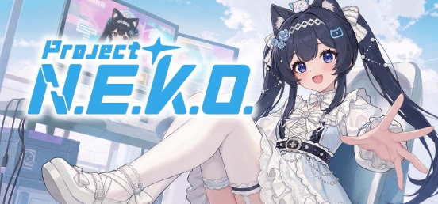

<div align="center">



**English** · [简体中文](docs/README_zh-CN.md) · [日本語](docs/README_ja.md) · [Русский](docs/README_ru.md)

# Project N.E.K.O.

**An open-source personal-agent stack built for companionship.**

> **N.E.K.O.** = **N**etworked **E**motional **K**nowledging **O**rganism

[](https://www.python.org/)
[](LICENSE)
[](https://github.com/Project-N-E-K-O/N.E.K.O/commits)
[](https://discord.gg/5kgHfepNJr)

[](https://store.steampowered.com/app/4099310/__NEKO/)

[](https://project-neko.online)
[](https://project-neko.cn)

</div>

This README is for developers. If you just want to use N.E.K.O., get it free on [Steam](https://store.steampowered.com/app/4099310/__NEKO/) or visit [project-neko.cn](https://project-neko.cn).

---

## What it is

Personal agents such as OpenClaw showed that people want an AI of their own: one that runs on their machine, remembers them, acts for them, and gets better the longer they keep it. N.E.K.O. takes that idea into companionship. In one integrated runtime it combines:

- realtime voice and vision,
- a biomimetic long-term memory,
- Live2D / VRM / MMD / PNGTuber avatars,
- proactive behavior,
- agent tools,
- and a plugin SDK.

The core runs locally and is licensed under Apache 2.0.

| | |
|---|---|
| **Realtime voice providers** | 8, including a free hosted route that needs no API key |
| **Text / vision providers** | 21 (OpenAI, Claude, Gemini, Qwen, DeepSeek, Kimi, GLM, Doubao, MiniMax, Grok, OpenRouter, …) |
| **TTS backends** | 15, including local CosyVoice and GPT-SoVITS |
| **ASR backends** | 8, including local faster-whisper |
| **Avatar formats** | Live2D, VRM, MMD, PNGTuber, plus a desktop widget mode |
| **UI languages** | 8 (en, zh-CN, zh-TW, ja, ko, ru, es, pt) |
| **Distribution** | Desktop packages for Windows / macOS / Linux (also on Steam), Docker, source |

## Features

<details open>
<summary><b>Realtime conversation</b></summary>

- **Realtime voice** over Realtime APIs (OpenAI-protocol and Gemini profiles). It falls back to a text mode built on standard ChatCompletion.
- **Screen and window understanding** through a dedicated vision model.
- **Voice stack**:
  - 15 TTS backends and 8 ASR backends;
  - voice cloning (MiniMax, Qwen / CosyVoice);
  - CAM++ speaker verification;
  - an optional offline wake word (sherpa-onnx).
- **Proactive behavior**: the companion starts conversations from what is on screen, from trending feeds (Bilibili, Tieba, Twitch, YouTube), from personal updates and from music. It also sends break reminders and mini-game invitations. A BM25 anti-repetition corpus keeps it from repeating itself.

</details>

<details open>
<summary><b>Biomimetic memory: three domains, five layers</b></summary>

The design follows how people learn from experience: different kinds of experience end up in different cognitive structures. Experience flows through five layers:

**Recent → Summary → Fact → Reflection → Model**

It is organized into three domains:

| Domain | About | Ends in | Status |
|---|---|---|---|
| **Formative** | who I am | **Self-model**: a stable, consistent self-image | ✅ Shipped |
| **Social** | others and relationships | **Person models**: traits, preferences and relationships of others, scoped per person and per group | ✅ Shipped |
| **Experiential** | how to act | **Skill / Policy**: better ways of doing things | 🚧 Early: agent tool-routing lessons learned from user corrections |

Memories enter the prompt in three ways:

- **Always in context**: the self-model, summary and recent history.
- **On-demand retrieval**: the model calls a `recall_memory` tool. Lookup runs keyword search (BM25) and vector search in parallel and merges the two result lists (reciprocal-rank fusion). It also supports time-window recall.
- **Condition-triggered**: reflections are raised in proactive chat, and a high bar decides when a memory is added to a turn automatically.

Supporting machinery:

- **Evidence scores.** Every fact and reflection has a score that rises when the user confirms it and falls when they dispute it, and both counts decay over time. The score moves a reflection from pending to confirmed and then into the persona.
- **Contradiction correction.** Conflicting persona entries are queued for an LLM to correct.
- **Crash safety.** An append-only event log, a task outbox that re-runs unfinished work after a restart, and idempotent writes.
- **Embedding fallback.** A local ONNX embedding model, with automatic keyword-only fallback on low-memory machines.
- **Deterministic import** from OpenClaw / Hermes Markdown and Molili exports.

</details>

<details open>
<summary><b>Avatars, agent, plugins and cloud</b></summary>

- **Avatars**:
  - Live2D, VRM, MMD and PNGTuber, with emotion mapping;
  - a desktop widget mode;
  - VMC-protocol pose output to external apps;
  - Steam Workshop sharing for models, voices and character cards.
- **Agent**:
  - channels: computer use, browser use, MCP, an OpenClaw-compatible external agent adapter, and user plugins;
  - the companion keeps talking to you while a task runs.
- **Plugins**:
  - a plugin SDK with a `neko-plugin` CLI and a Vue plugin manager;
  - a plugin market and a knowledge-pack market;
  - built-in plugins for web search, MCP, music, reminders, WeChat, Minecraft and more.
- **Cloud**: a free hosted route covers realtime voice, text, vision, agent models and TTS, with no key required.

</details>

<details open>
<summary><b>Sync and social</b></summary>

- **Multi-device sync**: chat sync and long-term memory sync (opt-in), plus Steam Cloud saves. The mobile app is in closed beta.
- **Visits**: two users' companions meet in a shared LiveKit room, and each one brings a debrief back into its own memory.
- **Community hub**: [community.project-neko.cn](https://community.project-neko.cn), reachable from inside the app.
- **Games**: two-player mini-games (air basketball, badminton, drawing guess, soccer), watch-together, a card forge, and an interactive theater.

</details>

## Vision: an AI-companion metaverse

From the start, the goal of Project N.E.K.O. has been a living AI-companion metaverse built by its community. In that metaverse the same companion follows you across desktop, phone, games and devices; companions meet one another; and the whole network stays connected to the real world.

Personal agents have made "an AI of your own" mainstream. Our job is to bring that stack into everyday companionship, and to provide what a general-purpose agent does not:

| Pillar | Today | Planned |
|---|---|---|
| **Seamless multi-device sync**: one companion, one memory, every device | Desktop chat and long-term memory sync, Steam Cloud saves; mobile app in closed beta | Full mobile release |
| **Plugin market and cloud services**: external compute including, but not limited to, LLM, voice, decision-making and visual recognition | Plugin market, knowledge-pack market, Steam Workshop, free hosted voice / text / vision / TTS route | More hosted capabilities |
| **Companion social platform** | Visits, community hub | Daily analysis, chat rooms |
| **Companion smart hardware**: including, but not limited to, mirrors, plush dolls, drones and robots | — | In planning |

How N.E.K.O. differs from neighboring tools:

| Compared with | They are | N.E.K.O. |
|---|---|---|
| **General agents (OpenClaw, Hermes, …)** | Task engines: instruction → work → done | Relationship-first. It can drive such agents as its hands, while staying with you during the task |
| **Roleplay front ends (SillyTavern, …)** | Text RP clients that you wire to models and keep consistent by hand with lorebooks | Integrated end to end: native voice and vision, an embodied avatar, persistent memory with a sense of time, and the ability to act on your computer |

## Roadmap

- ✅ **v0.7**: agent capabilities
- ✅ **v0.8**: memory system, desktop pet mode, built-in two-player mini-games
- ✅ **v0.9**: Linux support, mobile closed beta, companion network infrastructure ([community](https://community.project-neko.cn))
- ✅ **v0.9.1**: current release
- 🎯 **v1.0**: targeted before the end of 2026. Completes the community and plugin-market features and the remaining optimization work.
- 🔭 **After 1.0 (planned)**:
  - the generalized skill / policy layer of experiential memory;
  - companion social-platform features (daily analysis, chat rooms);
  - in-house models;
  - companion hardware.

Related project: [K.U.R.O.](https://github.com/Project-N-E-K-O/K.U.R.O) is the first AI-native indie game built on the N.E.K.O. stack. It is in development, and a demo is available on its [releases page](https://github.com/Project-N-E-K-O/K.U.R.O/releases).

## Quick start (source)

Requirements:

- Python 3.11 exactly;
- [uv](https://docs.astral.sh/uv/);
- Node.js `^22.12.0 || >=24.0.0` (needed to build the frontends).

```bash
# Partial clone: the history holds large retired binaries (~390 MB .git), so fetch blobs on demand
git clone --filter=blob:none https://github.com/Project-N-E-K-O/N.E.K.O.git
cd N.E.K.O
uv sync

# Unpack built-in avatars and build the React chat window and the Vue plugin manager
./build_frontend.sh        # Windows: .\build_frontend.bat

# Start memory, main and agent services together
uv run python launcher.py
```

Open the URL the launcher prints (normally `http://127.0.0.1:48911`) and configure providers at `/api_key`. Splitting services by hand is only for diagnostics. See [Development Setup](https://project-neko.online/guide/dev-setup) and [Manual Source Setup](https://project-neko.online/deployment/manual).

**Docker (Linux)**: in `docker/`, copy `env.template` to `.env`, then run `docker compose up -d`. By default it listens on HTTP 48911 and HTTPS 48912; override them with `NEKO_HTTP_PORT` / `NEKO_HTTPS_PORT`. For volumes, TLS, image tags, upgrading from the old mount layout and troubleshooting, see the [Docker guide](https://project-neko.online/deployment/docker) and [`docker/README_Docker.md`](docker/README_Docker.md).

## Documentation

The developer docs at **[project-neko.online](https://project-neko.online)** are the reference for everything beyond this page:

- [Getting started](https://project-neko.online/guide/)
- [Project structure](https://project-neko.online/guide/project-structure)
- [Architecture](https://project-neko.online/architecture/)
- [API reference](https://project-neko.online/api/)
- [Configuration](https://project-neko.online/config/)
- [Plugin development](https://project-neko.online/plugins/)
- [Deployment](https://project-neko.online/deployment/)
- [Contributing](https://project-neko.online/contributing/)

## Contributing

Read [CONTRIBUTING.md](CONTRIBUTING.md) first. Repository rules for AI-assisted development live under `.agent/`; see the [setup guide](https://project-neko.online/contributing/ai-assisted-dev).

- Bugs and scoped proposals go to [GitHub Issues](https://github.com/Project-N-E-K-O/N.E.K.O/issues).
- Discussion happens on [Discord](https://discord.gg/5kgHfepNJr) and in the developer QQ group 1092413003.

## Telemetry

N.E.K.O. **enables token-usage telemetry by default**. It sends no conversation content and identifies a device only by a pseudonymous ID (see below). It is used to track version compatibility, model-usage distribution and error rates.

**Opt out**: set `DO_NOT_TRACK=1` (or `NEKO_DO_NOT_TRACK=1`). Remote reporting is then fully disabled; token usage is still recorded locally in `token_usage.json`, which is not uploaded. The variable is read when a process starts, so restart N.E.K.O. after setting it; no rebuild is needed. With Docker, add it to `docker/.env` and recreate the container with `docker compose up -d`.

| ✅ Collected | ❌ Not collected |
| --- | --- |
| LLM token usage (prompt / cached / completion) | Conversation content, text, voice, images |
| Model name and call type (conversation / memory, etc.) | User name, API keys, GitHub ID |
| Call and error counts | IP address, location, MAC, hardware serials |
| App version, A/B branch, locale, time zone, distribution channel (source / release / steam) | File paths, cookies, browser fingerprints |
| Pseudonymous device ID (see note below) | Any PII that can identify a person |
| Device hardware profile: OS, CPU architecture, RAM tier, CPU tier | |
| Usage metrics: feature-use counts, latency and session-length histograms, error classes, crash fingerprints (a hash of the traceback), coarse settings state (on / off, bucketed intervals) and avatar type | |
| **Only in release builds, when the Steamworks SDK initializes and you are logged in to the Steam client**: your Steam64 user ID | Any other account ID (GitHub / Google / OpenAI, etc.) |

> **Pseudonymous device ID**: a one-way SHA-256 hash. The raw inputs (machine ID, MAC, install path) are never sent.
> - Primary path: `SHA256(OS_machine_id ‖ namespace)`.
> - Fallback path: `SHA256(uuid.getnode() ‖ install path ‖ namespace)`.
> - During migration both the new and the old ID are sent, so the server can merge them into one user cohort.
>
> The same OS install reproduces the same ID, so under GDPR / PIPL it is pseudonymous data, not fully anonymous data. It is used only for DAU de-duplication and version-compatibility attribution.
>
> **Steam64**: the public numeric ID that the Steam client exposes to every third-party SDK after you log in. It is the number at the end of your Steam profile URL. It contains no email, phone number or real name, but it stays the same across sessions.
>
> **The code decides when it is sent**:
> - [`app/main_server/__init__.py`](app/main_server/__init__.py) calls `initialize_steamworks()` at startup.
> - `_get_telemetry_metadata()` in [`utils/token_tracker/telemetry.py`](utils/token_tracker/telemetry.py) reads the ID only in a release build, when the SDK is available and `Users.GetSteamID()` returns a non-zero value.
> - Source runs never send it: for any non-release build the function returns `("source", "")`, even with the Steam client open.
>
> **To prevent it**, use any of:
> 1. `DO_NOT_TRACK=1` (disables all telemetry);
> 2. quit the Steam client.

Implementation:

- Client metadata and reporting: [`utils/token_tracker/telemetry.py`](utils/token_tracker/telemetry.py) and [`utils/token_tracker/reporting.py`](utils/token_tracker/reporting.py).
- Server transport and storage: [`local_server/telemetry_server/README.md`](local_server/telemetry_server/README.md). Requests are HMAC-SHA256 signed, accepted only within ±5 minutes to block replays, and rate-limited to 120 per hour per device. Storage is append-only.
- Each server process reports at most about once every 60 s, sharing one timer with local persistence.

## License

[Apache License 2.0](LICENSE)

## Star History

<a href="https://www.star-history.com/?repos=Project-N-E-K-O%2FN.E.K.O&type=date&legend=top-left">
 <picture>
   <source media="(prefers-color-scheme: dark)" srcset="https://api.star-history.com/chart?repos=Project-N-E-K-O/N.E.K.O&type=date&theme=dark&legend=top-left&sealed_token=nr78l3wDFXejkwf5jAoOZoESiAAX9-j8mznc-e4y92MggEiueKcbJFFgMYmBS5zLjPm_Db3ZZW7rbgGDqDsMsyMZQv032rQiVxP9zH7PJ33urAi_ZTZxKraHxjz9n9IpqyrpS_xFn0MYlP65Ah62wOQK-uleBdil9RgG19rCop_vrNNRIfxQuQVeDHSD" />
   <source media="(prefers-color-scheme: light)" srcset="https://api.star-history.com/chart?repos=Project-N-E-K-O/N.E.K.O&type=date&legend=top-left&sealed_token=nr78l3wDFXejkwf5jAoOZoESiAAX9-j8mznc-e4y92MggEiueKcbJFFgMYmBS5zLjPm_Db3ZZW7rbgGDqDsMsyMZQv032rQiVxP9zH7PJ33urAi_ZTZxKraHxjz9n9IpqyrpS_xFn0MYlP65Ah62wOQK-uleBdil9RgG19rCop_vrNNRIfxQuQVeDHSD" />
   
 </picture>
</a>
