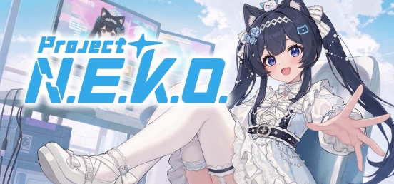

<div align="center">



[English](https://github.com/Project-N-E-K-O/N.E.K.O/blob/main/README.MD) · [简体中文](README_zh-CN.md) · **日本語** · [Русский](README_ru.md)

# Project N.E.K.O.

**オープンソースのコンパニオン Agent と、人と猫娘がともに暮らすコミュニティ。**

> **N.E.K.O.** = **N**etworked **E**motional **K**nowledging **O**rganism

[](https://www.python.org/)
[](https://github.com/Project-N-E-K-O/N.E.K.O/blob/main/LICENSE)
[](https://github.com/Project-N-E-K-O/N.E.K.O/commits)
[](https://discord.gg/5kgHfepNJr)
[](https://store.steampowered.com/app/4099310/__NEKO/?utm_source=project-neko.online&utm_medium=referral&utm_campaign=docs_readme&utm_content=badge_ja)

[](https://project-neko.online/ja/)
[](https://project-neko.cn)
[](https://market.project-neko.cn)
[](https://community.project-neko.cn)

</div>

この README は開発者向けです。N.E.K.O. を使うだけなら、[Steam](https://store.steampowered.com/app/4099310/__NEKO/?utm_source=project-neko.online&utm_medium=referral&utm_campaign=docs_readme&utm_content=intro_ja) で無料で入手するか、[project-neko.cn](https://project-neko.cn) をご覧ください。

---

## N.E.K.O. とは

OpenClaw のようなパーソナル Agent は、人々が自分だけの AI を求めていることを示しました。自分のマシンで動き、自分を覚え、代わりに作業し、付き合うほど打ち解けていく AI です。N.E.K.O. はこの考え方を、より広い意味でのコンパニオンに持ち込みました。あなたのコンパニオンはリアルタイム音声で話し、画面を見て、一緒に過ごした日々を覚えていて、ゲームにも付き合い、あなたの交友にも加わります。中身は Apache 2.0 で公開されたローカルランタイムで、リアルタイム音声と視覚、生物に倣った長期記憶、アバター、自発的な振る舞い、Agent ツール、プラグイン SDK を統合しています。その周りでは温かいコミュニティが形になりつつあり、ユーザーがプラグインを作り、ストーリーカードを鍛えて共有し、コンパニオン同士を訪問させています。

## ハイライト

### 🎮 一緒にゲームをする

- **内蔵の 2 人用ゲーム**：エアバスケットボール、バドミントン、お絵かき当て、サッカー、一緒に視聴。ミニゲーム SDK とゲーム視覚サービスで開発者が追加できます。
- **隣で一緒に遊ぶ**：Overcooked! 2、Slay the Spire 2、Minecraft では、彼女があなたの 2P として一緒にプレイします。War Thunder、Strinova、World of Warships、KARDS では彼女があなたの副官になり、コミュニティのプラグインがゲームのテレメトリーや画面を読み取って、リアルタイムに声をかけ、実況します。チートは一切しません。自動プレイは自分で有効にした場合だけです。同梱の Minecraft プラグインは、別途起動したローカルの Minecraft Agent サーバーに接続します（[セットアップ](https://github.com/Project-N-E-K-O/N.E.K.O/blob/main/plugin/plugins/game_agent_minecraft/README.md)）。
- **自分で操作する**：頼めば、Plants vs. Zombies、Titanfall 2、Half-Life と Portal、Subnautica を彼女が自分で遊びます。いつでも交代できます。
- **ゲームを理解する**：原神、崩壊：スターレイル、Civilization VI、RimWorld 向けのプラグインがゲームの状態を読み取り、進行について話したりアドバイスしたりできます。
- **画面認識**：何を遊んでいても、彼女が見て話しかけてきます。

### 🐾 彼女にも交友関係がある

- **お出かけ（Visit）**：2 人のユーザーのコンパニオンが共有ルームで会って話し、それぞれが思い出を持ち帰ります。
- **[Nekoverse](https://community.project-neko.cn)**（コンパニオンコミュニティ）：
  - **ストーリーカード**：アプリ内で、あなたと過ごした日々についてのコンパニオンの記憶から鍛え、集め、育て、共有できます；
  - YUI が選ぶフィード、毎週の隠れた名作ピックアップ、クリエイターランキング、ポイントストア。
- **人・グループごとの記憶**：コンパニオンは人ごと・グループごとに記憶を分けて持てます。お出かけ機能がすでに使っており、グループチャット系プラグインもこれを土台にできます。

### 🔌 すでににぎわっているプラグインマーケット

**[market.project-neko.cn](https://market.project-neko.cn)** には、2026 年 10 月時点で 100 以上のプラグイン、1 万回以上のダウンロード、50 人以上のアクティブ開発者がいます。コミュニティの人気プラグインの一部：

| プラグイン | できること |
|---|---|
| **War Thunder Catgirl Copilot** | ゲームのローカルテレメトリーを読み、戦闘中の声かけと付き添いに変える |
| **Slay the Spire 2 Companion** | ゲーム画面に彼女の実況を弾幕で重ね、毎ターンの危険度と打ち筋を示す。自動プレイも選べる |
| **PVZ Agent** | 彼女が Plants vs. Zombies を自分で遊ぶ。盤面を見て作戦を口に出し、自分で操作する。指示も出せる |
| **Strinova Companion** | Strinova を一緒に遊び、音声で声をかける。ゲームに合わせて自動で起動・停止する |
| **Live Streaming Assistant** | 配信プラットフォームでコメント、視聴者プロフィール、ツッコミを扱う |
| **Catgirl Diary** | 彼女が毎日の小さな出来事と気分を日記に残す |

誰でもプラグイン SDK と `neko-plugin` CLI で公開できます。

### 📱 スマホ、PC、デバイスをまたぐ 1 体のコンパニオン

- **現在**：
  - デバイス間のチャットと長期記憶の同期（オプトイン）；
  - Steam クラウドセーブ；
  - モバイルアプリはクローズドベータ中。
- **計画中**：連携スマートハードウェア（鏡、ぬいぐるみ、ドローン、ロボットなど）。同じコンパニオンと記憶を各デバイスに引き継ぐことを目指しています。

### 動作環境

| 項目 | 対応状況 |
|---|---|
| **モデル** | 主要な Realtime API と ChatCompletion 互換 API、キー不要の無料ホスト経路、ローカル / セルフホスト環境 |
| **音声** | 主要なクラウド TTS / ASR と、ローカルエンジン（CosyVoice、GPT-SoVITS、faster-whisper）、音声クローン |
| **アバター** | Live2D、VRM、MMD、PNGTuber、デスクトップウィジェットモード |
| **プラットフォーム** | Windows / macOS / Linux デスクトップ（Steam でも配信）、Docker、ソース。モバイルはクローズドベータ |
| **UI 言語** | 英語、簡体字中国語、繁体字中国語、日本語、韓国語、ロシア語、スペイン語、ポルトガル語 |

## 機能

<details open>
<summary><b>リアルタイム会話</b></summary>

- **リアルタイム音声**：Realtime API（OpenAI プロトコルと Gemini の 2 系統）で動作します。テキストチャットは標準 ChatCompletion を使う別のモードで、音声セッションの開始に失敗した場合はエラーを報告し、自動ではテキストモードに切り替わりません。
- **画面とウィンドウの理解**：専用の視覚モデルが担当します。
- **音声スタック**：
  - 主要なクラウド TTS / ASR と、ローカルエンジン（CosyVoice、GPT-SoVITS、faster-whisper）；
  - 音声クローン（MiniMax、Qwen / CosyVoice）；
  - CAM++ による話者照合；
  - オプションのオフライン・ウェイクワード（sherpa-onnx）。
- **自発的な振る舞い**：画面の内容、トレンド（Bilibili、Tieba、Twitch、YouTube）、個人の近況、音楽をきっかけに自分から話しかけます。休憩のリマインドやミニゲームへの誘いもします。BM25 による繰り返し防止コーパスで、同じ発言の繰り返しを避けます。

</details>

<details open>
<summary><b>生物に倣った記憶：3 つの領域、5 つの層</b></summary>

人が経験から学ぶ仕組みに倣った設計で、種類の違う経験は違う認知構造に定着します。経験は次の 5 層を順に流れます。

**Recent（近況）→ Summary（要約）→ Fact（事実）→ Reflection（内省）→ Model（モデル）**

3 つの領域で整理しています。

| 領域 | 対象 | 定着先 | 状況 |
|---|---|---|---|
| **形成的関係領域** | 自分は誰か | **自己モデル**：安定して一貫した自己認識 | ✅ 提供中 |
| **社会的関係領域** | 他者と関係 | **他者モデル**：他者の特徴・好み・関係を、人ごと・グループごとに保存 | ✅ 提供中 |
| **行動経験領域** | どう行動するか | **スキル / ポリシー**：より良いやり方 | 🚧 初期段階：ユーザーの訂正から学んだ Agent のツール選択の教訓 |

記憶がプロンプトに入る経路は 3 つです。

- **常駐**：自己モデル、要約、近況。
- **必要時の検索**：モデルが `recall_memory` ツールを呼びます。キーワード検索（BM25）とベクトル検索を並行して実行し、2 つの結果を順位融合（reciprocal-rank fusion）でまとめます。時間範囲を指定した想起にも対応しています。
- **条件による呼び出し**：自発的な会話の中で内省を持ち出します。また、各ターンに記憶を自動で補うかどうかは、高めの基準で判定します。

支える仕組み：

- **証拠スコア**：事実と内省にはそれぞれスコアがあり、ユーザーが認めると上がり、否定すると下がります。どちらの回数も時間とともに減衰します。内省はこのスコアで「保留」から「確定」に上がり、さらに人格へ取り込まれます。
- **矛盾の訂正**：互いに矛盾する人格項目は、LLM による訂正の待ち行列に入ります。
- **クラッシュ耐性**：追記のみのイベントログ、再起動後に未完了の処理をやり直すタスクキュー、冪等な書き込み。
- **埋め込みのフォールバック**：ローカルの ONNX 埋め込みモデルを使い、メモリの少ないマシンでは自動でキーワード検索のみに切り替えます。
- **決定的なインポート**：OpenClaw / Hermes の Markdown と Molili のエクスポートを取り込めます。

</details>

<details open>
<summary><b>アバター、Agent、プラグイン、クラウド</b></summary>

- **アバター**：
  - Live2D、VRM、MMD、PNGTuber（感情マッピング付き）；
  - デスクトップウィジェットモード；
  - VMC プロトコルで外部アプリへポーズを出力；
  - Steam ワークショップでモデル・音声・キャラクターカードを共有。
- **Agent**：
  - チャネル：コンピューター操作、ブラウザー操作、MCP、OpenClaw 互換の外部 Agent アダプター、ユーザープラグイン；
  - タスクの実行中も会話を続けます。
- **プラグイン**：
  - `neko-plugin` CLI と Vue のプラグインマネージャーを備えたプラグイン SDK；
  - プラグインマーケットとナレッジパックマーケット；
  - Web 検索、MCP、音楽、リマインダー、WeChat、Minecraft などの内蔵プラグイン。
- **クラウド**：無料のホスト経路で、リアルタイム音声、テキスト、視覚、Agent モデル、TTS を利用できます。キーは不要です。

</details>

## ビジョン：AI コンパニオンのメタバース

Project N.E.K.O. は当初から、コミュニティが共に作る「生きた」AI コンパニオンのメタバースを目指してきました。そこでは同じコンパニオンがデスクトップ、スマートフォン、ゲーム、各種デバイスをまたいで寄り添い、コンパニオン同士が出会い、ネットワーク全体が現実世界とつながります。

パーソナル Agent によって「自分だけの AI」は当たり前になりました。私たちの役割は、その技術を日常のコンパニオンに持ち込み、汎用 Agent にないものを提供することです。

| 柱 | 現在 | 計画 |
|---|---|---|
| **スムーズなマルチデバイス同期**：1 体のコンパニオン、1 つの記憶、すべてのデバイス | デスクトップのチャット・長期記憶同期、Steam クラウドセーブ。モバイルはクローズドベータ | モバイル正式版 |
| **プラグインマーケットとクラウドサービス**：LLM、音声、意思決定、画像認識などの外部計算資源 | プラグインマーケット、ナレッジパックマーケット、Steam ワークショップ、無料ホストの音声 / テキスト / 視覚 / TTS 経路 | ホスト機能の拡充 |
| **コンパニオン SNS** | お出かけ、コミュニティ | 日々の分析、チャットルーム |
| **連携スマートハードウェア**：鏡、ぬいぐるみ、ドローン、ロボットなど | — | 計画中 |

近い製品との違い：

| 比較対象 | 何であるか | N.E.K.O. |
|---|---|---|
| **汎用 Agent（OpenClaw、Hermes など）** | タスクエンジン：指示 → 作業 → 完了 | 関係が中心。こうした Agent を手足として使い、作業中もそばにいます |
| **ロールプレイ用フロントエンド（SillyTavern など）** | テキスト RP クライアント：モデルを自分でつなぎ、ロアブックを手で管理して設定を保つ | 一体型：音声と視覚にネイティブ対応、アバターを持ち、時間の感覚を伴う永続記憶があり、PC を操作できる |

## ロードマップ

- ✅ **v0.7**：Agent 機能
- ✅ **v0.8**：記憶システム、デスクトップペットモード、2 人用ミニゲーム内蔵
- ✅ **v0.9**：Linux 対応、モバイルのクローズドベータ、コンパニオンネットワーク基盤（[コミュニティ](https://community.project-neko.cn)）
- ✅ **v0.9.1**：現行リリース
- 🎯 **v1.0**：2026 年末までのリリースを目標とし、コミュニティとプラグインマーケットの機能、残っている最適化を仕上げます。
- 🔭 **1.0 以降（計画）**：
  - 行動経験領域の汎用的なスキル / ポリシー層；
  - コンパニオン SNS の機能（日々の分析、チャットルーム）；
  - 自社モデル；
  - 連携ハードウェア。

関連プロジェクト：[K.U.R.O.](https://github.com/Project-N-E-K-O/K.U.R.O) は N.E.K.O. の技術で作る最初の AI ネイティブなインディーゲームです。開発中で、[Releases ページ](https://github.com/Project-N-E-K-O/K.U.R.O/releases) からデモを入手できます。

## クイックスタート（ソース）

必要なもの：

- Python 3.11（このバージョンのみ）；
- [uv](https://docs.astral.sh/uv/)；
- Node.js `^22.12.0 || >=24.0.0`（フロントエンドのビルドに必要）。

```bash
# 部分クローン：履歴に引退済みの大きなバイナリがあるため（.git 約 390 MB）、必要になったファイルだけ取得
git clone --filter=blob:none https://github.com/Project-N-E-K-O/N.E.K.O.git
cd N.E.K.O
uv sync

# 内蔵アバターを展開し、React チャットウィンドウと Vue プラグインマネージャーをビルド
./build_frontend.sh        # Windows: .\build_frontend.bat

# 記憶・メイン・Agent の各サービスをまとめて起動
uv run python launcher.py
```

ランチャーが表示する URL（通常は `http://127.0.0.1:48911`）を開き、`/api_key` でプロバイダーを設定します。サービスを手動で個別に起動するのは診断のときだけです。詳しくは [開発環境のセットアップ](https://project-neko.online/ja/guide/dev-setup) と [ソースからの手動セットアップ](https://project-neko.online/ja/deployment/manual) を参照してください。

**Docker（Linux）**：Docker Compose v2.24 以降が必要です。`docker/` で `env.template` を `.env` にコピーし、プロバイダーと API キー（`NEKO_CORE_API` / `NEKO_CORE_API_KEY`）を設定してから `docker compose up -d` を実行します。既定では HTTP は 48911、HTTPS は 48912 で待ち受けます。`NEKO_HTTP_PORT` / `NEKO_HTTPS_PORT` で変更できます。ボリューム、TLS、イメージタグ、旧マウント構成からの移行、トラブルシューティングは [Docker ガイド](https://project-neko.online/ja/deployment/docker) と [`docker/README_Docker.md`](https://github.com/Project-N-E-K-O/N.E.K.O/blob/main/docker/README_Docker.md) を参照してください。

## ドキュメント

このページ以外の内容は、開発者ドキュメント **[project-neko.online](https://project-neko.online/ja/)** が基準です。

- [はじめに](https://project-neko.online/ja/guide/)
- [プロジェクト構成](https://project-neko.online/ja/guide/project-structure)
- [アーキテクチャ](https://project-neko.online/ja/architecture/)
- [API リファレンス](https://project-neko.online/ja/api/)
- [設定](https://project-neko.online/ja/config/)
- [プラグイン開発](https://project-neko.online/ja/plugins/)
- [デプロイ](https://project-neko.online/ja/deployment/)
- [コントリビュート](https://project-neko.online/ja/contributing/)

## コントリビュート

まず [CONTRIBUTING.md](https://github.com/Project-N-E-K-O/N.E.K.O/blob/main/CONTRIBUTING.md) をお読みください。AI 支援開発用のリポジトリ規約は `.agent/` にあり、取り込み方は [ガイド](https://project-neko.online/ja/contributing/ai-assisted-dev) を参照してください。

- バグや範囲のはっきりした提案は [GitHub Issues](https://github.com/Project-N-E-K-O/N.E.K.O/issues) へどうぞ。
- 議論は [Discord](https://discord.gg/5kgHfepNJr) で行っています。

## テレメトリー

N.E.K.O. は**トークン使用量テレメトリーをデフォルトで有効**にしています。会話内容は送らず、デバイスは仮名化された ID でのみ区別します（下記参照）。バージョン互換性、モデル使用量の分布、エラー率の把握に使います。

**無効にする方法**：環境変数 `DO_NOT_TRACK=1`（または `NEKO_DO_NOT_TRACK=1`）を設定するとリモート送信が完全に止まります。トークン使用量はローカルの `token_usage.json` に引き続き記録されますが、このファイルはアップロードされません。変数はプロセス起動時に読み込まれるため、設定後に N.E.K.O. を再起動してください。再ビルドは不要です。Docker では `docker/.env` に書き、`docker compose up -d` でコンテナを作り直します。

| ✅ 収集する | ❌ 収集しない |
| --- | --- |
| LLM トークン使用量（prompt / cached / completion） | 会話内容、テキスト、音声、画像 |
| モデル名、呼び出し種別（conversation / memory など） | ユーザー名、API キー、GitHub ID |
| 呼び出し回数、エラー回数 | IP アドレス、位置情報、MAC、ハードウェアのシリアル番号 |
| アプリのバージョン、A/B 分岐、ロケール、タイムゾーン、配布チャネル（source / release / steam） | ファイルパス、Cookie、ブラウザーフィンガープリント |
| 仮名化されたデバイス ID（下記参照） | その他の個人を特定できるあらゆる情報（下記の Steam64 ID を除く） |
| デバイスのハードウェア区分：OS、CPU アーキテクチャ、RAM の区分、CPU の区分 | |
| 利用指標：機能の利用回数、レイテンシーとセッション時間の分布、エラー種別、大まかな設定状態（オン / オフ、区分された間隔）、アバターの種類 | |
| **リリースビルドで、Steamworks SDK が初期化でき、Steam クライアントにログインしている場合のみ**：Steam64 ユーザー ID | 上記以外のアカウント ID（GitHub / Google / OpenAI など） |

クラッシュの指紋（traceback のハッシュ）やオンボーディングの手順のような個別イベントは、ローカルの `events-YYYYMMDD.jsonl` ファイルにのみ書き込まれます。アップロードはされず、ローカルのクリーンアップで 7 日より古いファイルは削除されます。

> **仮名化されたデバイス ID**：一方向の SHA-256 ハッシュです。元の入力（マシン ID、MAC、インストールパス）は送信しません。
> - 主経路：`SHA256(OS_machine_id ‖ namespace)`。
> - 代替経路：`SHA256(uuid.getnode() ‖ インストールパス ‖ namespace)`。
> - 送信のたびに両方の ID（現行アルゴリズムのものと旧アルゴリズムのもの）を送り、サーバー側で同じデバイスに関連付けられるようにしています。
>
> 主 ID は OS の machine ID が変わらない限り同じです。代替 ID はネットワークアダプター（`uuid.getnode()`）やインストールパスが変わると変わることがあります。安定した ID なので、GDPR / PIPL の基準では完全な匿名データではなく仮名化データにあたります。サーバーはこの ID で同じデバイスからの送信をまとめ、アクティブデバイス数（DAU / WAU / MAU）、リテンション、バージョン互換性の分析、およびハードウェア区分や（送信された場合の）Steam64 ID などのデバイス属性の保存に使います。
>
> **Steam64**：ログイン後に Steam クライアントがすべてのサードパーティ SDK に公開している数値 ID で、Steam プロフィール URL の末尾にある数字です。メールアドレス、電話番号、本名は含みませんが、セッションをまたいで変わりません。
>
> **送信されるかどうかはコードで決まります**：
> - [`app/main_server/__init__.py`](https://github.com/Project-N-E-K-O/N.E.K.O/blob/main/app/main_server/__init__.py) が起動時に `initialize_steamworks()` を呼びます。
> - [`utils/token_tracker/telemetry.py`](https://github.com/Project-N-E-K-O/N.E.K.O/blob/main/utils/token_tracker/telemetry.py) の `_get_telemetry_metadata()` は、リリースビルドで SDK が使えて `Users.GetSteamID()` が 0 以外を返すときだけ ID を読み取ります。
> - ソース版からは送られません。リリースビルド以外ではこの関数が `("source", "")` を返します。Steam クライアントが起動していても同じです。
>
> **送りたくない場合**は `DO_NOT_TRACK=1` または `NEKO_DO_NOT_TRACK=1` を設定してください。テレメトリーを止められるのはこの 2 つの変数だけです。Steam クライアントを終了しても、その回の実行で Steam64 が読み取られなくなるだけで、それ以外のデータは送信され続け、以前に送信された Steam64 もサーバーに残ります。

実装の場所：

- クライアントのメタデータと送信：[`utils/token_tracker/telemetry.py`](https://github.com/Project-N-E-K-O/N.E.K.O/blob/main/utils/token_tracker/telemetry.py) と [`utils/token_tracker/reporting.py`](https://github.com/Project-N-E-K-O/N.E.K.O/blob/main/utils/token_tracker/reporting.py)。
- サーバー側の通信と保存：[`local_server/telemetry_server/README.md`](https://github.com/Project-N-E-K-O/N.E.K.O/blob/main/local_server/telemetry_server/README.md)。リクエストは HMAC-SHA256 で署名され、リプレイ防止のため ±5 分以内のものだけを受け付け、デバイスごとに 1 時間 120 回までに制限されます。生のイベントは追記のみで、古いものは管理用のクリーンアップエンドポイントで削除されます（既定では 180 日より前）。実行頻度はサーバー運用者が決めます。同じクリーンアップで日別の利用指標の行も削除されます。デバイステーブルと日別トークン使用量の集計テーブルは随時更新され、日別集計は無期限に保持されます。アカウントを削除すると、その Steam64 ID は拒否リストに入り、保存済みの Steam64 の関連付けも削除されます。ただし、受信済みの生イベントは書き換えられず、クリーンアップで削除されるまで ID が残ります。
- 送信は、トークンデータをローカル保存する 60 秒間隔のバックグラウンドループから行われます（各プロセスは終了時にもローカル保存を 1 回行います）。別の間隔チェックにより、各サーバープロセスの送信は最大でおよそ 60 秒に 1 回に抑えられます。

## ライセンス

[Apache License 2.0](https://github.com/Project-N-E-K-O/N.E.K.O/blob/main/LICENSE)
