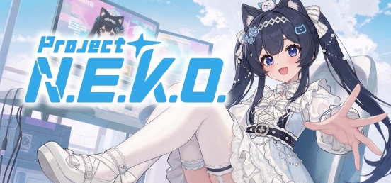

<div align="center">



[English](https://github.com/Project-N-E-K-O/N.E.K.O/blob/main/README.MD) · [简体中文](README_zh-CN.md) · [日本語](README_ja.md) · **Русский**

# Project N.E.K.O.

**Открытый стек персонального агента, созданный для AI-компаньонов.**

> **N.E.K.O.** = **N**etworked **E**motional **K**nowledging **O**rganism

[](https://www.python.org/)
[](https://github.com/Project-N-E-K-O/N.E.K.O/blob/main/LICENSE)
[](https://github.com/Project-N-E-K-O/N.E.K.O/commits)
[](https://discord.gg/5kgHfepNJr)
[](https://store.steampowered.com/app/4099310/__NEKO/)

[](https://project-neko.online)
[](https://project-neko.cn)
[](https://market.project-neko.cn)
[](https://community.project-neko.cn)

</div>

Этот README предназначен для разработчиков. Если вы хотите просто пользоваться N.E.K.O., скачайте его бесплатно в [Steam](https://store.steampowered.com/app/4099310/__NEKO/) или зайдите на [project-neko.cn](https://project-neko.cn).

Документация для разработчиков доступна на английском, китайском и японском языках; русской версии сайта пока нет, поэтому ссылки ниже ведут на английские страницы.

---

## Что это

Персональные агенты вроде OpenClaw показали, что людям нужен собственный AI: он работает на их компьютере, помнит их, действует за них и становится лучше, чем дольше им пользуются. N.E.K.O. переносит эту идею в сферу компаньонов. Голос и зрение в реальном времени, биомиметическая долговременная память, аватары, проактивное поведение, инструменты агента и SDK для плагинов собраны в одной локальной среде выполнения под лицензией Apache 2.0. Вокруг неё уже есть сообщество, которое пишет плагины, создаёт карточки-истории и отправляет компаньонов в гости друг к другу.

## Главное

### 🎮 Играет вместе с вами

- **Встроенные игры для двоих**: воздушный баскетбол, бадминтон, «угадай рисунок», футбол и совместный просмотр. Разработчики могут добавлять новые через SDK мини-игр и сервис игрового зрения.
- **Игровые плагины сообщества**:
  - помощник для War Thunder: превращает живую телеметрию игры в боевые события, на которые реагирует компаньон (только чтение: без читов и автоматизации);
  - мост к Touhou Little Maid: компаньон командует горничной в Minecraft обычной речью;
  - встроенный плагин Minecraft: подключается к отдельно запущенному локальному серверу агента Minecraft, который играет рядом с вами, а компаньон комментирует голосом ([настройка](https://github.com/Project-N-E-K-O/N.E.K.O/blob/main/plugin/plugins/game_agent_minecraft/README.md)).
- **Внимание к экрану**: компаньон видит, во что вы играете, и вступает в разговор.

### 🐾 У компаньона есть своя социальная жизнь

- **Визиты**: компаньоны двух пользователей встречаются в общей комнате, общаются, и каждый уносит воспоминание домой.
- **[Nekoverse](https://community.project-neko.cn)**, сообщество компаньонов:
  - **карточки-истории**: создаются в приложении из воспоминаний компаньона о ваших общих днях; их можно собирать, развивать и показывать другим;
  - лента от YUI, еженедельная подборка скрытых жемчужин, рейтинг авторов и магазин баллов.
- **Память по людям и группам**: компаньон может хранить отдельные воспоминания для каждого человека и каждой группы. Визиты уже используют это, и плагины групповых чатов могут на это опираться.

### 🔌 Магазин плагинов уже живёт

На **[market.project-neko.cn](https://market.project-neko.cn)** по состоянию на ноябрь 2026 года 134 плагина, 9,8 тыс. загрузок и 51 активный разработчик. Несколько любимцев сообщества:

| Плагин | Что добавляет |
|---|---|
| **War Thunder Catgirl Copilot** | Читает локальную телеметрию игры и превращает её в боевые напоминания и поддержку |
| **Wine Fox** | Связывает с модом Touhou Little Maid для Minecraft, чтобы компаньон управлял горничной в игре |
| **Eternal Companionship** | Ядро с непрерывным состоянием: собственные эмоции, телесные ритмы и долговременная память |
| **Live Streaming Assistant** | Работает с комментариями, профилями зрителей и репликами на стриминговых платформах |
| **Catgirl Diary** | Компаньон ведёт ежедневный дневник мелочей и настроений |
| **Music Playlist Management** | Плейлисты NetEase Cloud Music, QQ Music и Bilibili; попросите песню — она заиграет |

Любой разработчик может публиковать плагины с помощью SDK и CLI `neko-plugin`.

### 📱 Один компаньон на телефоне, компьютере и устройствах

- **Сейчас**:
  - синхронизация чата и долговременной памяти между устройствами (включается вручную);
  - сохранения в Steam Cloud;
  - мобильное приложение в закрытом бета-тестировании.
- **В планах**: умные устройства для компаньонов, в том числе зеркала, плюшевые игрушки, дроны и роботы. Цель — чтобы один и тот же компаньон и его память переходили на каждое устройство.

### На чём работает

| | |
|---|---|
| **Модели** | Основные Realtime API и API, совместимые с ChatCompletion, бесплатный хостинговый маршрут без ключа, а также локальное или собственное развёртывание |
| **Голос** | Основные облачные TTS / ASR и локальные движки (CosyVoice, GPT-SoVITS, faster-whisper), клонирование голоса |
| **Аватары** | Live2D, VRM, MMD, PNGTuber и режим виджета на рабочем столе |
| **Платформы** | Windows / macOS / Linux (также в Steam), Docker, исходный код; мобильная версия в закрытой бете |
| **Языки интерфейса** | Английский, упрощённый и традиционный китайский, японский, корейский, русский, испанский, португальский |

## Возможности

<details open>
<summary><b>Разговор в реальном времени</b></summary>

- **Голос в реальном времени** через Realtime API (профили протокола OpenAI и Gemini). Текстовый чат — отдельный режим на стандартном ChatCompletion; если голосовой сеанс не запускается, выводится ошибка, а автоматического перехода в текстовый режим нет.
- **Понимание экрана и окон** с помощью отдельной модели зрения.
- **Голосовой стек**:
  - основные облачные TTS / ASR, а также локальные движки (CosyVoice, GPT-SoVITS, faster-whisper);
  - клонирование голоса (MiniMax, Qwen / CosyVoice);
  - проверка говорящего CAM++;
  - необязательное офлайн-слово активации (sherpa-onnx).
- **Проактивное поведение**: компаньон сам начинает разговор, опираясь на содержимое экрана, популярные ленты (Bilibili, Tieba, Twitch, YouTube), личные новости и музыку. Он также напоминает о перерывах и зовёт сыграть в мини-игры. Корпус против повторов на BM25 не даёт ему повторять собственные фразы.

</details>

<details open>
<summary><b>Биомиметическая память: три области, пять слоёв</b></summary>

Устройство повторяет то, как люди учатся на опыте: разный опыт закрепляется в разных когнитивных структурах. Опыт последовательно проходит пять слоёв:

**Recent (недавнее) → Summary (сводка) → Fact (факт) → Reflection (рефлексия) → Model (модель)**

Память разделена на три области:

| Область | О чём | Итог | Статус |
|---|---|---|---|
| **Формирующая** | кто я | **Модель себя**: устойчивое, цельное представление о себе | ✅ Готово |
| **Социальная** | другие люди и отношения | **Модели людей**: черты, предпочтения и отношения других, отдельно для каждого человека и каждой группы | ✅ Готово |
| **Опытная** | как действовать | **Навыки / политики**: лучшие способы делать дела | 🚧 Начальный этап: уроки выбора инструментов агентом, извлечённые из исправлений пользователя |

Воспоминания попадают в контекст тремя путями:

- **Постоянно**: модель себя, сводка и недавняя история.
- **По запросу**: модель вызывает инструмент `recall_memory`. Поиск по ключевым словам (BM25) и векторный поиск идут параллельно, а их результаты объединяются слиянием по рангам (reciprocal-rank fusion). Поддерживается вспоминание по временному окну.
- **По условию**: рефлексии всплывают в проактивном разговоре, а высокий порог решает, когда воспоминание автоматически добавляется к реплике.

Вспомогательные механизмы:

- **Оценка по свидетельствам.** У каждого факта и рефлексии есть оценка: она растёт, когда пользователь подтверждает запись, и падает, когда оспаривает; оба счётчика со временем затухают. По этой оценке рефлексия переходит из ожидающих в подтверждённые, а затем в персону.
- **Исправление противоречий.** Противоречащие друг другу записи персоны ставятся в очередь на исправление LLM.
- **Устойчивость к сбоям.** Журнал событий только на дозапись, очередь задач, которая после перезапуска доделывает незавершённую работу, и идемпотентные записи.
- **Запасной режим эмбеддингов.** Локальная ONNX-модель эмбеддингов; на машинах с малым объёмом памяти система автоматически переходит на поиск только по ключевым словам.
- **Детерминированный импорт** из Markdown OpenClaw / Hermes и экспортов Molili.

</details>

<details open>
<summary><b>Аватары, агент, плагины и облако</b></summary>

- **Аватары**:
  - Live2D, VRM, MMD и PNGTuber с привязкой эмоций;
  - режим виджета на рабочем столе;
  - вывод позы во внешние приложения по протоколу VMC;
  - обмен моделями, голосами и карточками персонажей через Steam Workshop.
- **Агент**:
  - каналы: управление компьютером, управление браузером, MCP, адаптер внешнего агента, совместимый с OpenClaw, пользовательские плагины;
  - компаньон продолжает общаться с вами, пока выполняется задача.
- **Плагины**:
  - SDK для плагинов с CLI `neko-plugin` и менеджером плагинов на Vue;
  - магазин плагинов и магазин пакетов знаний;
  - встроенные плагины для веб-поиска, MCP, музыки, напоминаний, WeChat, Minecraft и другого.
- **Облако**: бесплатный хостинговый маршрут покрывает голос в реальном времени, текст, зрение, модели агента и TTS; ключ не нужен.

</details>

## Видение: метавселенная AI-компаньонов

С самого начала цель Project N.E.K.O. — «живая» метавселенная AI-компаньонов, которую строит сообщество. В ней один и тот же компаньон сопровождает вас на компьютере, телефоне, в играх и на разных устройствах; компаньоны знакомятся друг с другом; вся сеть связана с реальным миром.

Персональные агенты сделали «собственный AI» привычным явлением. Наша задача — перенести этот стек в повседневное общение и дать то, чего нет у универсального агента:

| Направление | Сейчас | В планах |
|---|---|---|
| **Бесшовная синхронизация между устройствами**: один компаньон, одна память, все устройства | Синхронизация чата и долговременной памяти на компьютере, Steam Cloud; мобильное приложение в закрытой бете | Полный выпуск мобильной версии |
| **Магазин плагинов и облачные сервисы**: внешние вычисления, включая LLM, голос, принятие решений и распознавание изображений | Магазин плагинов, магазин пакетов знаний, Steam Workshop, бесплатный хостинговый маршрут для голоса / текста / зрения / TTS | Больше хостинговых возможностей |
| **Социальная платформа компаньонов** | Визиты, сообщество | Ежедневный анализ, чат-комнаты |
| **Умные устройства для компаньонов**: в том числе зеркала, плюшевые игрушки, дроны и роботы | — | В планах |

Чем N.E.K.O. отличается от похожих инструментов:

| Сравнение | Что это | N.E.K.O. |
|---|---|---|
| **Универсальные агенты (OpenClaw, Hermes, …)** | Движки задач: инструкция → работа → готово | В центре — отношения. Может использовать такие агенты как свои руки и оставаться с вами во время задачи |
| **Ролевые интерфейсы (SillyTavern, …)** | Текстовые RP-клиенты: модели подключаете сами, а образ персонажа держите вручную через лорбуки | Цельная система: встроенные голос и зрение, аватар, постоянная память с чувством времени и возможность действовать на вашем компьютере |

## Дорожная карта

- ✅ **v0.7**: возможности агента
- ✅ **v0.8**: система памяти, режим питомца на рабочем столе, встроенные мини-игры для двоих
- ✅ **v0.9**: поддержка Linux, закрытая бета мобильной версии, инфраструктура сети компаньонов ([сообщество](https://community.project-neko.cn))
- ✅ **v0.9.1**: текущий выпуск
- 🎯 **v1.0**: целевой срок — до конца 2026 года. Завершение функций сообщества и магазина плагинов, а также оставшейся оптимизации.
- 🔭 **После 1.0 (в планах)**:
  - обобщённый слой навыков / политик в опытной памяти;
  - функции социальной платформы (ежедневный анализ, чат-комнаты);
  - собственные модели;
  - устройства для компаньонов.

Связанный проект: [K.U.R.O.](https://github.com/Project-N-E-K-O/K.U.R.O) — первая AI-native инди-игра на стеке N.E.K.O. Она в разработке; демо доступно на [странице релизов](https://github.com/Project-N-E-K-O/K.U.R.O/releases).

## Быстрый старт (из исходников)

Требования:

- ровно Python 3.11;
- [uv](https://docs.astral.sh/uv/);
- Node.js `^22.12.0 || >=24.0.0` (нужен для сборки фронтендов).

```bash
# Частичное клонирование: в истории лежат крупные устаревшие бинарные файлы (.git около 390 МБ), поэтому файлы скачиваются по мере надобности
git clone --filter=blob:none https://github.com/Project-N-E-K-O/N.E.K.O.git
cd N.E.K.O
uv sync

# Распаковать встроенные аватары и собрать окно чата на React и менеджер плагинов на Vue
./build_frontend.sh        # Windows: .\build_frontend.bat

# Запустить сервисы памяти, основной и агента вместе
uv run python launcher.py
```

Откройте адрес, который выведет лаунчер (обычно `http://127.0.0.1:48911`), и настройте провайдеров на странице `/api_key`. Ручной запуск сервисов по отдельности нужен только для диагностики. Подробнее: [Development Setup](https://project-neko.online/guide/dev-setup) и [Manual Source Setup](https://project-neko.online/deployment/manual).

**Docker (Linux)**: в каталоге `docker/` скопируйте `env.template` в `.env` и выполните `docker compose up -d`. По умолчанию сервис слушает HTTP на 48911 и HTTPS на 48912; порты меняются через `NEKO_HTTP_PORT` / `NEKO_HTTPS_PORT`. Тома, TLS, теги образов, переход со старой схемы монтирования и устранение неполадок описаны в [руководстве по Docker](https://project-neko.online/deployment/docker) и в [`docker/README_Docker.md`](https://github.com/Project-N-E-K-O/N.E.K.O/blob/main/docker/README_Docker.md).

## Документация

Всё, что выходит за рамки этой страницы, описано в документации для разработчиков **[project-neko.online](https://project-neko.online)**:

- [Getting started](https://project-neko.online/guide/)
- [Project structure](https://project-neko.online/guide/project-structure)
- [Architecture](https://project-neko.online/architecture/)
- [API reference](https://project-neko.online/api/)
- [Configuration](https://project-neko.online/config/)
- [Plugin development](https://project-neko.online/plugins/)
- [Deployment](https://project-neko.online/deployment/)
- [Contributing](https://project-neko.online/contributing/)

## Участие в разработке

Сначала прочитайте [CONTRIBUTING.md](https://github.com/Project-N-E-K-O/N.E.K.O/blob/main/CONTRIBUTING.md). Правила репозитория для разработки с AI-ассистентами лежат в `.agent/`; как их подключить, описано в [руководстве](https://project-neko.online/contributing/ai-assisted-dev).

- Ошибки и предложения с чётко очерченными рамками отправляйте в [GitHub Issues](https://github.com/Project-N-E-K-O/N.E.K.O/issues).
- Обсуждения ведутся в [Discord](https://discord.gg/5kgHfepNJr).

## Телеметрия

В N.E.K.O. **телеметрия расхода токенов включена по умолчанию**. Содержимое разговоров не отправляется, а устройство различается только по псевдонимизированному идентификатору (см. ниже). Она нужна, чтобы отслеживать совместимость версий, распределение использования моделей и частоту ошибок.

**Как отключить**: задайте `DO_NOT_TRACK=1` (или `NEKO_DO_NOT_TRACK=1`). Отправка данных на сервер полностью прекратится; расход токенов по-прежнему записывается локально в `token_usage.json`, и этот файл никуда не загружается. Переменная читается при запуске процесса, поэтому после её установки перезапустите N.E.K.O.; пересборка не нужна. В Docker добавьте её в `docker/.env` и пересоздайте контейнер командой `docker compose up -d`.

| ✅ Собирается | ❌ Не собирается |
| --- | --- |
| Расход токенов LLM (prompt / cached / completion) | Содержимое разговоров, текст, голос, изображения |
| Название модели и тип вызова (conversation / memory и т. п.) | Имя пользователя, API-ключи, GitHub ID |
| Число вызовов и ошибок | IP-адрес, местоположение, MAC, серийные номера оборудования |
| Версия приложения, ветка A/B, локаль, часовой пояс, канал распространения (source / release / steam) | Пути к файлам, cookie, отпечатки браузера |
| Псевдонимизированный идентификатор устройства (см. ниже) | Любые другие данные, позволяющие установить личность (кроме Steam64 ID ниже) |
| Профиль оборудования: ОС, архитектура CPU, класс объёма RAM, класс CPU | |
| Метрики использования: счётчики использования функций, распределения задержек и длительности сеансов, классы ошибок, отпечатки сбоев (хеш traceback), общее состояние настроек (вкл. / выкл., интервалы по диапазонам) и тип аватара | |
| **Только в релизных сборках, если Steamworks SDK инициализируется и вы вошли в Steam**: пользовательский Steam64 ID | Любые другие идентификаторы аккаунтов (GitHub / Google / OpenAI и т. п.) |

> **Псевдонимизированный идентификатор устройства** — односторонний хеш SHA-256. Исходные данные (ID машины, MAC, путь установки) не отправляются.
> - Основной путь: `SHA256(OS_machine_id ‖ namespace)`.
> - Запасной путь: `SHA256(uuid.getnode() ‖ путь установки ‖ namespace)`.
> - В каждом отчёте передаются оба идентификатора (по текущему и по старому алгоритму), чтобы сервер мог связать их с одним устройством.
>
> Основной идентификатор не меняется, пока не меняется machine ID ОС; запасной может измениться при смене сетевого адаптера (`uuid.getnode()`) или пути установки. Поскольку идентификатор стабилен, по меркам GDPR / PIPL это псевдонимизированные, а не полностью анонимные данные. Сервер по нему объединяет отчёты одного устройства: считает активные устройства (DAU / WAU / MAU) и удержание, анализирует совместимость версий и хранит атрибуты устройства, например профиль оборудования и, если он передаётся, Steam64 ID.
>
> **Steam64** — публичный числовой ID, который клиент Steam после входа открывает всем сторонним SDK; это число в конце адреса вашего профиля Steam. В нём нет почты, телефона или настоящего имени, но он не меняется между сеансами.
>
> **Когда он отправляется, определяет код**:
> - [`app/main_server/__init__.py`](https://github.com/Project-N-E-K-O/N.E.K.O/blob/main/app/main_server/__init__.py) вызывает `initialize_steamworks()` при запуске.
> - `_get_telemetry_metadata()` в [`utils/token_tracker/telemetry.py`](https://github.com/Project-N-E-K-O/N.E.K.O/blob/main/utils/token_tracker/telemetry.py) читает ID только в релизной сборке, когда SDK доступен и `Users.GetSteamID()` возвращает ненулевое значение.
> - Запуск из исходников его никогда не отправляет: для любой нерелизной сборки функция возвращает `("source", "")`, даже если клиент Steam открыт.
>
> **Чтобы этого избежать**, задайте `DO_NOT_TRACK=1` или `NEKO_DO_NOT_TRACK=1` — только эти переменные отключают телеметрию. Если закрыть клиент Steam, поле Steam64 в этом запуске просто останется пустым: остальные данные по-прежнему отправляются, а ранее отправленный Steam64 остаётся на сервере.

Где это реализовано:

- Метаданные клиента и отправка: [`utils/token_tracker/telemetry.py`](https://github.com/Project-N-E-K-O/N.E.K.O/blob/main/utils/token_tracker/telemetry.py) и [`utils/token_tracker/reporting.py`](https://github.com/Project-N-E-K-O/N.E.K.O/blob/main/utils/token_tracker/reporting.py).
- Передача и хранение на сервере: [`local_server/telemetry_server/README.md`](https://github.com/Project-N-E-K-O/N.E.K.O/blob/main/local_server/telemetry_server/README.md). Запросы подписываются HMAC-SHA256; для защиты от повторов принимаются только запросы в пределах ±5 минут; действует лимит 120 запросов в час на устройство. Исходные события только дописываются; старые удаляются через административную точку очистки (по умолчанию старше 180 дней), а частоту её запуска определяет оператор сервера; таблицы устройств и агрегатов со временем обновляются, а агрегированные данные хранятся бессрочно. При удалении аккаунта его Steam64 ID попадает в чёрный список, а сохранённые связи со Steam64 удаляются.
- Отправка запускается из того же фонового цикла с периодом 60 секунд, который сохраняет данные о токенах локально (при завершении каждый процесс тоже один раз сохраняет их), а отдельная проверка интервала ограничивает каждый серверный процесс примерно одной отправкой в 60 секунд.

## Лицензия

[Apache License 2.0](https://github.com/Project-N-E-K-O/N.E.K.O/blob/main/LICENSE)
