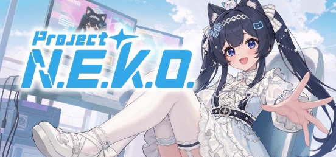

<div align="center">



[English](https://github.com/Project-N-E-K-O/N.E.K.O/blob/main/README.MD) · **简体中文** · [日本語](README_ja.md) · [Русский](README_ru.md)

# Project N.E.K.O. 猫娘计划

**开源的伙伴 Agent，和一个人与猫娘共同生活的社区。**

> **N.E.K.O.** = **N**etworked **E**motional **K**nowledging **O**rganism（网络型情感知性生命体）

[](https://www.python.org/)
[](https://github.com/Project-N-E-K-O/N.E.K.O/blob/main/LICENSE)
[](https://github.com/Project-N-E-K-O/N.E.K.O/commits)
[](https://discord.gg/5kgHfepNJr)

[](https://store.steampowered.com/app/4099310/__NEKO/)

[](https://project-neko.online/zh-CN/)
[](https://project-neko.cn)
[](https://market.project-neko.cn)
[](https://community.project-neko.cn)

</div>

本 README 面向开发者。只想使用 N.E.K.O. 的话，请在 [Steam](https://store.steampowered.com/app/4099310/__NEKO/) 免费下载，或访问官网 [project-neko.cn](https://project-neko.cn)。

---

## 这是什么

OpenClaw 这类个人 Agent 证明了一件事：人们想要一个属于自己的 AI。它运行在自己的机器上，记得自己，能替自己做事，而且越处越熟。N.E.K.O. 把这套思路带进了更广泛的陪伴里。你的伙伴能用实时语音和你聊天、看得到你的屏幕、记得你们相处的日子，还会陪你打游戏、参与你的社交。底层是一个基于 Apache 2.0 开源的本地运行时，集成了实时语音与视觉、仿生长期记忆、有形象的化身、主动行为、Agent 工具和插件 SDK。围绕它，一个有温度的社区正在建成，用户们写插件、锻造并分享故事卡、让伙伴们互相串门。

## 亮点

### 🎮 陪你打游戏

- **内置双人游戏**：空气篮球、羽毛球、你画我猜、足球，还有一起看。开发者可以用小游戏 SDK 和游戏视觉服务继续扩展。
- **陪你一起玩**：在胡闹厨房 2、杀戮尖塔 2 和 Minecraft 里，她是你的 2P，跟你一起上手玩；在战争雷霆、卡拉彼丘、战舰世界、KARDS 里，她是你的副官，社区插件读取游戏遥测或画面，让她实时提醒和解说，绝不作弊。自动操作只在你主动开启时才会发生。自带的 Minecraft 插件需要连接单独启动的本地 Minecraft Agent 服务器（[启用步骤](https://github.com/Project-N-E-K-O/N.E.K.O/blob/main/plugin/plugins/game_agent_minecraft/README.md)）。
- **自己上手玩**：你一句话，她就能在植物大战僵尸、泰坦陨落 2、半条命与传送门、深海迷航里自己玩，你随时可以接手。
- **懂你的游戏**：原神、崩坏：星穹铁道、文明 6、环世界的陪玩插件会读取游戏状态，让她能聊你的进度、给你出主意。
- **屏幕感知**：你玩什么，她都能看着、随时搭话。

### 🐾 她有自己的社交圈

- **串门**：两位用户的伙伴在共享房间里见面聊天，结束后各自把这段经历带回自己的记忆。
- **[喵宇宙社区](https://community.project-neko.cn)**：
  - **故事卡**：在应用里，从伙伴记得的你们相处的日常中锻造出来，可以收集、养成、分享；
  - YUI 精选的信息流、每周遗珠精选、创作者榜、积分商城。
- **按人、按群分开的记忆**：伙伴可以为每个人、每个群分别保存记忆。串门已经在用，群聊类插件也可以基于它来做。

### 🔌 已经很热闹的插件市场

截至 2026 年 10 月，**[插件市场 market.project-neko.cn](https://market.project-neko.cn)** 已有 100+ 个插件、10K+ 次下载、50+ 位活跃开发者。几个社区热门：

| 插件 | 能做什么 |
|---|---|
| **战雷猫娘副驾驶** | 读取游戏本地遥测，转成战斗提醒和陪伴 |
| **尖塔2陪玩** | 在游戏画面上用弹幕实时点评，给每回合评估风险、建议打法，可选自动出牌 |
| **PVZ Agent** | 她自己玩植物大战僵尸：看战局、说出打算、亲自操作，你也可以随时指挥 |
| **卡拉彼丘陪伴** | 陪你玩卡拉彼丘，语音提醒，随游戏自动启停 |
| **直播助手** | 在直播平台上处理弹幕、观众画像和吐槽互动 |
| **猫娘日记** | 她每天记下小事和心情 |

任何开发者都可以用插件 SDK 和 `neko-plugin` 命令行工具发布插件。

### 📱 一个伙伴，跨手机、电脑和设备

- **现在**：
  - 设备之间同步聊天和长期记忆（需手动开启）；
  - Steam 云存档；
  - 手机端正在内测。
- **规划中**：配套智能硬件，包括但不限于镜子、玩偶、无人机、机器人。目标是让同一个伙伴、同一份记忆在每台设备上延续。

### 运行环境

| 方面 | 支持情况 |
|---|---|
| **模型** | 主流 Realtime API 与兼容 ChatCompletion 的 API、无需 Key 的免费托管线路，以及本地或自托管部署 |
| **语音** | 主流云端 TTS / ASR，加上本地引擎（CosyVoice、GPT-SoVITS、faster-whisper），支持声音克隆 |
| **形象** | Live2D、VRM、MMD、PNGTuber，另有桌面挂件模式 |
| **平台** | Windows / macOS / Linux 桌面（Steam 同步上架）、Docker、源码；手机端内测中 |
| **界面语言** | 英语、简体中文、繁体中文、日语、韩语、俄语、西班牙语、葡萄牙语 |

## 功能

<details open>
<summary><b>实时对话</b></summary>

- **实时语音**：走 Realtime API（OpenAI 协议与 Gemini 两套）。文字聊天是另一种独立模式，基于标准 ChatCompletion；语音会话启动失败时会报错，不会自动切换到文字模式。
- **屏幕与窗口理解**：由专用视觉模型完成。
- **语音栈**：
  - 主流云端 TTS / ASR，以及本地引擎（CosyVoice、GPT-SoVITS、faster-whisper）；
  - 声音克隆（MiniMax、通义 / CosyVoice）；
  - CAM++ 声纹验证；
  - 可选的离线唤醒词（sherpa-onnx）。
- **主动行为**：她会根据屏幕内容、热门内容（B 站、贴吧、Twitch、YouTube）、个人动态和音乐主动找你聊天，也会提醒你休息、邀请你玩小游戏。另有一个 BM25 防复读语料库，避免她重复自己说过的话。

</details>

<details open>
<summary><b>仿生记忆：三个领域，五层结构</b></summary>

设计参照人从经历中学习的方式：不同类型的经验，会沉淀成不同的认知结构。经验依次流过五层：

**近期（Recent）→ 总结（Summary）→ 事实（Fact）→ 反思（Reflection）→ 模型（Model）**

按三个领域组织：

| 领域 | 关于 | 沉淀为 | 状态 |
|---|---|---|---|
| **形成性关系域** | 我是谁 | **自我模型**：稳定、连贯的自我认知 | ✅ 已上线 |
| **社会关系域** | 他人与关系 | **他人模型**：他人的特点、偏好与关系，按人、按群分别保存 | ✅ 已上线 |
| **行动经验域** | 如何做事 | **技能 / 策略**：学到更好的做事方法 | 🚧 初期：从用户纠正中学到的 Agent 工具选择经验 |

记忆通过三种方式进入上下文：

- **常驻**：自我模型、总结与近期对话。
- **按需检索**：模型调用 `recall_memory` 工具。检索时关键词搜索（BM25）和向量搜索并行进行，再把两路结果合并排序（倒数排名融合），也支持按时间段回忆。
- **条件触发**：主动搭话时会带出反思；每轮对话是否自动补充某条记忆，有一道较高的门槛来决定。

配套机制：

- **证据分**：每条事实和反思都有一个分数，用户确认时加分、否认时减分，两种计数都会随时间衰减。反思靠这个分数从待定升为确认，再并入人格。
- **矛盾纠正**：互相矛盾的人格条目会排队交给 LLM 纠正。
- **防崩溃**：只追加的事件日志、重启后补跑未完成工作的任务队列、幂等写入。
- **向量回退**：本地 ONNX 向量模型；内存不足的机器上自动退回纯关键词检索。
- **确定性导入**：支持导入 OpenClaw / Hermes 的 Markdown 和 Molili 的导出文件。

</details>

<details open>
<summary><b>形象、Agent、插件与云服务</b></summary>

- **形象**：
  - Live2D、VRM、MMD、PNGTuber，带情绪映射；
  - 桌面挂件模式；
  - 通过 VMC 协议向外部应用输出姿态；
  - 在 Steam 创意工坊分享模型、声音和角色卡。
- **Agent**：
  - 通道：电脑操控、浏览器操控、MCP、兼容 OpenClaw 的外部 Agent 适配器、用户插件；
  - 任务执行期间，她仍会和你聊天。
- **插件**：
  - 插件 SDK，带 `neko-plugin` 命令行工具和 Vue 插件管理面板；
  - 插件市场与知识包市场；
  - 内置插件覆盖网络搜索、MCP、音乐、提醒、微信、Minecraft 等。
- **云服务**：免费托管线路覆盖实时语音、文本、视觉、Agent 模型与 TTS，无需填写 Key。

</details>

## 愿景：AI 伙伴元宇宙

猫娘计划从一开始的目标，就是一个由社区共同构建、"活"的 AI 伙伴元宇宙。在那里，同一个伙伴陪你跨越桌面、手机、游戏和各种设备；伙伴们彼此相识；整个网络与现实世界相连。

个人 Agent 已经让"一个属于自己的 AI"成为主流。我们要做的，是把这套技术带进日常陪伴，并提供通用 Agent 没有的东西：

| 支柱 | 现在 | 规划 |
|---|---|---|
| **丝滑的多端同步**：一个伙伴、一份记忆、所有设备 | 桌面端聊天与长期记忆同步、Steam 云存档；手机端内测中 | 手机端正式发布 |
| **插件市场与云服务**：外置算力，包括但不限于 LLM、语音、决策、视觉识别 | 插件市场、知识包市场、Steam 创意工坊、免费托管的语音 / 文本 / 视觉 / TTS 线路 | 更多托管能力 |
| **伙伴社交平台** | 串门、喵宇宙社区 | 日常分析、聊天室 |
| **配套智能硬件**：包括但不限于镜子、玩偶、无人机、机器人 | — | 筹划中 |

和相近产品的区别：

| 对比对象 | 它们是 | N.E.K.O. |
|---|---|---|
| **通用 Agent（OpenClaw、Hermes 等）** | 任务引擎：给指令 → 干活 → 结束 | 以关系为核心：可以把这类 Agent 当作手脚来调用，执行任务时依然陪着你 |
| **角色扮演前端（SillyTavern 等）** | 文字 RP 客户端：需要自己接模型，靠手动维护世界书保持人设 | 端到端集成：原生语音与视觉、有形象、有时间感知的持久记忆，还能操作你的电脑 |

## 开发计划

- ✅ **v0.7**：Agent 能力
- ✅ **v0.8**：记忆系统、桌宠模式、内置双人小游戏
- ✅ **v0.9**：Linux 适配、手机端内测、伙伴网络基础设施（[社区](https://community.project-neko.cn)）
- ✅ **v0.9.1**：当前版本
- 🎯 **v1.0**：目标在 2026 年底前上线。完善社区与插件市场功能，完成遗留的优化工作。
- 🔭 **1.0 之后（规划）**：
  - 行动经验域中通用的技能 / 策略层；
  - 伙伴社交平台功能（日常分析、聊天室）；
  - 自研模型；
  - 配套硬件。

相关项目：[K.U.R.O.](https://github.com/Project-N-E-K-O/K.U.R.O) 是基于 N.E.K.O. 技术栈的首款 AI Native 独立游戏，正在开发中，可在其 [Release 页面](https://github.com/Project-N-E-K-O/K.U.R.O/releases) 下载 Demo。

## 快速开始（源码）

环境要求：

- Python 3.11（只支持这个版本）；
- [uv](https://docs.astral.sh/uv/)；
- Node.js `^22.12.0 || >=24.0.0`（构建前端需要）。

```bash
# 部分克隆：历史里有大量已废弃的二进制资源（.git 约 390 MB），文件用到时才下载
git clone --filter=blob:none https://github.com/Project-N-E-K-O/N.E.K.O.git
cd N.E.K.O
uv sync

# 解包内置形象，构建 React 聊天窗口和 Vue 插件管理面板
./build_frontend.sh        # Windows：.\build_frontend.bat

# 一次拉起记忆、主服务、Agent 三个服务
uv run python launcher.py
```

打开启动器输出的地址（通常是 `http://127.0.0.1:48911`），在 `/api_key` 配置服务商。手动分开启动各服务只用于排查问题。详见 [开发环境搭建](https://project-neko.online/zh-CN/guide/dev-setup) 与 [源码手动部署](https://project-neko.online/zh-CN/deployment/manual)。

**Docker（Linux）**：需要 Docker Compose v2.24 或更高版本。在 `docker/` 目录下把 `env.template` 复制为 `.env`，在里面填好服务商和 API Key（`NEKO_CORE_API` / `NEKO_CORE_API_KEY`），再执行 `docker compose up -d`。默认监听 HTTP 48911 和 HTTPS 48912，可用 `NEKO_HTTP_PORT` / `NEKO_HTTPS_PORT` 修改。数据卷、TLS、镜像标签、从旧挂载布局升级、故障排查等，见 [Docker 部署文档](https://project-neko.online/zh-CN/deployment/docker) 与 [`docker/README_Docker.md`](https://github.com/Project-N-E-K-O/N.E.K.O/blob/main/docker/README_Docker.md)。

## 文档

本页以外的内容，以开发者文档 **[project-neko.online](https://project-neko.online/zh-CN/)** 为准：

- [入门](https://project-neko.online/zh-CN/guide/)
- [项目结构](https://project-neko.online/zh-CN/guide/project-structure)
- [架构](https://project-neko.online/zh-CN/architecture/)
- [API 参考](https://project-neko.online/zh-CN/api/)
- [配置](https://project-neko.online/zh-CN/config/)
- [插件开发](https://project-neko.online/zh-CN/plugins/)
- [部署](https://project-neko.online/zh-CN/deployment/)
- [参与贡献](https://project-neko.online/zh-CN/contributing/)

## 参与贡献

请先阅读 [CONTRIBUTING.md](https://github.com/Project-N-E-K-O/N.E.K.O/blob/main/CONTRIBUTING.md)。AI 辅助开发的仓库规范放在 `.agent/` 下，导入方法见 [适配指引](https://project-neko.online/zh-CN/contributing/ai-assisted-dev)。

- Bug 和范围明确的提案请提到 [GitHub Issues](https://github.com/Project-N-E-K-O/N.E.K.O/issues)。
- 交流可以去 [Discord](https://discord.gg/5kgHfepNJr) 或开发者 QQ 群 1092413003。

## 遥测说明

N.E.K.O. **默认开启 Token 用量遥测**：不上报对话内容，设备只以假名化标识区分（见下方说明）。遥测用于跟踪版本兼容性、模型用量分布和错误率。

**关闭方法**：设置环境变量 `DO_NOT_TRACK=1`（或 `NEKO_DO_NOT_TRACK=1`）即可完全停止远程上报；Token 用量仍会记录在本地的 `token_usage.json` 里，这个文件不会上传。该变量在进程启动时读取，设置后重启 N.E.K.O. 即可，无需重新构建。Docker 部署请写进 `docker/.env`，再用 `docker compose up -d` 重建容器。

| ✅ 收集 | ❌ 不收集 |
| --- | --- |
| LLM Token 用量（prompt / cached / completion） | 对话内容、文本、语音、图片 |
| 模型名称、调用类型（conversation / memory 等） | 用户名、API Key、GitHub ID |
| 调用次数、错误次数 | IP 地址、地理位置、MAC、硬件序列号 |
| 应用版本、A/B 分支、locale、时区、发行渠道（source / release / steam） | 文件路径、Cookie、浏览器指纹 |
| 假名化设备标识（见下方说明） | 其他任何能识别到个人的信息（下方的 Steam64 ID 除外） |
| 设备硬件档位：操作系统、CPU 架构、内存档位、CPU 档位 | |
| 使用指标：功能使用次数、延迟与会话时长分布、错误类型、粗粒度设置状态（开 / 关、分档间隔）以及形象类型 | |
| **仅限发行版构建，且 Steamworks SDK 初始化成功、你已登录 Steam 客户端时**：Steam64 用户 ID | 其他任何账号体系的 ID（GitHub / Google / OpenAI 等） |

崩溃指纹（traceback 的哈希）、新手引导步骤这类离散事件只写入本地的 `events-YYYYMMDD.jsonl` 文件，不会上传，本地清理会删除 7 天前的文件。

> **假名化设备标识**：单向 SHA-256 哈希，原始输入（机器 ID、MAC、安装路径）不会上报。
> - 主路径：`SHA256(OS_machine_id ‖ namespace)`。
> - 回退路径：`SHA256(uuid.getnode() ‖ 安装路径 ‖ namespace)`。
> - 每次上报都会同时带上两个标识（当前算法的和旧算法的），方便服务端把它们关联到同一台设备。
>
> 只要系统的 machine ID 不变，主标识就不变；回退标识会在网卡（`uuid.getnode()`）或安装路径变化时改变。因为它是稳定的，按 GDPR / PIPL 口径属于假名化数据，而不是完全匿名的数据。服务端用它把同一台设备的上报归到一起：统计活跃设备数（日活 / 周活 / 月活）、留存、版本兼容性归因，以及按设备保存硬件档位、Steam64 ID（如有上报）等属性。
>
> **Steam64**：你登录 Steam 客户端后，客户端向所有第三方 SDK 公开的数字 ID，也就是你 Steam 个人主页链接末尾的那串数字。它不含邮箱、手机号或真实姓名，但每次会话都相同。
>
> **何时上报以代码为准**：
> - [`app/main_server/__init__.py`](https://github.com/Project-N-E-K-O/N.E.K.O/blob/main/app/main_server/__init__.py) 启动时调用 `initialize_steamworks()`。
> - [`utils/token_tracker/telemetry.py`](https://github.com/Project-N-E-K-O/N.E.K.O/blob/main/utils/token_tracker/telemetry.py) 的 `_get_telemetry_metadata()` 只在发行版构建中、SDK 可用且 `Users.GetSteamID()` 返回非零值时读取该 ID。
> - 源码运行永远不会上报：非发行版构建下该函数直接返回 `("source", "")`，即使 Steam 客户端开着也一样。
>
> **不想上报的话**，请设置 `DO_NOT_TRACK=1` 或 `NEKO_DO_NOT_TRACK=1`，只有这两个变量能关闭遥测。退出 Steam 客户端只会让本次运行读不到 Steam64：其余数据照常上报，之前已上报的 Steam64 也仍保留在服务端。

实现位置：

- 客户端元数据与上报：[`utils/token_tracker/telemetry.py`](https://github.com/Project-N-E-K-O/N.E.K.O/blob/main/utils/token_tracker/telemetry.py) 和 [`utils/token_tracker/reporting.py`](https://github.com/Project-N-E-K-O/N.E.K.O/blob/main/utils/token_tracker/reporting.py)。
- 服务端传输与存储：[`local_server/telemetry_server/README.md`](https://github.com/Project-N-E-K-O/N.E.K.O/blob/main/local_server/telemetry_server/README.md)。请求用 HMAC-SHA256 签名防篡改，只接受 ±5 分钟内的请求以防重放，每台设备每小时最多 120 次。原始事件只追加写入；旧事件由管理员清理接口删除（默认清理 180 天前的数据），多久执行一次由服务端运维决定；同一个清理接口也会删除按日记录的使用指标；设备表和按日 Token 用量聚合表会随时间更新，按日聚合数据长期保留。删除账号时，其 Steam64 ID 会被列入黑名单，已存的 Steam64 关联也会被删除；但已经收到的原始事件不会被改写，里面的 ID 会保留到清理接口把这些事件删掉为止。
- 上报由本地保存 Token 数据的那个 60 秒后台循环顺带触发（进程退出时也会单独保存一次本地数据）；另有一道独立的间隔检查，保证每个服务进程大约最多每 60 秒上报一次。

## 许可证

[Apache License 2.0](https://github.com/Project-N-E-K-O/N.E.K.O/blob/main/LICENSE)
