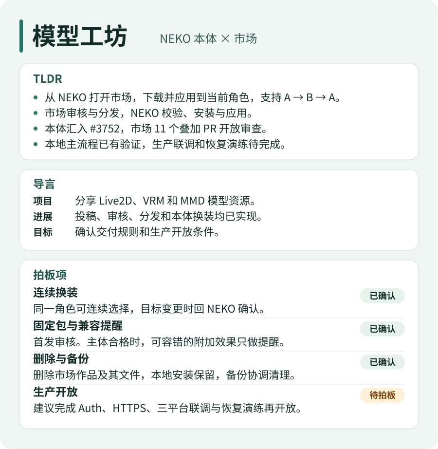

# 模型工坊开发报告 · NEKO 本体

## TLDR

- 从 NEKO「角色设置 → 角色外形 → 模型工坊」进入市场，点击「下载并使用」，即可给当前角色换装。同一次有效连接支持 A → B → A。
- 支持 Live2D、VRM、MMD（PMX／PMD）。市场负责审核与分发，NEKO 负责校验、安装、恢复及角色应用。分享范围限模型资源。
- 本体 N1–N4 已汇入开发 PR [#3752](https://github.com/Project-N-E-K-O/N.E.K.O/pull/3752)。本地单测和隔离浏览器已覆盖换装，真实 Auth、HTTPS 与三平台桌面验收仍待完成。
- **待拍板** 按完整实机验收结果决定何时开放生产联动。建议用同一次联调验证正常换装、角色冲突、断线恢复和原数据保留。

## 导言

**项目简介。** 模型工坊让用户从 NEKO 找到市场作品并换装。独立访问市场时可以把模型下载到本地。从 NEKO 打开工坊并建立有效连接后，本体会完成下载、校验、安装和角色保存，用户无需手动导入或再点保存。

**当前进展。** 截至 2026-11-27，本体的包校验、可恢复安装、既有模型管理接入和连续换装已经实现。NEKO 的合入入口仍是 #3752，市场使用独立的 11 个叠加 PR。两边的验证记录均包含限定环境的结果。

**本次要解决什么。** 确定本体与市场的职责、连接和失败恢复规则，并列出生产开放前需要共同验收的场景。市场的投稿审核、接口与运维见配套报告。 [市场开发报告](https://github.com/Project-N-E-K-O/N.E.K.O.-PluginMarket/blob/codex/model-workshop-m10-connected/docs/model-workshop-public.md)

## 拍板项

### 连续换装与角色绑定（已确认）

**现状。** 用户通过工坊换装时，NEKO 绑定发起操作的角色和数据目录。一次有效连接可顺序发起多次选择。

**选项。** 每换一次重新打开市场，或在原连接中为同一角色创建独立操作。

**风险。** 账号、角色、模型设置或数据目录在下载期间变更时，旧操作可能覆盖新的用户设置。

**成本。** 本体需要在已有角色保存锁内复核目标，市场需保留原操作回执，并等待本体确认可以继续选择。

**收益。** 用户能连续换装，重复点击和网络重试能查询原操作，避免重复下载或保存。

**推荐。** 沿用已确认规则。同一角色一次只处理一项替换，检测到目标变化时暂停自动应用，用户回 NEKO 重新确认目标。

### 模型兼容和原始文件（已确认）

**现状。** 必需资源完整且安全的 Live2D 模型可能带有内置加载器无法使用的可选动作或第三方配置。

**选项。** 拒绝所有偏离格式的模型，或允许主体正常展示的模型附带兼容提醒进入审核。

**风险。** 宽泛放行会引入损坏资源或加载失败，全部拒绝会挡住主体可用的常见模型。

**成本。** 需要跨两仓维护准入规则、兼容分类与正反例。审核时需在 NEKO 检查模型显示及相关动作。

**收益。** 作者可保留原始模型资源，用户能预先知道部分附加效果可能不可用。

**推荐。** 保持主体和安全边界严格。可容错的附加效果只提醒，市场作者与审核员可看明细，公开详情只显示简短提示。

### 生产开放条件（待拍板）

**现状。** 隔离环境已覆盖真实本体 HTTP、角色保存和主画面渲染。完整生产账号、代理及桌面链路的联合证据待补齐。

**选项。** 先开放模型联动并观察问题，或由两仓对同一套验收标准共同签收后开放。

**风险。** 登录令牌、浏览器到本机的连接及不同平台的存储行为存在环境差异，单仓回归无法覆盖全链路。

**成本。** 需要预发布市场、真实测试账号、Windows／Linux／macOS 客户端，以及能回滚、恢复的测试数据。

**收益。** 开放之前能验证普通下载和自动换装分别成立，失败时原角色配置和已安装资源可以继续使用。

**推荐。** 两仓联调通过后开放生产联动。验收证据关联构建版本、操作结果与日志。

## 总览图

## 方法

1. 以角色外形入口为起点核对本体路由、管理页、安装服务和原角色保存链，查明连接、文件、登记与角色绑定的责任归属。
2. 以正常 A → B → A 和角色切换、重复请求、中断、迁移冲突为验收场景，对照单测、真实回环 HTTP 与隔离浏览器结果。
3. 按 GitHub PR 的合入目标与提交 SHA 核对交付状态。将本地、隔离浏览器、GitHub CI 与生产实机验收分别记录。

## 详细结果

### 本体链路与目录

| 环节 | 实现与职责 |
| --- | --- |
| 打开工坊 | `templates/model_manager.html` 与 `static/js/model_manager/model-workshop.js` 提供入口。`page-controller.js` 负责挂载、页面编辑检查、应用后的原管理页重载 |
| 连接与接收 | `main_routers/model_market_router.py` 挂载本体端点。`services/model_workshop/market.py` 管理连接和选择，`download.py` 编排流式下载 |
| 包校验和安装 | `services/model_workshop/` 校验包、资源、哈希与容量，使用同一套暂存、任务、安装登记和恢复流程 |
| 角色保存 | `main_routers/model_market_application.py` 复用原 `update_catgirl_l2d`，在同一把角色保存锁内复核目标并记录实际提交 |
| 市场桥接 | `plugin/server/routes/model_market.py` 转发查询、选择和取消。后台包读取走 NEKO 既有桌面 OAuth，网页只获得配对后的命令能力 |

安装和应用是同一次用户操作的两个阶段。管理页在原加载流程完成且无编辑冲突后开放下一次选择。重新选择已经安装的固定包时，仍需核对当前市场权限和包身份，随后复用本地资源。再次选择当前正在使用的同一模型只返回结果。

### 连接与接口

| 入口 | 约定 |
| --- | --- |
| Main `POST /api/model-market/launch` | 校验本地请求后，捕获当前角色并获取一次性配对码，返回工坊 URL |
| Main `GET /api/model-market/launch/{request_id}` | 查询连接和当前操作。使用 `operation_id` 可查询原回执 |
| Main `POST …/select`、`POST …/cancel` | 选择体仅含 `operation_id`、`model_id`、`expected_sha256`、`byte_size`。取消只针对明确的原操作 |
| Main `POST …/apply`、`POST …/ready`、`POST …/invalidate` | 由本地管理页发起，分别应用、确认可继续、撤销连接 |
| Plugin `/market/models/launch/{request_id}` | 只允许已配对的受信页面查询、选择或取消 |
| Plugin `GET /market/models/descriptor/{model_id}`、`GET /market/models/package/{model_id}` | 只向受信本地服务提供元数据和模型字节 |

市场 HashRouter URL 使用 `model_origin`、`model_request`、`model_code`。配对码一次性消费，桌面 OAuth 令牌留在本体侧。连接最长 30 分钟，换装成功不会续期。每项操作使用独立的 32 位小写十六进制编号，重复提交相同选择回到原任务，同编号换包被拒绝。市场以本体返回的 `can_select` 为准，未知结果先查询原任务。

手动导入兼容 API `POST /api/model-market/imports` 继续接受单个本地文件。存储启动闸门先于导入接收保护，正文额度为 500 MiB 包加 1 MiB multipart 封装。本体路由和桥接各自保留身份、来源、CSRF 或本地服务证明校验。网页命令不接收任意 URL、文件路径或角色目标。

### 格式、来源和恢复

- Live2D 的主配置、MOC 和贴图必须齐全。部分缺失的可选效果、有界的动作统计差异、个别空曲线或内置加载器不使用的工具效果，按实际包生成兼容提醒。绝对路径、目录穿越、不安全 URL、损坏动作、缺少主体资源及超限包仍拒绝。
- 支持按角色校验 `FileReferences` 中引用的普通 JSON。Live2D 可携带有效的 `*.vtube.json`、`*.xyplugin.json`、`items_pinned_to_model.json` 与有限数值的 `parameters.json`。工具数据和模型资源原字节保留，第三方指令作为数据处理。
- 本体独立校验每个固定包的长度、哈希、清单和原生格式。VRM 检查动画、蒙皮和形变开销，显式形变权重须与目标数一致。MMD 检查骨骼引用、贴图及转换开销，先核对 TGA 的总解码预算，再扫描实际引用贴图的像素数据。发布时需对照市场产包版本验证一致性。
- 安装登记保存固定包身份、来源声明、安装身份和实际模型入口。半成品隔离，安装中断按任务日志恢复。参数保存发生在重新安装前时，旧请求不能覆盖新的安装。
- 存储迁移把安装登记和模型目录作为同源组合。未完成或不可读的安装会让启动时旧数据导入暂缓并保留原件，故障解除后可重试。迁移切换前再按实际来源检查，同步软件在复制期间写入的目标目录与原登记冲突时停止切换。
- 模型替换沿用已有展示刷新及通知路径，原角色的名称、人设、声音、记忆与来源信息继续保留。工坊与 Steam 发布、订阅及角色同步各自沿用现有链路。

### 失败结果如何解释

| 观察到的状态 | 本体与市场处理 |
| --- | --- |
| 下载或安装失败、提交前取消 | 保留原角色绑定，显示对应失败或取消 |
| 下载期间切换角色或出现编辑冲突 | 停止自动应用。已安装的资源可保留，用户回 NEKO 建立新的有效连接 |
| 角色保存成功，页面刷新失败 | 保留真实的已保存结果，先处理展示刷新。保存成功与模型已渲染分别验收 |
| 请求响应丢失、页面刷新或重复提交 | 查询原操作，复用已有结果。关闭页面不等于取消已受理操作 |

提交前重新检查运行根、同名角色是否仍是原角色、语音状态和角色配置版本。切走后切回仍构成上下文变化。按角色串行受理，不跨标签页并行覆盖同一角色。

### 交付与验证

| 模块 | PR 与合入目标 |
| --- | --- |
| N1 包格式与本地准入 | [#3752](https://github.com/Project-N-E-K-O/N.E.K.O/pull/3752) 开放审查，目标为 `main` |
| N2 安装、登记及恢复 | [#3755](https://github.com/Project-N-E-K-O/N.E.K.O/pull/3755) 已合入 N1 分支 |
| N3 既有模型管理与存储迁移 | [#3758](https://github.com/Project-N-E-K-O/N.E.K.O/pull/3758) 已合入 N1 分支 |
| N4 市场联动和连续换装 | [#4057](https://github.com/Project-N-E-K-O/N.E.K.O/pull/4057) 已合入 N3，再随 N3 进入 #3752 |

本体提交 `ff7949ff4` 的本地记录为 **2,275 项单测、37 项浏览器回归、12 项 Docker 配置检查通过**。4 项条件跳过，2 项因 macOS 文件系统差异排除。隔离跨窗口用例实际执行 Live2D → VRM → Live2D 的本地 HTTP、安装、角色保存及主画面渲染，市场数据和账号使用测试替身。GitHub 检查以对应提交页面为准。 [#3752 检查](https://github.com/Project-N-E-K-O/N.E.K.O/pull/3752/checks)

复验入口为 `tests/unit/test_model_workshop_formats.py`、`test_model_workshop_install.py`、`test_model_workshop_storage.py`、`test_model_workshop_market_apply.py` 与 `tests/frontend/test_model_workshop_crosswindow.py`。正式验收还需覆盖真实 Auth／HTTPS、桌面和浏览器入口、Windows／Linux／macOS、各格式连续换装、账号与角色切换、取消、超时和断线恢复。

## 结论

本体已实现从选模型到自动保存、展示及连续换装的链路。#3752 仍是本体合入入口。生产开放取决于两仓在真实账号、HTTPS 和三平台桌面环境完成联合验收。
