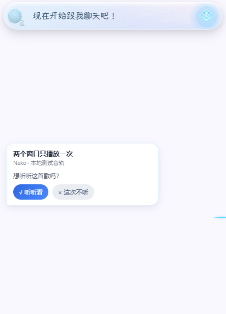
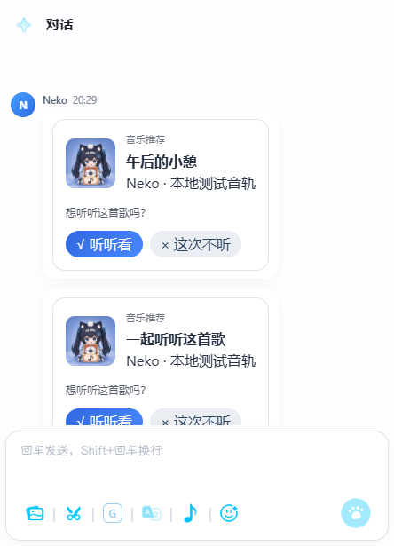
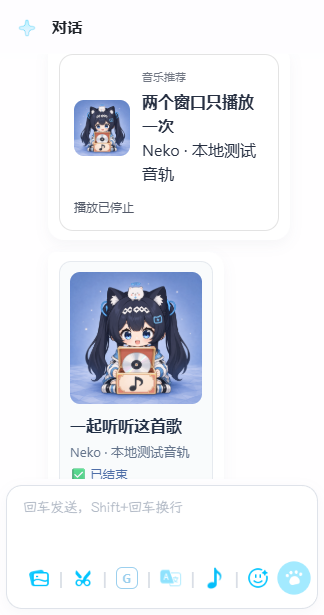
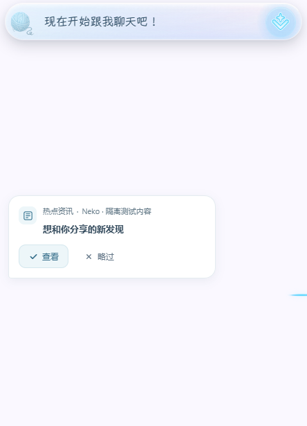
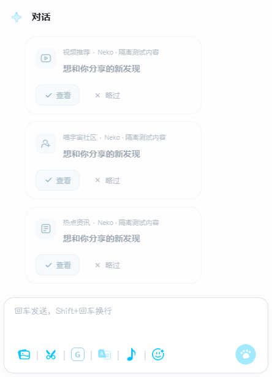

# 音乐推荐卡片与行为记录

第一版将主动音乐推荐从自动播放改为确认后播放，复用网页与 Electron 的 React 聊天渲染器及现有 APlayer。用户直接点歌与插件播放继续使用原有入口。

## 其他主动搭话的气泡与卡片

资讯、社区、视频、个人动态、表情包和网页分享等有实际来源链接的推荐，使用 `proactive_recommendation` 消息块。紧凑模式显示独立气泡，完整模式显示聊天卡片；两种展示共享推荐 ID、决定与跨窗口快照。小游戏邀请继续使用已有邀请组件及接受／拒绝／稍后协议。

- 有外链的内容提供 `√ 查看` 与 `× 略过`，决定持久化并取得 `action_grant` 后才打开。网页提前建立空白窗口以保留点击权限，保存失败或并发输掉决定时关闭；Electron 使用现有 shell 桥。外链失败不撤销已保存的接受决定。
- 表情包提供 `√ 看看`，接受前不加载图片。接受后可收起预览，收起状态同步到其他窗口，且不记录为拒绝。普通新对话结束紧凑预览，纯推荐记录不会错误地将它提前收起。
- 无实际推荐素材的普通搭话和提醒直接显示原有对话正文，不额外生成“主动话题”或空内容确认卡片，也不伪造推荐事件。屏幕观察是独立类型：确实使用截图且投递成功的无外链回合携带本轮回复，在紧凑气泡／完整卡片上提供“√ 感兴趣／× 略过”，记录选择但不自动发言或打开网页；反馈库只保留类型、身份、设置与行为，不保存截图、窗口标题或屏幕回复原文。历史通用话题卡片和无来源占位卡片继续隐藏。未知分类的真实链接按网页分享展示。

2026-10-19 屏幕观察补齐：此前移除通用占位卡时，URL 必需条件误伤无外链的真实屏幕回合。现在只从 committed delivery 的实际视觉截图事实派生 `screen_observation`，不从开关或普通 CHAT 标签推断；正文仅用于本轮界面展示。162 项后端定向测试通过，反馈路由与记录模块覆盖率 95.08%；完整前端 942 项 React、81 项控制器测试、类型检查及构建通过。首次 pytest 使用系统共享临时根遇到 WinError 5，改用本轮独立临时目录后通过。Electron 41.2.0 隔离 HTTP/SQLite、双 session 与桌面源码 IPC 验证 8 次曝光、5 次接受、3 次跳过，其中屏幕观察接受／跳过分别在紧凑气泡点击，完整卡片同步状态，外链派发仍仅 3 次，renderer 错误 0。证据 `%TEMP%/neko-music-smoke-xh_xcqwk/`，含 `screen-bubble-detail.png`、`screen-card-detail.png`。这次新增验收使用隔离视觉文案，不宣称真实模型截图到新版 UI 已实测；需刷新现有 Electron 页面，等待下一次真实屏幕回合。核心交付函数仅新增已交付视觉回合的 UI 字段，回归重点为无截图普通对话不误生成卡、带外链推荐不重复、授权撤回与账号替换仍拒绝过期选择；核心新增字段需 review。
- 通用控制器位于 `static/app/app-recommendations.js`，保留原音乐 API 与 outbox 键；`window.nekoRecommendations.offer(record, turnId)` 接收后端已经登记的推荐。任意编造 ID 的前端预览不能提交真实决定。
- SQLite schema v2 保留全部 v1 事实并添加独立上传队列，缺少类别的历史记录仍视为音乐；非音乐记录仅允许 `shown / accepted / skipped`。确认时重查对应类别开关、全局主动搭话开关及视觉隐私开关。本机增量读取接口沿用 `/api/proactive/recommendations/events`；云端事实接收与模型消费分开。

2026-10-19 移除无素材占位卡后复验：67 项记录／路由／静态检查通过，后端两个新增模块覆盖率 94.98%；完整前端 940 项 React 测试、80 项控制器测试及构建通过。真实 Electron 双窗口验证旧通用卡片与无来源卡片都不留空白历史行，真实新闻、社区、视频、个人动态、表情包和网页推荐继续展示并同步；6 次曝光、4 次接受、2 次跳过落盘，renderer 错误为 0。证据位于 `%TEMP%/neko-music-smoke-p4fbp4o3/`。主后端已重启，三个后端健康检查及三个聊天宿主路由均返回 200。全未提交分支图分析仍为 CRITICAL（51 文件、180 个已索引变更符号、24 条流程），新组件调用未完全索引，源码及定向整链路验收不能替代合并前全分支 review。

2026-10-19 推荐视觉调整：来源并入一行辅助信息，大号 emoji 改为统一线条图标，操作按钮使用浅色背景与明确的键盘焦点；完整聊天移除双层卡片边框，紧凑模式保留气泡。`表情包_2` 等自动素材编号只在显示层替换为自然分享文案，真实标题和行为记录协议保留，8 种语言与缓存版本同步更新。56 项相关界面测试、类型检查与构建通过；真实 Electron 双窗口再次通过曝光、确认、跳过、表情展开及窄窗口深色验收（6 次曝光、4 次接受、2 次跳过）。截图位于 `%TEMP%/neko-music-smoke-0_2nd8i6/`，含 `meme-bubble-detail.png`、`meme-card-detail.png` 和深色截图。独立 Chromium 网页验收同样通过，证据位于 `%TEMP%/neko-music-smoke-zxngebo4/`；运行中的 48911 已返回新样式、构建及中文文案。

本轮验证：248 项后端与聊天宿主定向测试通过，两个新增后端模块总覆盖率 94.61%；完整前端 41 个文件、933 项 React 测试和 79 项控制器测试通过，类型检查与构建通过。Electron 41.2.0 使用桌面源码 IPC 与两个隔离 session 验证 11 类推荐，最终 SQLite 为 11 次曝光、7 次接受、4 次跳过；外链实际派发到隔离接收器 3 次，并发接受只执行一次，表情包图片实际绘制后才截图。证据在 `%TEMP%/neko-music-smoke-jchwfu5t/`。音乐回归同样实跑通过，证据在 `%TEMP%/neko-music-smoke-6j0u_4ku/`。

网页 Chromium 实跑确认：社区卡片接受后才打开链接、紧凑资讯气泡略过不打开页面、4 条曝光／决定持久化，页面错误为 0；外部网址由隔离响应器接收。证据在 `%TEMP%/neko-proactive-browser-7a3e757a10ed4cada8d59d0d2afef8b0/`。这些验收未使用真实社区账号、LLM 或云端训练。开发分支主后端已重新启动，`/`、`/chat`、`/chat_full` 均返回新控制器与新构建资源；已有 Electron 页面需刷新加载。

本轮全分支图分析报告 51 个文件、177 个已索引变更符号、24 条流程、CRITICAL，包含此前音乐与小游戏修改，不能解读为局部低风险。新动态调用和未索引组件另做源码与整链路核对；图结果仍受现有索引覆盖限制，不作为全量清洁证明。请重点 review 核心记录模块中的类别隔离、开关门控，以及共享控制器的跨窗口决定、重试和页面恢复；改变核心模块的必要性是为各类内容提供同一事务证据链。此前自动展示的来源／图片现在提供明确选择，主要回归面是旧推荐兼容、共享聊天宿主和弹窗生命周期。

## 用户行为合同

真实 Electron 隔离用例的操作前后效果（合成账号与静音音轨；不是生产截图）：

| 紧凑模式待确认 | 完整模式待确认 | 接受并播放后的完整模式 |
|---|---|---|
|  |  |  |

| 新闻紧凑气泡 | 其他内容完整卡片 |
|---|---|
|  |  |

2026-10-19 真实 Electron 最终定位与显示验收：只凭 phase2 流日志缺少标签推断卡片漏判不充分。只读查运行库发现 17:28:02、17:30:13 等多个真实回合已有 vision 推荐，却没有 shown；因此这些轮次已经完成后端登记。实际 Pet DevTools 执行只读版本检查，旧 `window.nekoRecommendations.offer.toString()` 不含 `screenObservation`，React build 为 1792399416；确认运行页面未加载新前端。桌面源码 `protectWindowNavigationShortcuts` 会拦截 Ctrl+R/Ctrl+Shift+R，单独重启后端也不能替换已运行的脚本。通过各自 DevTools 的 `location.reload()` 更新 Pet 与 chat_full 后，Pet 的屏幕控制器检查为 true、React build 为 1792401177；真实 chat_full 已显示 17:36:28 的“总览计划”视觉回复卡片，含“√ 感兴趣／× 略过”。该内容来自真实屏幕与模型，未伪造新推荐或代点用户选择。后续触发中的 BM25 重复过滤／接管 pass 不应被误报为卡片交付成功。发布/体验说明须明确完整重启 Electron 或逐页 DevTools 重载，不能再把刷新快捷键当作已加载新脚本的证据。

2026-10-19 真实屏幕复测补漏：17:28:02 主后端已完成截图分析并流式投递 42 字，但视觉专用生成没有来源标签，`build_proactive_response` 的真实主通道为 `unknown`；上一轮 UI 标记仅接收 chat/vision，导致卡片漏出。现在把“确有已交付截图、正文非空、无外部链接”的 unknown 回合也纳入屏幕观察，不放宽普通无截图对话。增加 chat/vision/unknown × 有无截图／外链／空正文的回归组合，146 项交付、反馈路由与服务边界测试通过；核心调用链图影响 LOW（服务与 HTTP 路由），新测试未入图，已按 pytest 入口确认。核心条件需 review，模型无标签视觉回合列为真实验收重点。

- 完整聊天以卡片展示封面、歌名、歌手与 `√ 听听看`、`× 这次不听`。紧凑聊天以文字气泡展示歌名、歌手、提示与相同选项，不再在气泡里嵌套封面卡片。
- 紧凑历史收起时，最新待处理推荐显示为独立气泡，确认或跳过后收起；历史展开时，推荐直接融入已有聊天气泡。独立气泡加入已有桌面几何与命中区域协议，避免透明窗口裁切或鼠标穿透。历史选择与导出模式不提供推荐操作，其他历史按钮继续保持只读。最小化模式不弹出推荐。
- √ 只代表接受本条推荐。服务端先持久化决定，获得播放许可的窗口才启动这首歌；不会自动替换为另一首候选。
- × 记录跳过，不推断不喜欢。未操作保留为未响应；播放失败独立记录。
- `shown` 按页面可见性与卡片进入视口记录，表示页面渲染曝光，不等同用户已阅读，也不推断操作系统层面的遮挡状态。
- 同一推荐的决定只能提交一次。重试相同事件不会重复入库；另一窗口的相反选择不能覆盖已确认决定。
- 卡片有效期为 30 分钟。确认时重新检查主动搭话与音乐开关。生成期间切换账号时，不把结果归给新账号。

## 数据链路

`proactive_chat_flow` 在调用生成服务前固定账号归属，投递成功后为第一首音乐候选创建推荐。账号读取、身份复核和落盘与已有社区会话的写入锁串行，避免异步结果跨账号登记。没有社区账号时保留为本机匿名记录，登录后不追溯归并。

`main_logic/recommendation_feedback.py` 管理 SQLite 事务。推荐、决定与事件使用独立 ID，决定及其事件原子提交。数据库位于运行配置目录中的 `recommendation_feedback.sqlite3`，与角色对话记忆分离。所有数据库和文件操作在工作线程执行。

前端为曝光及播放事件保存有界 outbox；联网、下一次事件或页面重载时尝试补传，服务端按事件 ID 去重。每个事件使用独立的 localStorage 键，避免两个窗口覆盖彼此的待上传记录。接受决定保存失败时不播放，卡片保留重试入口。

卡片及状态复用播放器的窗口通信桥：网页走 BroadcastChannel，Electron 走现有 preload / 主进程 IPC，支持桌面浮层与全屏聊天窗口的隔离会话。窗口晚打开时请求最多 128 张推荐快照，仅补齐本地缺失的卡片，不回放音频；接收的状态同时更新待处理推荐的调度门控。

播放器仅为带推荐 ID 的播放额外记录 `playing / paused / ended / stopped / failed`。原会话感知协议保持不变。媒体自身结束才记听完，关闭或替换播放器记停止。`listened_seconds` 是浏览器 `audio.played` 各区间的长度之和，反映实际听到的媒体范围，不把拖动进度算成收听，也不累计重复收听同一区间；`position_seconds` 单独保存当前媒体位置。

## 本机增量读取与云端同步

`GET /api/proactive/recommendations/events?after=0&limit=100` 按插入序号返回当前账号的事件与 `next_cursor`；晚到事件也能通过增量游标读到。最多每批 500 条。读取和写入均要求现有 Origin 与 CSRF 校验。浏览器调用示例：

```js
const headers = await window.nekoLocalMutationSecurity.getMutationHeaders();
const data = await fetch('/api/proactive/recommendations/events?after=0&limit=100', { headers }).then(r => r.json());
```

事件包含推荐 ID、事件 ID、分类、账号及社区来源、角色、回合、推荐时间与过期时间、事件发生和接收时间、开关快照、歌曲元数据、播放实例、收听范围、媒体位置及失败原因。播放 URL 可能带签名，因此不写入训练记录；播放实例也不携带 URL。数据不含 OAuth token 或原始对话。

云端同步使用独立合同 `desktop-proactive-feedback-v1`，向固定社区 origin 的 `POST /api/proactive/feedback/batches` 上传事实，不复用 private-chat 或社区卡牌曝光协议，不修改赞藏或兴趣权重，不调用模型训练。上传前复用 OAuth 单飞刷新并核对社区 `/api/users/me` 的权威用户；账号或来源不一致保留原记录并停止该批次，匿名历史不追溯归并。

推荐登记和事件与 SQLite outbox 同事务提交，无曝光/操作的推荐也登记。批次发送前冻结 ID、成员、原始 payload 及摘要；云端全批事务入库和回执同时提交，本地只按精确成员与摘要确认。网络失败和丢回执重传原批次，409/422 保留并阻塞，不把最大序号前的记录一概清除。推荐有效期只约束新决定，不能拒绝已有事实的迟到补传。旧音乐继续播放时，仅补入数据库真实存在的原接受事件作为依赖，不自动上传所有旧历史。

开关变更由偏好中央保存入口生成中立 journal，与配置在同一次原子 JSON 保存中提交，仅采集明确的 10 个布尔开关与 2 个整数间隔。同值/CAS 冲突不记变更，首次值记 baseline，系统回滚记 system；保存前固定原账号。worker 先将原 ID/body 持久化到 SQLite，再精确确认 JSON journal。导入容量不足不阻塞已有队列上传，重启或 JSON 确认失败不丢失/重复。journal 不进入普通偏好 API 或云存档，存档恢复和本地目录迁移保全本机待发记录；恢复的 staging/apply/rollback 与普通保存共享锁。

本机 `GET /api/proactive/feedback/status` 与 `POST /api/proactive/feedback/sync` 使用现有 Origin/CSRF 校验。`success` 表示诊断调用完成；实际上传看 `state=synced`。`local_queue_empty` 单独表达当前账号 SQLite pending、JSON journal pending 及导入/阻塞错误均已清空；`fully_synced` 还要求当前登录身份已校验、已有云端精确回执且未处于上传维护暂停。未登录或从未上传不能报全部同步。此字段不是独立云端验收或备份证明。worker 在存储选择 barrier 成功后才启动，退出取消并关闭自有资源；不改变主动搭话或视觉权限默认值。

当前限制：设置范围是来源设备的观测快照和变更，不自动覆盖其他设备；云存档恢复本身暂不新增 system 变更事件，只保全已有 journal。收听度量为同一播放实例的媒体区间覆盖累计快照，不能相加；进程异常退出不能补造终态。旧元数据哈希不冒充平台原生内容 ID，屏幕内容身份为空。上线前必须核对生产迁移链和实际接口；隔离验收不代表线上已经部署。

2026-10-19 入云验收：本地 Store/HTTP 定向 86 项通过，记录与路由合计覆盖 95.24%；上传 runtime/router/生命周期 57 项通过，相关模块覆盖 96.83%，既有聊天同步 router/scheduler 116 项回归通过。设置、云存档与迁移相关 283 项通过/2 项跳过，审计与共享锁覆盖 98.92%，移除恢复锁的反证用例准确失败。云端 SQLite/PostgreSQL16.15 矩阵 52 项通过/3 项跳过，Windows 生产模块覆盖约 98%，既有推荐/认证定向回归 113 项通过/3 项跳过；真实跨仓库 Store/runtime→HTTP→SQL→ACK 已验证音乐、开关、重启和丢回执幂等。测试只用合成账号/隔离数据库；Linux Python3.12.3 原生覆盖扩展崩溃的失败与未开覆盖的 PG 实跑分别保留，覆盖统计取 Windows。首次跨仓库测试曾因系统 pytest 临时目录权限失败，使用独立 basetemp 后通过。

Electron41.2.0 双窗口隔离复验：音乐 11 条推荐/12 条真实行为全部进入 outbox，8 条无事件推荐仍登记；其他内容 11 条推荐/16 条行为全部入队，3 条无事件推荐仍登记；两端实际 payload 通过云端 schema 且 canonical hash 相同，无 URL/token。证据 `%TEMP%/neko-music-smoke-c8m6ezl3/`、`%TEMP%/neko-music-smoke-25slp9p9/` 的 result.json 和 outbox-verification.json。生产环境未迁移、未发布，模型训练未接入。

最终复验：合并后的本地专项134 passed/94.27%覆盖；跨仓库实际SQLite/PostgreSQL闭环6 passed，日志 `%TEMP%/neko-proactive-cloud-roundtrip-20261019-b813ad9.log`。本地完整功能分支图73文件/555符号/24流程、CRITICAL（含此前UI），云端13文件/220符号/0已索引流程、LOW；重新索引后包含新文件，但流程提取仍有预算截断，未将零流程当作无影响，发布前须review核心保存、恢复、启动与鉴权事务。

## 容量与验证边界

本机最多容纳 10,000 条未获云端逐项 ACK 的推荐、100,000 条未获 ACK 的事件，以及 100,000 项待上传事实。配额按所有本地账号计，使用与事实/ACK 同事务的 SQLite 计数器；ACK 释放配额，保留全部本地历史、播放依赖和幂等回执，不自动 GC。匿名和旧版本地历史没有自动上传授权，仍计入未确认配额。status 暴露 retained/awaiting_ack、最老待传时间、未知时间数、数据库字节和 512 MiB 提醒；这不是无限磁盘保证。前端每窗口最多暂存 256 个待补传事件。未知数据库版本保留原文件并拒绝处理。

## 阻塞恢复、维护与回退

409/422 不会自动解除。先修复拒绝原因，再读取当前账号 status 的 `owner_key`、`batch_id`、`batch_hash`，通过现有安全请求头调用 `POST /api/proactive/feedback/resume`，JSON 仅含这三个字段。接口重新校验 OAuth/权威账号，并在凭据锁内核对当前 token 和冻结批次摘要；不改 ID、body、成员或证据。旧快照、换号、错误摘要和重复恢复返回冲突。恢复仅表示允许重试，必须继续观察同批次上传与 ACK，不等于已入库。

`NEKO_PROACTIVE_FEEDBACK_UPLOAD_PAUSED=1` 在创建 runtime 时生效，暂停 OAuth/上传，继续本地记录和 journal 导入，不改变用户开关。解除变量并重启同 schema-v2 兼容版本恢复上传。回退到旧 v1 不受支持；禁止降低 `PRAGMA user_version` 或覆盖新库来假装兼容。

独立保全工具：`uv run python scripts/backup_proactive_feedback.py --database "<运行配置目录>/recommendation_feedback.sqlite3" --output-dir "<必须不存在的备份目录>"`。以 SQLite 只读在线 backup 获取一致快照，校验完整性/FK，计算 SHA256，最后原子发布 `manifest.json`；只有完成清单才表示成功。失败保留快照、临时清单及 in-progress 标记，不改 live、不自动恢复。合作式时限覆盖复制/校验/计数/哈希/发布前检查，单次 OS 文件调用不能强制打断。备份含私有事实，目录仅供本人/运维访问。

`last_acknowledged_batch.receipt` 保留当前账号最近的完整原回执。可导出后用云端同版本 `scripts/verify_proactive_feedback_receipt.py`，经固定社区域名和真实登录读取 `GET /api/proactive/feedback/batches/{batch_id}`，逐项核对同一原回执；不上传合成行为，不访问其他账号。真实 OAuth、正式安装包与生产代理仍须上线试点单独验收。

本轮发布可靠性最终验证：桌面联合204 passed/96.94%覆盖，随后新增深JSON恢复入口护栏的整路由19 passed；云端SQLite/真实PG16.15与跨仓库/迁移工具联合107 passed/5 skipped。恢复入口真实HTTP由深嵌套JSON的500变为422，未调用runtime。独立agent复核容量/备份28 passed，无确认的新问题；不以这些合成认证测试代替真实OAuth/安装包。完整合成PG备份恢复7表结构、逐行摘要与计数一致，生产快照和完整历史差额未验。核心Store修改使ACK释放配额、恢复重试保留原body，需重点review事务计数器、旧v2兼容触发器、账号/token fence和备份失败保全。

最终图检查强制无解析缓存重建，解决增量漏类方法映射；全功能分支76文件/711符号/24已抽取流程，CRITICAL影响规模包含此前全部UI。关键恢复/容量/备份及最后深JSON测试均映射正确；detect输出无partial/truncated标记不代表全仓流程完整，工具候选/深度/分支预算仍截断。证据 `%TEMP%/neko-feedback-desktop-detect-forced-final-20261019.json`。本轮未commit/push或操作生产。

Draft交付更新：桌面 [#3467](https://github.com/Project-N-E-K-O/N.E.K.O/pull/3467) 与云端 [#401](https://github.com/Project-N-E-K-O/N.E.K.O.Verse/pull/401) 已提交推送，均以main为目标且保持Draft，生产未操作。提交前桌面相关226项、React/播放器回归及构建通过。首轮CI发现services反向导入main_logic的真实分层错误，已把具体Store与runtime工厂组装移至main_routers，服务只接收Store实例；启动存储barrier、取消无HTTP泄漏和暂停语义保持不变。完整模块分层守卫及相关生命周期回归需随此修复重新验收，不通过降低分层规则绕过。

单元与 HTTP 集成覆盖原子确认、重试、账号替换、禁用开关、过期、数据保全、容量回滚、非法输入和终局状态。`tests/frontend/run_music_recommendation_smoke.py` 用隔离账号、配置、SQLite 和静音 WAV 音轨运行真实 HTTP/APlayer 验收，可传入 Electron 可执行文件，或使用 `--serve` 在浏览器中验收。Electron 模式使用两个隔离 session，并加载桌面仓库现有的 preload 音乐桥及 IPC router；默认从桌面仓库内的 Electron 可执行路径推导源码目录，也可设置 `NEKO_MUSIC_SMOKE_PC_ROOT`。未打包的测试 preload 使用 `contextIsolation: true`、`sandbox: false`，窗口隐藏且静音。截图、事件数据库等输出均在独立临时目录；验收不使用真实账号或 LLM。

## 回归报告 / Regression Report

- 基线为 `upstream/main` 的 `30c6d7556`，开发分支 `codex/music-recommendation-feedback`。此前主动推荐会立即派发候选音轨；现在先生成有账号归属的卡片，决定落盘并获得许可后才播放。核心新增事务记录模块的必要性是将接受、跳过和实际播放区分开，并在重试和多窗口操作下保留唯一决定。
- 后端相关 147 项定向测试通过；新增后端模块覆盖率约 95.8%。桌面修复后另复验记录/API/音乐静态契约 35 项。完整前端 `npm test` 通过：39 个测试文件、905 项 React 测试和当时的 68 项播放器/卡片控制器测试；补充迟到响应竞态后定向套件共 70 项通过。主动搭话调度 15 项 Node 测试通过，类型检查和构建通过。控制器测试已加入现有 CI 调用的 `test:music`。
- 浏览器整链路实跑：展示和跳过均未创建音频，确认后实际播放，完整 3 秒音轨落盘 `shown → accepted → playing → ended`，记录实际收听 3 秒。另一次实跑确认暂停及手动关闭分别为 `paused`、`stopped`；340 像素宽度下卡片无横向溢出。数据来自隔离测试账号与静音 WAV。
- Electron 启动失败根因为测试启动参数中的 URL 未用 `--` 与 Electron 选项分隔。最小探针对照显示：原参数在主脚本执行前退出 `4294967295`，加入分隔后成功进入主脚本。截图路径另有离屏渲染 `UnknownVizError`，测试改为普通隐藏窗口。启动器现在校验进程退出码及 renderer 的结果文件，避免假绿；中文诊断按 UTF-8 读取。
- Electron 41.2.0 实跑通过，使用桌面源码原有 IPC 桥与两个隔离会话：三张卡片逐张滚动曝光、曝光全局去重、晚打开窗口补收、跨窗口跳过、确认后单实例播放、暂停/恢复/听完、双窗口并发确认、实际点击关闭和双端移除播放器。340 像素窄窗口无卡片横向溢出，renderer 错误为 0。退出 Electron 后重新打开 SQLite，确认 3 次曝光、2 次接受、1 次跳过、3 次播放、1 次暂停、1 次听完、1 次停止；完整收听 10 秒落盘，训练记录未包含音轨 URL 或账号 token。原先只用 BroadcastChannel 的反证测试在跨隔离会话同步阶段超时，修复后同一验收通过。
- 本次桌面证据为真实 Electron 引擎、桌面 IPC 源码与共享 React/APlayer/HTTP/SQLite 链路；尚未验收完整安装包、真实社区账号、真实音乐源和 LLM，也未接云端模型训练。2026-10-19 最终截图与事件证据位于 `%TEMP%/neko-music-smoke-xns6rf_p/`，包含进程退出后的 `durable-evidence.json`。
- 上一轮 GitNexus 增量索引曾出现符号与文件错配，未采信其低风险结果；强制重建且禁用解析缓存后，该轮全量变更分析返回 183 个变更符号、8 条受影响流程、32 个文件、HIGH，`partial=false`、`truncated=false`，符号与文件错配为 0。全文检索构建此前失败，重建显式跳过 FTS；流程图本身仍受工具默认入口与深度预算限制，动态 JSX 消费者另做源码核对。主要回归面是共享播放器生命周期、调度与多窗口 UI。请重点 review 播放替换/关闭、账号归属和跨窗口确认，再进行桌面分发验收。
- 紧凑/完整展示修正后，完整前端套件 908 项 React 测试、70 项音乐回归通过，类型检查与构建通过。真实 Electron 41.2.0 验证紧凑独立气泡、切换为完整卡片，以及气泡与卡片之间并发确认只播放一次，行为记录仍为 3 次曝光、2 次接受、1 次跳过。隐藏测试窗口截图另加像素可见性等待，避免仅 DOM 已更新但仍截到上一帧的假绿。两种展示截图在 `%TEMP%/neko-music-smoke-hk7b43c8/`，分别为 `recommendation-compact-before.png` 和 `recommendation-before.png`。
- 小游戏邀请原本仍使用 composer 底部三选项。本轮补充共享 `MiniGameInvitePrompt`：compact 在原定位层显示气泡，full 在聊天滚动区显示卡片，接受/拒绝/稍后均沿用现有邀请响应与 resolved 通知，未改动小游戏后端记录协议。邀请解决后卡片移除；本轮没有新增小游戏决定的历史卡片或推荐训练事件。同步补齐透明窗口 native/hit 区域、引导选择器、8 个 locale 和语言缓存版本。
- 本轮 `npm test`（含新增 10 项邀请界面用例、70 项音乐回归）、类型检查、构建及 96 项聊天宿主检查通过。独立 Electron 41.2.0 使用真实 React、邀请 controller、几何计算代码及隔离 HTTP fixture，验证完整卡片、紧凑气泡、原生鼠标点击、三种响应参数、accept 单窗口、resolved 双端移除、503 后恢复重试、窄窗口/深色布局，以及引导识别三种按钮。fixture 只模拟服务端响应和 resolved 事件分发，不代表真实账号、游戏运行或新训练记录已验收。证据在 `%TEMP%/neko-game-invite-smoke-ujlfqqeq/`，包含三种布局截图、`compact-geometry.json` 和 `result.json`。运行中的 `48911` 后端返回的新 bundle 已含邀请组件。
- 扩展引导检查共 103 项，96 通过、7 失败。将本轮修改的引导实现替换为 HEAD 原文再运行，失败名称和数量完全相同，属于本轮修改前已存在的失败；没有宣称全量 CI 通过。GitNexus 修改前对 compact 挂载的影响为 LOW（1 个调用方），几何计算为 LOW（6 个上游符号）；full/JSX 和动态引导调用为 UNKNOWN，已补查实际入口。整个未提交分支的图变更分析为 CRITICAL（含既有音乐推荐和大型聊天宿主修改），应继续按全分支范围 review，不将局部验收当作整个分支的低风险证明。
