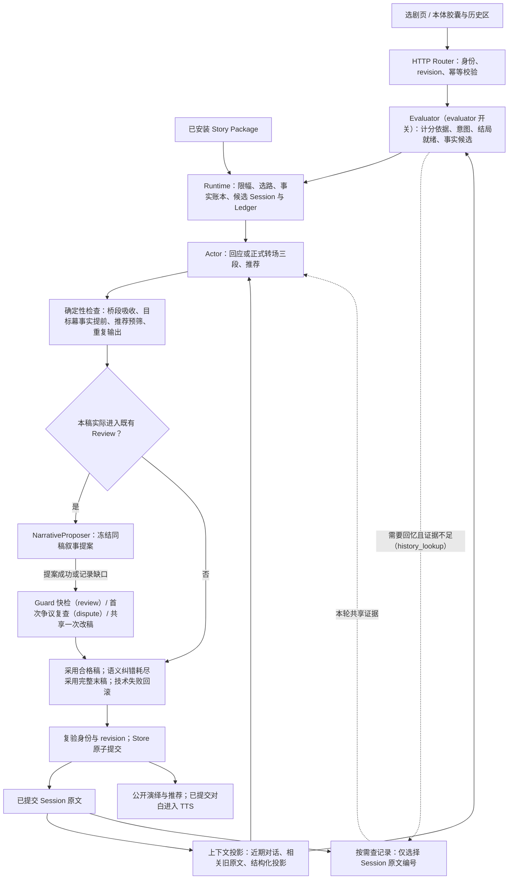
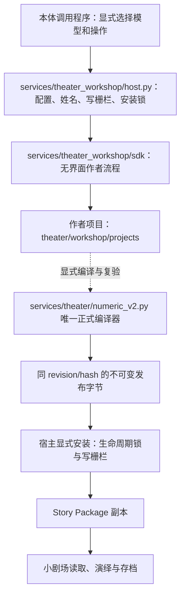
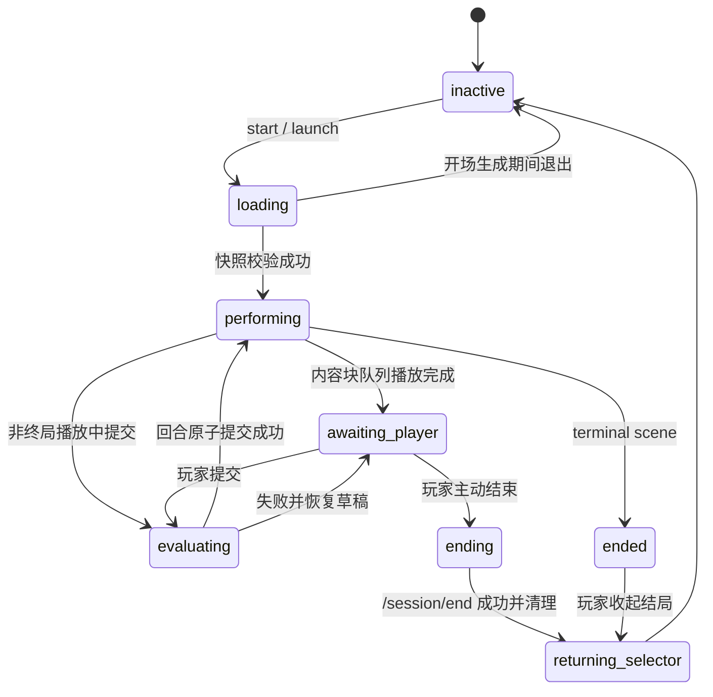

# N.E.K.O 小剧场架构

状态：Numeric v2.2。[Actor 与叙事提案职责拆分](./neko-theater-actor-responsibility-split.md)已实现，程序检查完成；真实回合、质量、容量和时延结论以仓库外验证报告为准。本文记录当前合同与实现边界，模块与权限、数据合同、回合流水线、复核、生命周期与事务仍以代码和测试为准。

| 需要了解 | 入口 |
| --- | --- |
| 当前运行、数据、前端合同 | 本文 |
| 为什么这样设计、否决过什么、仍未验证什么 | [小剧场设计决策记录](./neko-theater-decisions.md) |
| 剧本工坊 SDK 的调用、宿主与发布合同 | 仓库 `services/theater_workshop/README.md` |
| 各阶段 Token 上限的汇总 | [LLM Prompt 预算](./llm-prompt-budget.md) |
| 本轮职责拆分方案、调用与交付边界 | [Actor 与叙事提案职责拆分](./neko-theater-actor-responsibility-split.md) |

实现存在不等于体验已验收；未覆盖的范围集中列在决策记录的“已知风险与未验证范围”。

## 当前临时策略：速度优先

运行时已按用户要求暂停前台模型审核。`numeric_v2_options.MODEL_REVIEWS_ENABLED = False` 暂停前台审核，恢复为 `True` 后全部前台审核模块启用；HTTP 的后台动态账本也已关闭，不生成新提案或进入下一轮账本等待，保留既有账本和原文历史。剧场设置及其入口、设置页面、读写接口已删除；默认模块表为全开，当前有效配置关闭 `review`、`dispute`、`review_contract`，不再读取旧开关值，也不修改旧设置文件。

开场、普通回复、正式转场的完整审核、玩家动作归属短审、争议复查、Evaluator 完成事实复核、Actor 新事实与邀请短审均不调用。公开链路已删除“重新邀请”恢复按钮与能力字段，新恢复请求会被拒绝，旧记录和回执仍可读取及幂等恢复。普通路径的推荐采用同次 Actor 生成结果，空推荐允许玩家自由输入；`fixed_entry_only` 非终局入幕可复用既有推荐补全，终局不补。没有待确认或已撤回邀约、已声明的幕完成条件尚未满足、且本幕及其出口不涉及结局时，普通回合由一次 Actor 调用同时返回演出与 `turn_evaluation`（当前互动收束信号、按作者准则提出的指标变化、当前输入或本幕已演原文支持的完成事实）。程序复用原 Evaluator 解析和 Runtime 数值结算，历史引文必须同时出现在本次实际保留的历史和当前访问的已提交演出中，不能引用作者模板；新正文事实仍走原证据校验。该提案无主动换幕或结束权限，不写入演出历史或客户端响应。未声明完成合同的旧剧本保留前置 Evaluator，继续判断玩家主动前往已公开地点的请求。场景已完成、邀约解释、换幕、结局及恢复完整审核后的回合保留前置 Evaluator → Actor；正文已公开邀约但标记缺失时，接受表达须通过原有逐字公开原文和出口一致性检查，按正常主动出发承接；结构失败或程序规则触发的原有重写仍可能增加调用。

普通／正式正文审核输入容量由 8500 提到 10000 Token，Actor 原本即为 10000；判定与其它非审核调用的预算不变。剧本编译、类型／原文证据检查、状态与事务提交保护保留；Evaluator 事实按原程序校验处理，Actor 事实通过原白名单及证据校验后提交，不伪造模型批准结果。条件固定旁白沿用无前台 Review 的原有行为。未改存档结构，不恢复预生成。

全局暂停审核时，Actor 正文中的明确邀约及其标记按原邀请记录保存，不再因缺少该模式下不会生成的审核回执而撤下；下一轮仍由 Evaluator 核对玩家接受范围并经 Runtime 路由。审核启用时的模块关闭／降级保守规则保留。合并普通回合若把逐字引用本轮玩家输入的事实放进正文事实字段，只将它转交既有 Evaluator 事实校验，不视为角色新演出的结果。反之，`turn_evaluation` 中的引文若不属于玩家输入或保留历史、却逐字出现在本轮可见演出中，转交既有 Actor 事实校验，不能用于本轮提前换幕。两种纠正都不绕过键、值、证据和路线条件检查，不增加模型调用。

Actor 的事实输出要求逐项登记本轮已演出的合同结果，包括角色、NPC 与环境变化，不等整幕完成才上报；没有实际结果仍返回空数组，不为填字段补造正文。该提示不替代原文与类型校验，也不保证模型绝不漏报。

霓虹普通结局的既有入幕固定原文同时回顾本地脉冲造成近处追兵装备失效、核心历史记忆区烧毁与休眠，再承接数月修复后的结果。它依赖进入该结局的路线仍要求预案公开与超载实际执行；技术反攻的另一结局不复用此段。此处由作者确定并保证关键后果可见，不代表运行时已证明自然语言结果语义，也不增加玩家动作、事实键或路线门槛。

普通回合现在按正文回应、`transition_offer` 邀请文字、推荐的顺序生成。邀请字段为空表示本轮不邀请；非空时先与回应合并，通过同一发声与格式校验后，程序派生原有 `transition_offered` 标记。推荐须承接实际公开的安排，不能首次在推荐里提出下一阶段。非空只证明文字交付，不证明安排正确，也不授予玩家接受或换幕权限；下一轮仍走原 Evaluator 与 Runtime。解析时的格式来源标识由 Workflow 当轮消费，不进入客户端或存档，开场、重邀与正式转场格式保持原状。

普通正文不再受“一个即时动作、最多一对动作括号”的提示限制。角色已经决定、无需新选择的连续行动及其确定直接后果，可在同一 performance 中按因果顺序完整交付；独立 NPC／玩家动作和对白仍不属于角色动作，独立场景事件继续走 scene_update。解析器原有多动作块与16块上限、发声策略保持，开场和正式转场未扩展。该提示约束仍需完整实演审阅，不是程序语义证明。

猫灯第六幕入幕固定公开纪念与互助空间的具体提议，玩家随后可以支持、拒绝或提出替代；不把模糊的改造意愿当作已经听过用途。摘要只描述带回已找到的日记与怀表，是否摆放由实际历史决定。

霓虹照护出口明确：公开“休息到明早再一起到工作台”的整体安排后，玩家同意或开始第一步可接受整体安排；未公开安排时，单独感谢或休息不授权换幕，等待由接受后的桥段经过。

采用新邀请字段的普通回合不再自动追加作者备用邀请，包括字段为空或后续邀请被裁掉的情况，避免覆盖动态安排或补出第二份安排。旧布尔输入仍兼容原解析与备用邀请：完整审核暂停期间，已声明完成事实全部满足，或旧包没有完成合同且原判定未降级、明确scene_complete=true、Actor未邀请时，可展示既有作者安排并将对应接受输入放在首项。原有拒绝、撤回、离场、路线、禁言、终局及事实先校验等保护不变。新格式漏邀可能延迟推进，须在完整实演中检查，不能靠计时或原文指纹推断邀请成立。

事实定义可选 `evidence_source: "performance"`，只允许新正文或已提交演出原文作为该事实的证据。玩家命令、许可及 Runtime 状态投影不能证明角色或环境结果；旧包未声明时保留原来源权限。工坊主线与支线的 `completion_facts` 可声明同一字段，导出后保留；玩家自身选择和动作省略该限制。它限制证据来源，不保证模型对正文语义的判断必然正确，不改变存档事实结构或增加审核调用。

普通 Actor 提示聚焦当轮回应和完整因果过程，保留玩家行动权、认知、物品归属与跨阶段边界。已有 `narrative_focus` 作为带数据边界的本幕导演资料进入 System，不再与节奏备注重复；它要求角色及环境在前因具备时主动交付必要内容，不授予新权限，也不证明结果已经发生。推荐只能使用已公开的工具与能力，同类连续工作可完整实施，不逐件生成等价按钮。普通 Evaluator 合并重复的出口说明，为原文留出容量；容量不足时先将辅助流程摘要限于当前访问、把相同的结局来源规划改为当前幕规划的显式引用，并省略无记录且无事实的空账本封套，再按原规则裁较早完整历史；仍不足时，可省略整份辅助进出幕摘要并标明容量省略。完成事实、已提交事实值和合同不在该摘要内。当前玩家输入、最近完整演出、路线条件与存档不变；输入上限仍为7000 tokens，Actor仍为10000 tokens，不增加判定调用。

新生成的正式入幕稿若在场景文字首尾逐字包含同容器的程序固定原文，且去掉该全文后仍有独立场景文字，Actor只去掉这一整段重复。固定片段及其展示记录不改，部分引用和全文即场景的旧兼容路径保留；存档读取与历史渲染不执行新改写。人设仍影响关注、判断和自主反应，但姓名与人设字段不证明剧中身世或技术来源。

固定原文的入幕提示明确分工：模型场景旁白建立原文之前的地点和氛围，程序随后交付原文，角色从交付后的状态回应；换词复演同一动作、对白或结果也不合要求。该提示不等于语义去重保证，原逐字去重仍只是确定性保护。

正式目标入幕存在尚待程序交付的entry原文时，模型目标旁白可空；目标表演仅交付作者开场要求、原文尚未承担的新回应。作者对白策略为optional或forbidden且原文已完整交付开场时，目标表演留空，等玩家回应后再表演；纯环境原文仍保留作者要求的必要发问，required对白不省略。原文缺失仍拒绝提交，无entry的普通入幕保持原要求。Schema、Parser、Runtime与Store维持既有格式，不增加字段、审核或调用。正式entry的System集中说明播放分工，actor_note只发送原文封套与仍适用的条件门槛，避免重复整段说明。程序原文以可逆JSON资料封套交给Actor，条件原文继续隐藏；入幕自动交付不再被提示为尚需等待的条件片段。

作者可显式为路线声明 `transition_contract.fixed_entry_only: true`，由完整 `entry` 原文独立承担目标入幕；编译要求目标发声策略为 `optional` 或 `forbidden`。此模式只在该原文尚未展示时启用，来源 Actor 保留实际玩家问题、来源权限、人设和历史，只生成来源回应及桥段，不接收目标开场、状态、知识或原文。Schema 与 Parser 要求目标两字段及推荐为空；程序沿原三段格式插入原文一次，非空模型目标稿仍拒绝。非终局复用现有推荐补全，可能多一次推荐调用，计入既有调用诊断；终局无推荐调用。缺省、false 与原文已展示的再访保持原生成链路，不扩大到所有 optional 或固定旁白节点，不改变后续普通回合、Runtime/Store 结构与预算。工坊主线使用来源 `exit_plan.fixed_entry_only`，支线使用对应 `transition.fixed_entry_only`；必要环境也要由原文完整交付，局部资料不应开启。声明不会自动迁移已安装包或旧存档。

带程序入幕原文的正式转场使用精简的同序播放说明，保留来源回应、具体NPC答复、授权桥段、原文前后分工、实际持物和玩家选择边界，省去重复的通用开场说明。该修复当时的原9975-token格式失败案例以9982-token首稿与9999-token重试完成提交和冷恢复；后续通用提示精简后，以新的实际输入审计和回归为准，不再宣称提示逐字不变。不扩大10000-token上限，也不把定向重放计为整剧通过。

正式转场的桥段泄漏修稿只把错误位置与修正要求放进System。旧稿按三段正文白名单投影为未提交编辑附件，在原合同、玩家输入及近期历史完整装箱后，仅用剩余额度附加；放不下则整份省略，不截断原稿、不为附件额外淘汰历史，也不携带固定原文、事实候选或批准。普通修稿复用同一余量附加逻辑，两种回合仍保留各自的上下文适配；既有一次修稿和失败回滚不变。

正式转场还用既有80-token短正文边界检查入幕原文长段复述：模型旁白或表演中连续完整原句、以及整段对白若逐字来自同段entry原文，进入原有重复输出重试；改了开头一句也不能掩盖长段照抄。此外，入幕原文中至少20个字母、数字或汉字的完整引号台词、或至少20字符的整段原文若被模型逐字复抄，也进入同一守卫，给整段加动作前缀不能绕过。省略号与引文标点不计入台词长度，避免短日期车次记录仅因省略号被拒。短引用、条件原文、仅语义相似的改写和客户端已去重的全文即场景路径保留；不改固定原文、旧存档或增加重试上限。

玩家原话复抄守卫保留至少10个有效字符的整段台词检查；另对同时含动作与对白、合计至少16个字母数字汉字的完整同文检查，忽略空白与标点，防止长动作加短台词绕过。只共享动作或简短互相附和仍允许，不作近义或语义相似判断。命中后进入既有重复输出重试，不静默删稿，不增加重试次数；旧存档不重写。

普通 Actor 装箱时，事实索引中同回合、同来源、同次访问且已完整保留在近期历史里的原文只发送一次；近期回合被整轮移除时，索引恢复对应原文。不同来源、访问、回合或部分相似引文不合并，不改写已提交历史。谨慎性格不自动建立新的危险、手续或资格门槛；工坊完成事实按单个可观察结果编写，具体导演重点说明待演事件及其收束方向。

索引与检索附件共同挤占最终请求时，索引复用原相关性及较新更正优先级，按实际剩余容量重新选择整条原文，再用余量重选检索附件。索引保留省略数量与最新缺口回合，不截句或把遗漏视为完成；固定角色、场景合同、当前玩家输入及最近完整回合不删，仍超限则拒绝发送。输入上限不增加，原存档不改。

历史邀请的撤回记录不再把后续每轮软节奏强制标为“当轮拒绝”；当前明确拒绝仍停止催促，历史撤回继续阻止确定性／自然收束合同自动重提旧邀请。玩家重新问安排或情境变化时可按当前意图商量新的具体安排，仍须公开并取得接受，不自动换幕，不修改邀请记录或路由授权。

提示词将接受公开安排与完成转场桥段分开：同意完整的过夜及次日出发安排可以授权相应桥段，单纯等待、准备或只同意其中一步不补全授权。普通回合不提前确认下一时段，时间沿实际演出承接。未知玩家称呼在作者资料投影中写为“玩家”，保留原始对白和显示称呼；NPC 接物、答复归属明确写入旁白，不能变成演出角色本人。超过软节奏时仅概括已获授权且无新选择的连续过程，不通过回合数强制换幕。上述提示约束不等同于语义质量保证，真实表现以对应压测记录为准。

HTTP 当前固定传入 `background_narrative=False`，与直接工作流默认值一致；前台审核继续关闭时，不调用动态叙事提取或账本专用复核，不创建新的后台 pending 任务，也不等待它们。旧存档若遗留 `narrative_pending`，下一次输入前取消仍在运行的提取任务，并用既有缺口结算移除该派生标记后重读；不等待模型、不改原文、不创建新任务，避免旧标记随下一轮追加后破坏存档校验。已保存的账本不删除，近期原文、相关旧原文和 Runtime 投影继续提供上下文。后台账本实现及其原有24秒任务／下一轮1秒等待保护保留供显式测试，不恢复预生成。

下文保留完整审核实现的说明，审核调用流程在暂停期间不执行。

当前角色归属与换幕修复沿用上述速度优先边界：Actor 的 `player_input` 是对方发言，`performance` 是当前猫娘回应；整段复制玩家长句（忽略标点与动作）的对白或旁白进入既有重复输出守卫及一次重试，短确认、纯动作和包含独立答复的正常引用保留。旁白与三段转场按同一规则核对，不新增补推荐或审核调用。

已获准的自然结局若目标发声策略为optional／forbidden，最多交付一处必要表演，也允许两处均无新表演。生成使用response_phase=none及空performance；none却携带非空performance属于矛盾输出，走原有有界格式重试，不能静默丢弃后当作成功。单回应相位与表演空值不相符时使用专门格式错误及一句纠错，不再追加要求全新来源表演的通用转场提示；原9975-token现场的重试为9997/10000，保持预算和重试上限。合法沉默解析后仍是原三段和两个空表演字段；目标旁白仍须非空，NPC待答内容仍须在来源旁白交付。Runtime提交、冷恢复和分叉同步接受此组合；required发声策略、普通转场、普通回合与开场保持原要求。工坊结局在旁白已完整收束时采用optional，不为填表演字段追加动作或旧幕反应。

结局出现疑似待答问句时，独立于完整审核暂停状态，复用原有8秒、无重试的交互合同窄检查；它覆盖完整结局三段，只区分必须再答的新问题／任务与无需回答的招呼、反问、自答及旧问题引用。确认为新问题时最多走既有一次Actor改稿，检查失败或改稿仍违规则整轮回滚；没有疑似问句不增加调用。认人招呼不凭问号直接拒绝，终局关闭输入、空推荐和原子提交保护保留。该按需调用及改稿会增加对应结局回合的等待，不恢复完整正文审核、动态账本或预生成。

正式转场的作者硬边界按来源幕、目标幕及共享范围完整保留在 System，Human 不再重复同一组边界数组。该去重避免辅助账本与重复合同共同挤占固定输入预算；不截断当前玩家输入或作者规则，仍使用原有 10000-token 上限。

Actor通用提示进一步合并职责、因果、行动与推荐规则，公共行动语言、入幕状态及推荐证据各只拼接一次。正式Human中的acting_contract禁令及author_entry_plan场景边界若已在带阶段标签的System逐字存在，也省去副本；其余状态、能力、权限和条件不删。路线事实按key逐字段复用定义，逐路线目标与满足状态保持，首次需要的未满足说明仍发送。待确认邀请已完整保留在同revision近期历史时以引用代替另一份正文；历史淘汰后恢复正文。只有coverage=unrecorded、内容全空且无省略标记的账本投影可以省略；已记录或因容量省略的账本保留。Actor不再读取累计进出幕事件日志，Runtime及Evaluator仍按原事件判断。

正式转场的来源或目标回应若原样复制上一轮整段长动作与短对白，均按对应段重复处理，沿用已有重试及失败回滚；该精确比较仅作用于正式转场，不改变普通回合的短确认与保持姿态语义。程序能拒绝复制不等于模型一定能在重试中生成合格结局。

正式转场还核对开场与桥段的跨幕整段复制：超过既有80-token短正文边界的新开场若逐字复制另一幕开场，或桥段复制不同起终点的旧桥段，进入同一重复守卫与既有重试。只比较完整原文（忽略空白），同幕再访、同一路线再次经过、短景物与部分相似文字保留；旧历史缺少节点身份时不推定跨幕。结局还检查来自不同幕的连续完整句复制：即使开头或结尾新加了句子，连续复用超过80 tokens仍进入同一守卫；普通非终局的部分相似开场继续保留。它不判断改写后的语义是否正确，也不新增审核调用。推荐的首项优先给当前核心互动的可执行选择，仍保留真实追问与暂缓，不按推荐选择强制推进。

普通回合中，玩家重复已说过的同一输入、指标和结构化事实不变、没有新旁白、事实候选或邀请时，沿用既有短确认豁免，并在较早历史和上一轮两处重复检查前统一判断，避免持续等待的姿态被早期检查误拒。新输入、新状态及正式换幕不受此豁免影响；这不保证等待情节一定推进。

Evaluator 的本轮 `player_input` 放在上下文末尾，与历史中的旧玩家发言区分；出口比较核对本轮行动的终点、出口所需终点及同行／留守分工，到入口准备不等于穿行并抵达。本轮明确改为同行可以覆盖上一轮留守，单让猫娘独自前往不能授权双方换幕。普通角色上下文只移除与三方状态逐字重复的合成处境，额外作者信息仍保留；转场重复约束合并，身份、认知、行动权与原提交保护不变。

《雁回镖局》《月台尽头的猫灯》《霓虹下的猫耳重构》的修订与真实模型测试保存为仓库外候选包，内置发布沿用对应的仓库外已测版本，不覆盖同 ID 已安装文件。当前筛选版三包已放入本体 `assets/theater`，首次安装及市场选择入口见[市场接入](neko-theater-market-integration.md)。候选仅用已有完成合同与路线事实表达必要前因；`goals` 的文字描述不等于程序门槛，关键结果须用完成合同或路线条件约束，固定原文可用实际展示记录作为完成条件。质量与时延以对应版本实演报告为准，不恢复预生成。

《月台尽头的猫灯》首幕明确玩家已入职，本批只有两把普通伞，登记数量与位置即可，不新增交接资格、编号、维修或多批次。第二幕说明旧熊与车票来自无人认领的旧箱，只引发对列车长的思念，归属仍未知，不以气味或直觉证实物主。第三幕只使用当前记录与猫灯，涂黑原因保持未知，以商定稍后的观察安排为目标，不新增调档审批；接受后的候车时间由转场桥段承接。第六幕以回应玩家对改造构想的实际立场并商定安排为收束点，采购与施工留给结局时间跳跃，不成为离幕前逐项任务。这些是作者边界，不强制玩家接受邀请或按回合数换幕；模型仍可能出现低影响即兴与冗长，质量须看实际演出。

第三幕入幕原文交付记录可读部分、遮盖原因未知及末班车后在旧站台观察猫灯的传说，完成合同只检查原文已显示。当前处境同步为已说明传说，玩家仍可追问或拒绝；不必先查具体钟点才商定稍后的观察。

第五幕的日记末页在入幕时已摊开，程序原样展示返程救援及此后下落未明的文字；展示记录进入完成合同，角色认知与开场同步。情绪回应仍由实际互动产生，不再依赖玩家朗读未见的内容，也不补造怀表编号或登记匹配来证明身份。

怀表与日记刚在信号房发现，未有独立的表主身份证据，不改成失物室旧藏。第六幕处境与三方状态一致为指向预留位置、未预先取走或安放遗物；延续只说明返程救援已知、之后仍失踪，不把释然改成死亡或归来的证明。

《霓虹下的猫耳重构》的照护幕承接玩家对照护的接受、感谢、拒绝或暂不谈感受，不要求定义“担心”。基础照护、担心和玩家回应已交付后，按实际时段商定下一步；已经醒来的清晨不再次安排过夜，也不追加日志解析或协议修补任务。

第二幕的维修委托与今日储能、第四幕备妥水杯药箱及愿意守候的提议，均由入幕原文稳定交付，完成合同只检查展示记录。补能规格仍未知，不生成手册或接口试验；玩家是否服药、休息或谈感受仍由实际输入决定，不以药效、入睡或康复证明延长照护。

第三幕复用入幕原文交付作者预定的自主接入、非法代码隔离、机械臂随后停止与围观者注意，当前处境同步为这些事件已经发生。原文停在公开接入带来关注，不预写玩家评价、处理风险或撤离决定；入幕前桥段只交付到场。后续互动不再索要掩护、反复等待隔离或重做维修，实际离开仍走玩家授权与原路线。没有新增事实键、路线门槛或模型调用。

该剧第五幕复用 `fixed_narrations` 的入幕固定原文交付追踪日志：天穹集团来源、角色的原型机身份、持续追踪及未清除的远程熔断风险。角色认知同步为已读到这四项信息，具体操作者与解除办法仍未知。完成合同检查该原文是否实际展示，不依赖模型填写披露标记；玩家行动和角色反应仍由实际互动决定。前台审核继续关闭，没有新增模型调用；此取舍将四项线索稳定放在入幕时公开。其它模型事实仍存在“引文真实但含义不支持事实值”的语义风险，不能将结构校验通过等同于剧情质量通过。

第六幕的入幕原文连贯交付无人机擦伤玩家、角色以仿生肢体徒手砸毁近处无人机及核心升温，不预写玩家行动。完成合同检查这一原文展示，不再要求模型另记战斗布尔值。后续互动回应玩家并商定撤往旧地铁站，不重复战斗、倒数或管道探索；这一作者取舍固定了角色的保护行动，仍保留玩家的回应与撤离选择。

第六幕女主处境和三方状态同步为已击毁无人机且核心升温，避免旧的“尚未战斗”起点要求再次演出。

该原文同时公开排水检修口通往旧地铁站，并由角色提出一起撤往站内遮蔽处的邀请；后续“带路”等回应有真实的具体安排可承接。超载收束桥段明确记忆烧毁与休眠，角色不能承诺重建旧记忆。

原第七、八幕合为同一地铁站内的连续危机，保留急救、风险预案、玩家回应、特遣队包围、自主超载及原有反攻分支，取消再次进入同一隔间的普通出口。核心预案仍须实际公开，不再把笼统的“玩家已回应”设成独立事实门槛；重要移动、反攻与玩家承诺继续走原授权规则。超载后的击退、记忆损毁与休眠连贯交付，`dialogue_policy=optional` 允许休眠后无对白；数月修复由结局承接，不追加玩家接线、供电、搬运或现场修复任务。终局入幕原文明确身体修复与历史记忆未恢复，角色不认得旧日关系。新版作者包不自动迁移旧安装或存档。

该剧 Normal End 的三条数值路线还要求实际超载事实，且该事实限定演出原文举证；预案、玩家催促与条件式授权不能代替它。高解密与高同步的反攻支路不要求先超载，避免将替代路线锁进共同完成合同。

地铁站入幕固定旁白明确特遣队已经进入并封堵出口，通信屏蔽不阻止物理搜索；角色不再把当前包围说成尚待触发。基础止血、预案说明、玩家回应及自主选择仍按实际互动发生，决定执行后连贯交付直接后果，不逐轮等待新的启动许可。

## 架构总览

### 小剧场回合

下图描述完整审核开启时的同步兼容路径。当前 HTTP 采用上述速度优先策略：符合合并条件的普通回合仅调用 Actor，其他回合使用 Evaluator → Actor，按需窄检查后原子提交与交付；不启动后台动态账本。下述正文 Review 与后台 NarrativeProposer → 独立账本复核 → 结算为保留实现，pending 恢复和下一轮有限等待见[职责拆分方案](./neko-theater-actor-responsibility-split.md#http-输入回合首字优先交付)。



默认只开启 `evaluator`；`review` 等模型复核默认关闭，不运行完整 Guard；新完成结果和已完成幕的动态邀请仍按需窄核对，确定性检查、原子提交和身份复验照常执行（第 5.1 节）。

### 剧本工坊



工坊只产出作者项目和 Story Package，不读取玩家 Session，也不参与运行时选路；调用合同见 `services/theater_workshop/README.md`。

新建逐幕生成在每幕及结局写稿后，另用一次短调用从本次开场摘录三方状态，普通幕同时摘录猫娘当前顾虑或未决问题，替换写稿时的场景处境，不再由两次创作独立认定位置、持物和已完成动作。配角不能因主角状态缺项而被改成玩家，未知保持未知。关系、认知和发声权限仍保留原规划；已写正文先存检查点，摘录失败不重写正文，旧三字段摘录候选可继续当前阶段。草稿派生状态的主体与该幕合成状态容量延至摘录后完整校验，其他字段照常检查，不用尚待替换的占位文字阻断摘录。调用次数及600-token摘录上限不增加，终稿384-token容量、完整字段校验与正式编译仍执行。模型摘录不构成语义正确性的程序证明。

关系发展机会通过现有narrative_focus送入本幕，标明待发生而非已达关系，不再挤入三方状态合成字段；合成焦点同样测量原384-token上限。Actor／Review依实际互动、原本人设及原关系上限回应，拒绝和未满足条件不自动升温。无新增关系分数、情绪分类器或完成门槛。

character_state可含temporal_context={anchor, relation_to_previous}作者入幕时序规划。anchor最多80字，生成时逐字来自当前开场或入幕桥段，相对关系为unspecified／same_day／next_day／after_interval。未知时间在摘录层归为空缺，不导出空时间记录；桥段仅供时序核对，不覆盖开场收笔的物理状态。旧包缺省可读；普通Actor、正式转场、Review与评分保留同一作者规划，实际当前时间仍依已交付记录核对，不自动推算日期或把未来约定当现在。结局输入排除上游入幕时序。原timeline_projection、Session、Ledger、换幕授权与文本修订权限保持。

逐幕正文须将框架展开成在当前场景可交付的具体因果；后幕依赖的结果由现有离幕事实引用，目标和后续提议不自证完成。下一幕输入只保留前幕标题、离幕合同引用的完成事实、出口及关系／权限，排除前幕入场姿态、处境、时间、旧桥段和完整待演正文，避免旧起点重置后幕。当前桥段只承接出口和接受输入共同保证的行动；接待与许可尚未取得时不预设入内落座。框架统一截止时间与各幕时序，每幕交付新的实质事件，同一次工作的商量、实施和直接回应不拆碎凑幕，出口明确对应后一幕的新活动。这些生成提示仍需完整实演验证。

结局生成只保留世界／人物／基调、结局标识、末幕关系／权限及离幕合同引用的完成事实，排除框架预设的未来结局、全幕梗概、待行提议、入幕姿态／持物／环境陈设及上游延续记录，避免把准备状态写成已经交付或活动结束。续写的结构校验无法重现已保存诊断时，首次请求保留这些诊断，新稿再按新校验更新问题；不增加阶段、重试或预算，不扩展结构建议的直接修订权限。

生成与评改的共享规则不将“玩家已回应”“表示理解”或“女主认可”等笼统描述单列为硬事实，必要门槛须对应实际交付或实质选择；普通追问、反对可在邀请后继续承接。许可、交易与风险承诺仍须明确授权。这是作者提示约束，未新增编译禁令、完成事实类型或模型阶段。

新建逐幕稿将不依赖玩家选择的关键证据、读数或自主开场事件用entry固定原文交付，选择依赖的结果仍留在互动。本模式主动编写独立交付原文，开场不重复同一事件；状态摘录读取当前开场及实际entry片段，不读取未触发条件原文，时间锚允许逐字引用entry文本。草稿校验要求末幕通向自然结局时，选入trigger_fact_ids且声明performance来源的实际结果同时显式列入entry_prerequisite_fact_ids，复用既有事实路线条件。普通出口不一概要求同类完成项成为硬锁，仍保留作者明确的必要许可或交付条件；前往下一地点的移动属于邀约和转场，不能作为来源完成或入口前提。此要求只针对当前生成阶段，不自动迁移旧包、已完成检查点、导入或支线；来源限制仍不是语义正确性的证明，不新增运行时审核。

## 1. 产品边界

小剧场只有 Numeric v2 剧本模式。`/theater` 是唯一页面入口，负责选剧、查看前情与角色身份、开始或继续 Session、导入删除剧本和记忆档案；正式演绎在 N.E.K.O 本体胶囊与历史区中进行。自由模式、`/theater-home`、`/theater-numeric` 和 `/api/theater` 已退役，不提供重定向。

小剧场与普通聊天只共享当前猫娘配置、聊天宿主和底层 TTS，不共享输入状态、草稿、历史、恢复指针或正式事实。剧场控制器只在 Session 激活且等待玩家输入时接管胶囊输入框；未激活时完全退出普通聊天链路。

产品定位：

- 作者控制背景、双角色身份、主线、支线、结局、隐藏数值规则、路线条件、过渡合同和可核验的完成事实；
- 玩家用自然语言决定当下行动；推荐输入只是可选的自然语言快捷输入，不存在正式 Choice；
- 聊天区玩家显示名沿用正常聊天的用户昵称，与剧中是否已互通姓名分开；剧情投影和猫娘台词继续遵守 `player_address_known`，显示名不改变相识状态。
- 前置 Evaluator 判断隐藏数值变化、自然收束信号、转场态度、候选结局就绪与事实候选；
- Actor 在同一次调用中生成旁白、猫娘动作与对白以及推荐输入；
- 叙事事件由独立 `NumericV2NarrativeProposer` 提案；完整审核启用的同步兼容路径在实际正文 Review 前执行；HTTP 后台提案与独立复核为保留实现，当前关闭；
- Runtime 确定性处理数值限幅、选路、结局、邀请锁存、事实账本、Ledger、Session 和原子提交；
- 隐藏数值、阈值、路线条件和内部判定依据不对玩家公开。

## 2. 模块与权限

下表以当前生产导入关系为准。“读取”指只读投影；剧情状态只能经 Runtime 和 Store 的原子提交写入。

### 2.1 运行端（`services/theater/`）

| 模块 | 职责与边界 |
| --- | --- |
| `numeric_v2.py` | 唯一正式 Story Package 编译器：校验 v2.2 合同、事实与完成合同、转场合同、规范化字节、静态图和可达性；不生成演绎、不持有 Session。 |
| `numeric_v2_registry.py` | 已安装包的导入、列举、读取、版本/hash 校验和删除；跨进程锁内原子发布，不覆盖同 ID。 |
| `numeric_v2_identity.py` | 读取当前猫娘角色卡与不可变 `character_id`，建立 Session 的角色绑定；提供工坊用的窄姓名快照。 |
| `numeric_v2_cast.py`、`name_projection.py` | 把作者稿双主角姓名单次投影为当前玩家昵称、当前猫娘名，或未披露时的“你”；不改作者包。 |
| `llm_context.py` | 人格读取、玩家称呼读取和 Prompt 文本截断辅助。 |
| `numeric_v2_evaluator.py` | 前置判定（计分依据、意图、结局就绪、事实候选）、Guard 快检/争议复查和作者禁令窄判定；只能选择作者声明的枚举，不选路线、不写 Session。 |
| `numeric_v2_actor.py` | 组装表现上下文与 Prompt，调用 Actor 生成正文、三段转场和推荐；带重复输出来源标签；不提交状态。 |
| `numeric_v2_narrative_proposer.py` | 独立 `NumericV2NarrativeProposer`：完整审核启用的同步路径在正文 Review 前提案；HTTP 后台提案与独立复核当前关闭，保留实现不改稿、不提交。 |
| `numeric_v2_actor_output.py`、`numeric_v2_json.py` | 解析 Actor JSON（只解包完整单个围栏）、校验正文/推荐/三段、保护玩家行动归属；不调用模型。 |
| `numeric_v2_context.py` | Actor/Evaluator/Guard 共用的历史、场景、作者边界（`project_contract_boundaries`）、实际开场与目标幕事实泄露检查。 |
| `numeric_v2_action_projection.py` | 为当轮结算及账本投影玩家动作、结果与未来约定；当前模型请求使用副本撤下本轮拟写事实的确认行，不推断目的地或意图，不修改持久化投影。 |
| `numeric_v2_budget.py` | 固定输入预算；`economy / balanced / quality` 只是同预算别名。 |
| `numeric_v2_history.py` | 证据不足时让模型选择已提交原文编号，再由代码核验还原；不生成摘要事实。 |
| `numeric_v2_narrative.py` | 核验叙事事件形状、逐阶段原文与末稿绑定；按序重放派生当前状态和记录缺口，过滤角色不可知信息；不调用模型或选路。 |
| `numeric_v2_fixed_narration.py` | 作者固定旁白的校验、触发候选、依赖顺序、逐字交付、交接方向与离幕前必显。 |
| `numeric_v2_performance.py` | 把演出形状转换为有序内容块（旁白、动作、对白、固定旁白），供历史、恢复与 TTS 坐标使用。 |
| `numeric_v2_runtime.py` | 确定性状态引擎：限幅、选路、结局、邀请、`story_state` 事实账本、完成合同判定、Ledger 事件、时间线与事实证据投影、版本冲突。 |
| `numeric_v2_workflow.py` | 回合编排：Evaluator → Runtime 候选 → Actor → 确定性检查 → 同步路径的条件叙事提案 → 条件复核/改稿 → 身份与 revision 复验 → 原子提交；记录分阶段诊断。 |
| `numeric_v2_store.py` | 原子保存/读取 Session、Ledger、演出历史、恢复槽和索引；拒绝重复回合与 stale revision。 |
| `numeric_v2_storage_transaction.py` | 把最终磁盘变更放进云存档写栅栏；不包住模型等待。 |
| `numeric_v2_archive.py` | 结束回执、公开单集记忆胶囊、公开冷档案、遗忘事务与冷档案隔离区。 |
| `numeric_v2_maintenance.py` | 冷启动存储审计、删除事务恢复、角色清理意图重试、隔离区与可恢复剧本删除。 |
| `numeric_v2_options.py` | 8 个可选模块开关的唯一清单：键、默认值、存储键、关闭代价。 |
| `numeric_v2_structured_output.py` | 按现有 Actor/Guard 输出合同生成严格 JSON Schema，并只对已核实的供应商与模型附加 `response_format`（第 5.5 节）；只约束形状，不替代解析器的语义与引文校验。 |
| `numeric_v2_usage.py` | 请求作用域的模型用量观测；缺失供应商用量保持未知。 |
| `numeric_v2_trace.py` | 由 `NEKO_THEATER_TRACE_DIR` 显式开启的演绎文案 JSONL 诊断。 |
| `paths.py` | 按 `ConfigManager` 当前存储策略解析小剧场根目录。 |
| `tts_bridge.py` | 把已提交对白交给现有 TTS 管线；失败只降级为文字。 |

### 2.2 HTTP、页面与本体表现

| 模块 | 职责与边界 |
| --- | --- |
| `main_routers/numeric_theater_router.py` | `/api/theater-numeric`：剧本列表与导入删除、Session 生命周期、模块开关、内容块朗读、归档与记忆档案；不重新实现 Runtime 规则。 |
| `main_routers/pages_router.py` | 提供 `/theater` 与 `/theater/settings`，登记静态资源。 |
| `templates/theater.html`、`static/js/theater_selector.js`、`static/css/theater_selector.css` | 选剧页：剧本列表与详情、开始/继续交接、导入删除、结束回执与记忆询问、记忆档案管理。 |
| `templates/theater_settings.html`、`static/js/theater_settings.js`、`static/css/theater_settings.css` | 模块开关设置页；只显示后端声明的开关和关闭影响。 |
| `static/js/theater_transport.js` | 选剧页与本体共用的消息 schema、请求 ID、JSON/CSRF 请求和跨窗口交接。 |
| `static/app/app-theater-runtime.js` | 本体剧场控制器：启动与恢复、真实输入框接管、历史投影、内容块播放、TTS、结束与刷新恢复、主动搭话抑制。 |
| `static/app/app-proactive.js` | 主动搭话调度；读取剧场控制器的临时抑制并随 leader 心跳传播（第 8.6 节）。 |
| `frontend/react-neko-chat/src/*` | 胶囊 `theaterPresentation` 投影、独立剧场草稿、历史面板剧场模式、Galgame 推荐槽复用。 |
| `app/memory_server/routes.py`、`memory/recent.py`、`memory/timeindex.py`、`main_routers/memory_router.py` | 接收剧场单集归档、维护有界周目记忆与时间索引，隔离普通 Prompt；记忆浏览器保存时原样保留剧场胶囊。 |
| `utils/llm_client/messages.py` | 消息来源元数据与剧场记忆识别（`is_theater_memory_message`）；发送给供应商前剥离元数据。 |

### 2.3 剧本工坊 SDK（`services/theater_workshop/`）

| 模块 | 职责与边界 |
| --- | --- |
| `host.py` | 本体宿主适配：模型、姓名、项目根、写栅栏、编译/复验/安装网关；不启动网页、不参与演绎回合。 |
| `release_smoke.py` | 源码环境的固定模型发行冒烟检查；不属于生产演绎链。 |
| `sdk/contracts.py` | 与 HTTP 无关的作者输入 DTO、revision、节点/支线/结局和发布请求合同。 |
| `sdk/model.py` | 注入式同步模型调用、用量捕获和模型错误边界；不带默认模型或密钥。 |
| `sdk/json_response.py` | 保留字符串原文的有限 JSON 语法修复；失败时报告。 |
| `sdk/packages.py` | 编译/发布/安装网关协议和不可变发布候选。 |
| `sdk/readiness.py` | 已复验候选与显式运行配置的只读兼容检查；当前只检查条件固定旁白，不认证剧情质量或压测通过。 |
| `sdk/workshop.py` | 作者项目业务编排：创建、编辑、生成、评分、修订、编译、复验和发布。 |
| `sdk/numeric_v2.py` | 作者字段投影（含完成事实、出口计划）、metric 预设和正式编译调用。 |
| `sdk/numeric_v2_project_store.py` | 作者项目 revision、检查点、失败候选、报告失效和原子持久化。 |
| `sdk/numeric_v2_analysis.py` | 数值与路线静态分析：可达性、优先级遮蔽、软节奏和 unknown 诊断；不调用模型。 |
| `sdk/numeric_v2_branch.py` | 终点先行的支线合同、候选检查和显式应用。 |
| `sdk/generation/*` | 主线/续写/完善/支线生成，事实检查、证据复核、文学评分、方案复核和限定修订；`runtime_rules.py` 维护共享运行语义。 |
| `sdk/generation/staged.py` | 新建生成先定框架，再逐幕生成内容与两条状态线，最后生成结局；按阶段保存检查点，节点编译错误只重做相应节点，旧整稿检查点仍走原续写协议。 |

`__init__.py` 只提供包入口与公开导出，不创建宿主、不取得写锁、不调用模型。

工坊事实审核按节点执行（D-148）：每次仅检查当前幕，保留全部直接来源、目标和原分支条件作衔接对照；引证仍绑定完整稿件的原路径与原文。主线、支线及结局全部完成后，合并为原报告并沿用统一证据复核、文学评分与方案复核。任一幕失败不保存部分评分，错误附失败节点；仅格式失败有一次当前幕纠正，统一证据复核格式也至多纠正一次，准确解析错误随原响应交回模型；技术错误及语义否决不自动重抽。无评分检查点、模型切换或包／存档格式变化。

原事实／证据 JSON 合同保持。本体宿主对已验证阿里云端点的 `qwen3.8-flash` 工坊首次事实／证据调用使用 2048-token 有界思考、省略接口 JSON 模式，格式纠正沿用非思考的 `json_object`，总输出仍含思考至多 6000 tokens；仅整份 JSON 外的单层完整围栏可解包，本地完整校验不变。其他模型和端点沿用原 `json_object` 及默认思考配置，不新增 Schema 或端点探测。同一宿主仅对框架、单幕与结局写稿启用有界思考，最多2048 tokens且不超过原输出额度的一半；写稿省略供应商JSON模式，原完整JSON解析／校验及阶段重试不变；开场状态摘录、旧整稿生成、文学评分与小剧场模型策略不变。格式通过不替代语义审核；角色状态相容不等于玩家授权，女主合同不能替玩家的新台词免责，道具生命周期规划也不统一对应开场时点。未采用分栏输出，完整合同见 `services/theater_workshop/README.md`。

### 2.4 压测与固定评测入口

| 脚本 | 用途 |
| --- | --- |
| `scripts/run_numeric_v2_stress.py` | 隔离 Session/报告/日志的真实模型多轮压测；支持推荐/自由/混合输入、指定 revision 分叉、`--trace-dir`；不写正式存档、不调用 TTS。 |
| `scripts/evaluate_numeric_v2_review.py` | 用冻结正反例统计普通复核的误杀、漏放、命中率和耗时。 |
| `scripts/evaluate_numeric_v2_completion_facts.py` | 用冻结正反例统计完成事实“模型提议”与“Runtime 接纳”的差异。 |
| `scripts/validate_numeric_v2_story.py` | 对单个 Story Package 执行 v2.2 编译校验；`--install` 与路由导入共用 8 MiB 上限和云存档写栅栏（维护模式返回可重试的 `CLOUDSAVE_WRITE_FENCE_ACTIVE`）。 |

发布包不再附带或自动安装内置剧本。用户从市场挑选后导入本地选剧页，下载包、已导入剧本和存档继续使用原本的本地运行与管理链路，不因更新删除。原有三份路线回归样本仅保留在 `tests/fixtures/theater_stories/`，不进入桌面构建或运行时安装流程。

三份仓库默认候选已按当前公开 SDK 局部适配并重新编译／校验／导出，revision 均以 `-sdk20261022` 结尾；保留原图、分支、完成条件和数值规则。适配处理茶座预写状态、公开开场混入调度说明、剑匣静态复位及结尾替玩家预写行为，没有更新真实已安装包。SDK 静态就绪检查无 issues，但状态仍为 `rehearsal_required`；隔离原生路线没有回填 SDK 排练凭证。首次适配后的旧六轨为五轨结束、119／135（88.15%），见优化方案 §15.49；随后按D-100冻结的六轨全部结束、147／157（93.63%），镖局25／30，见§15.54。两批均保留原分数，不按后续尺度重算。

当前源码及三包又完成一轮新六轨，采用D-100自然接收与D-106合理专业估算尺度：124／126（98.41%）可接受，1次明确失败、1次权限解释不确定且未计通过，未审0；地图41／41、麦香55／57、镖局28／28。10次零调用重邀全部合格，六轨均原生结束、无无回复／回滚失败，六份存档各用独立进程恢复通过。明确失败为麦香普通回合重复已离店NPC的到场送表，原始Actor已经重播且实际输入保留前次离店，ACC-03保持开放。地图两轨均走坡侧平台，茶歇未覆盖；这些已调试题材、合成人设及一次样本仍不能认证三部内置、全分支或真实用户表现。旧ACC-01～03不因本轮未复现自动关闭，不把微动作备注或活动细节权限分歧扩成新硬锁，详见优化方案 §15.66。

此前147／157复验之后、当前新六轨之前，仓库麦香候选只修正一条出口的 `fallback_offer`／`accept_input`，去掉“先收资料／等人过来”的可变历史前提，其他剧情与固定原文保留。重新邀请与冷恢复先在隔离副本验证，未替换真实已安装包；当时Actor输入修正仅经定向首稿检查。这些改动已包含于上述新六轨，ACC-01～03仍开放；修改背景见优化方案 §15.57～15.59，当前完整复测见§15.66。

另一题材《零号日志》的SDK适配复测未通过：显式开启条件日志所需的Review后，两轨64／78叙事可接受、12失败、2存疑不计通过，0／2自然结束。温柔停在第五幕的固定上下文容量门，直率停在第七幕的预设请求上限；后者不是无限预算下无法通关的证明。普通回合与非终局换幕后端P50分别16.883和21.451秒，不能与默认关闭Review的三候选六轨作因果比较。实测v59中的公开调度文案泄漏在停测后局部修正为v60，最终安装包仅重新完成SDK静态复验，未追加真实模型调用；固定日志与结尾仍未覆盖。容量冗余已用现场状态禁网复现，失败原样保留，详见优化方案§15.67。随后普通六块装箱已保留结构化索引，对两个附件中可辨认的唯一同源完整当前访问原文去重，并在最终拒绝前按原优先级重选可选证据。原10000上限和固定合同不变，六个现场回放均装入、4950项相关回归通过；新大纲生成及演绎仍待本轮后续验证，见§15.68。

随后按干净剧情完整重新生成《零号日志》，只经原生容量续写、未手改语义，最终98／120（81.67%）叙事可接受、21失败、1存疑，重邀控制2／3，1／2路线结束。温柔换幕重置背负／重复上传／错误静默按钮，直率预热和日志状态回退及长期等待均已实际发生；已公开恐惧与求助而后续完成状态仍未提交；随后追溯确认最新证据只准普通回合、排除了实际目标开场，首个入幕后补登记入口现按D-110修正，但不自动修复已经错过该机会的旧存档。新稿默认无需全量Review，普通后端P50／P95为9.436／15.776秒、换幕12.914／19.262秒，配置与内容不同不能作旧稿因果A／B。两份存档冷恢复通过；所选本地包仅以实测v61字节替换并备份v60，当前另一服务未重启。生成3请求与压力355请求分别计账，原始失败／独审及主线程尺度校准均保留；本批未达约90%，不认证工坊自动生成或内置资格，优先完成状态闭环与换幕连续性，见§15.69～15.70。 随后当前代码的两条第四幕末尾定向续演为14／26（53.85%）可接受，保留2次初始围栏失败后为14／28（50%），1次零调用控件失败，未审0；温柔到第八幕、直率停第五幕，均未结束。首后入幕证据均送达但第五幕没有事实提议，第七幕有真实补记成功。实际仍有fallback跳过加密／重复发信、退回旧地点、停机尾声反复和内部规则对白；普通成功P50为15.983秒、非终局换幕11.537秒，不作旧完整路线因果比较。两份存档新进程恢复通过；本轮未改源码、测试或包，详见§15.72。

当前源码与v62另完成两条全新原生路线，默认完整Review关闭：87／113（76.99%）叙事可接受，25失败、1存疑、未审0；温柔28／34并自然结束，直率59／79、累计8次错误后第七幕active，控制2／4。日志协助／拒绝与核心接收／不接收均实际覆盖，拒绝获尊重，入幕完成结果也实际补记；但“我自己来”与微弱发声仍被提前批准为处置完成／机体停机。真实接受发送邀请被拿下一幕撤离阶段比较为不匹配，Actor先执行而Runtime不换幕，导致后续重邀／固定桥段重演；旧预热／位置回卷仍在。直率结尾长停被外部策略绕过静默按钮和十次重邀放大，没有实测该现场的恢复点选路径，不能判绝对死锁。普通89回合后端P50／P95为7.654／14.110秒，非终局13回合9.101／17.613秒；387次调用均有完整响应与usage，两份存档独立进程冷恢复通过。无产品代码／测试／包改动，不将来源通路可用或恢复成功等同演绎达到90%，详细范围与证据见优化方案§15.75。

§15.76～15.78修后仅做有界验证：邀请严格分类旧4／8到新7／8，接受正例2／5到5／5；一条原推荐点选实际05→06且没有再问发送。完成窄审批5／6例符合预期，但原处置计划仍误批；审批通过后的Actor完成投影也仍显示回合前pending。4个原生回合落盘及4份独立进程恢复通过，5007项相关回归通过。这些结果不重算上面的87／113，不认证全路线90%或默认自由输入接受已放开；新完成批次增加一次至多8秒核对，无候选不增加，完整方法及遗留见优化方案§15.78。

最新冻结框架的新剧本验证见优化方案§15.79。先固定源码和标准，再由未读旧失败／产品源码的独立作者代理提供三份六幕大纲，Max生成、Flash原生演绎；默认仅Evaluator开启，保留推荐、静默按钮和重邀。第一部被外部同步socket工具首次本地阻断占去一个声明槽，只获得两份真实生成响应，第三响应未测，不能记为SDK完整三响应失败。另两包原生编译／复验／导出一致且默认无静态阻断，四轨实际审读204／242（84.30%）、32失败、6存疑、未审0，2次控制通过另计，0／4在各60次Workflow预算内自然结束。三部六轨计划保留，两条未跑路线、终局及山谷后段未覆盖；不按通关预算反推所有普通回合失败或绝对死锁。

跨题材实际问题仍包括已停靠／已签分摊后固定邀请回退、守渠／镇口交接分工复位、资源交易和推荐前提失真。18次无回复中13次为旧稿／旧答复回放、2次合理承接误拦、2次混合案，1次来自目标开场沉默与required对白合同冲突。22个完成预审获准单位中19个普通Actor请求仍把同key投为未确认，17次成功、2次技术失败，实际装箱缺口不等于已证实的重复根因。本轮没有修源码／SDK／测试／包或重抽；四份独立进程冷恢复的完整Session／Ledger及字节一致只证明持久化。普通／非终局换幕后端P50为8.965／12.740秒，排除模拟玩家、HTTP首字、桌面与TTS；新旧不同题材不作因果提速比较。旧熟悉三包98.41%不构成新题材质量认证，旧ACC及分数保持；本批已接触作品后续作为诊断集。

### 2.5 权限边界

最后集中验收三份独立新稿7请求均技术导出，六轨叙事74／81（91.36%），但三剧各76.47%／93.55%／96.97%、重邀仅2／29、自然结束0／6、无回复3.70%，整体未达标。普通后端P50／P95为10.670／16.654秒；六存档新进程冷恢复通过。五轨累计6执行错误、另一轨模拟玩家输入前中断，不能推断绝对死锁。固定作者出口与实际演出进度脱节、邀请误拦、重要物件及结果连续性仍待设计验证，两代码／两新稿批次到此停止，未认证内置或人格泛化。第一批74／80（92.5%）等旧证据不重算，完整范围见优化方案§15.80。

D-117复用当前未满足完成目标为主Evaluator只读completion_fact_targets，不变写入／审批权限或增加调用，实际参数装箱6066／7000 tokens；输入到达不证明状态推进。D-118让安全可算的SDK容量与其他结构错同轮反馈，维持384和三次原生上限；新包最大字段369／344／359，原生反馈／合并／导出可0API重建。技术生成3／3、原审仅1／3通过，两者分开报告；既有生成测试207项、最终完整回归5055项通过不替代演绎验收。

集中收口批次D-115将默认完成预审真正获准的原值／证据以本轮只读参数交给Actor。普通幕与正式来源完成投影区分回合前`committed`与本轮`approved_this_turn`，已审结果可满足演出视图，实际落盘仍等待完整回合原子提交。未审批prepare候选不因此成为事实，完整Review沿原审批顺序，无额外调用或持久层。普通视图保留原public／story范围，story不展开新增证据，正式来源仍限public。19个旧现场原生装箱与反控通过，不证明语义收益。D-116把晚期备用作者邀请和显式非静默重邀的最终正文／唯一原按钮纳入按需窄检查，失败不新增邀请授权；静默或两模块关闭的重邀仍零调用。条件检查最多8秒，普通回合共用既有预算，不改固定旁白或接受回执。新题材已有过期作者邀约被正确拦下却无恢复，以及疑似误拦；程序回归通过不等于全路线收益，当前保留待验收改动，见优化方案§15.80。

- 运行时没有独立 Planner、Director、自动文学评分或动态剧情规划层；工坊评分/修订只属于作者流程。
- Evaluator 不能选择路线、编写剧情或写 Session；它的事实候选只是提议。
- Actor 与推荐不能直接修改 metric、节点、路线、结局、事实账本或 Ledger；只有提交的可见演绎成为后续历史。
- Runtime 不解释自然语言，只应用已验证 delta、已裁定事实操作，并从作者声明的路线中确定性选路。
- 前端不能提交隐藏 metric、阈值、目标节点或朗读文本。
- Store 只提交完整候选回合（含按规则采用的语义末稿），不保存模型执行中的半状态；提交成功不等于复核通过。
- TTS 失败只降级为文字，不回滚已提交剧情。

### 2.6 公共数据的职责

| 数据 | 所有者与作用 | 不应混入 |
| --- | --- | --- |
| 作者项目 | 工坊 Store：草稿、画布、检查点、支线预览、评分、作者 revision | 玩家 Session、演出进度 |
| Story Package | 唯一正式编译器校验；显式编译、复验后导出或安装 | 编辑器状态、模型设置、评分报告、玩家历史 |
| Session | 当前节点、隐藏数值、邀请状态、事实账本、身份、包 hash 与已提交演绎 | 未采用候选、半状态、作者目标完成回执 |
| Ledger | 与 Session 同次提交的回合事件：输入、revision、计分、事实操作、转场结果 | 可独立修改的第二剧情真源 |
| Performance 与文案日志 | Performance 是可展示/恢复的演出；JSONL 是仓库外可选诊断 | 诊断不能反写历史，“模型返回”不等于“已提交” |

作者项目与正式包通过发布字节和 hash 交接，Session 绑定明确的包版本。

## 3. Story Package 合同

只接受 `neko.story.numeric.v2` 且 `meta.contract_version: "v2.2"`。顶层：`meta`、`intro`、`characters`、`catgirl_binding`、`metric_schema`、`initial_state`、`start_node_id`、`nodes`、`endings`，以及可选 `fact_contract`。Story Package 不含 Session、Ledger、演绎历史或工坊项目元数据。

旧版本或缺少当前必需字段的包返回 `numeric_v2_upgrade_required` 或编译错误，必须由工坊重新导出；Runtime 不做隐式迁移，也不删除磁盘上的旧包。

工坊写稿与获准的单节点修订区分公开文案和创作要求：`opening_scene`、`entry_bridge`、`transition_contract.bridge_scene_narration`、`fallback_offer` 与新生成的 `fixed_narrations.text` 只写玩家可读的叙事或角色发言；承接历史、保持道具状态等要求放在既有状态、禁令与转场保留项中。无法确定的动态细节省略，不写成调度说明或补造结果。既有固定原文仍受原编辑权限保护；此写作合同不等于编译器已能判定所有语义问题，也不自动修订已安装剧本。

演出需要的具体计划、期限、条件和选项应自然保留在 `narrative / summary`，入幕即应公开的信息写入 `opening_scene`，不能只留在目标判定描述中。Actor 不接收整份目标清单；补全导演信息仍须区分计划与已发生事实，不提前披露其它幕的剧情。

### 3.1 角色与身份

- 新工坊在 `intro.player_name`、`intro.catgirl_name` 成对保存完整姓名，身份描述以对应姓名和中文逗号开头；两字段都缺失的旧 v2.2 作者包仍可从身份首段读取姓名，首段须非空、不同且不超过 24 字符。
- 男主由用户扮演：`player_address_known=false` 时 Actor 只看到“你”，直到玩家本轮作出包含完整配置昵称的明确自我介绍或称呼请求，并由成功回合原子确认；仅提及昵称不算披露。已知时使用 `主人.昵称`，缺失回退 `主人.档案名`，最后“你”。
- 女主统一使用当前角色卡猫娘名；候选原名不能出现在 Actor 输出中；玩家与猫娘的行为、经历和台词归属不能交换。
- 角色卡不可变 ID 只用于存储身份，不进入人格正文。
- 人格优先读取当前绑定角色卡的既有表达、性格与行为偏好字段，兼容记忆文件仅补充卡片未提供的字段；缺文件不影响已有卡片输入。独立事实以空行分隔，多行标签续文保持完整；无标签旧猫娘人格仅作表达参考，未知标签及其续文整组过滤。共享字段白名单不导入现实身份、特殊能力或既有关系。`full` 允许人格影响关注、判断与角色自己的反应，`style_only` 仅保留表达偏好；两者都不授予世界、认知、能力、玩家行为或关系权限。运行时空人格仍允许通用演绎，真实个性化验收须检查实际请求。
- 名称投影只作用于叙事数据，最长姓名优先、单次替换，保护协议枚举和引用 ID。开演时按当时角色适配；切换角色不转移既有 Session 的角色归属。

### 3.2 隐藏数值

- `metric_schema` 定义数值 ID、范围、bands 和规则；`initial_state.metrics` 必须完整覆盖；`initial_state.player_address_known` 是结构化布尔值。
- 可选 `relationship_effect` 只能是 `positive / negative / none`，由作者显式声明，Runtime 不按 ID 或名称猜测。
- 每个 metric 的 `per_turn_limit.increase/decrease` 为 1—5 的整数；`[-5,+5]` 是单轮硬上限。
- Evaluator 只能选择作者声明的 `criterion_id` 和强度 `weak / normal / strong / decisive`；服务端按对应方向限幅确定性换算：`weak=1`、`normal=ceil(limit/3)`、`strong=ceil(2×limit/3)`、`decisive=limit`。同一已完成行为的重复确认或改述不再计分；新的有意义行为可沿同一依据连续计分。这是模型语义判断，不保证识别所有远期重复。
- 作者可将普通出口的 `transition_contract.accept_input_confirmation_only` 显式设为 `true`，声明该接受按钮只是确认已完成阶段，不包含新计分、事实或回忆任务。它不是程序从措辞推断出的分类；未声明或 `false` 保持原判定。带新行动、选择或承诺的输入不能使用此声明。

### 3.3 节点、路线与结局

- 非结局节点的 `min_turns`（1—20）只是作者提示；`recommended_turns`（`min_turns`—40）是软节奏预算，只改变 Actor 看到的 `normal / closure / overdue` 说明，不触发路线、不改变 route gate。
- 普通换幕需要玩家接受当前访问中真实公开的邀请（`accept`），或明确主动要求前往已公开的下一地点/阶段（`initiate`）；询问、考虑、准备不算。拒绝或暂缓过的邀请在本轮明确改主意接受同一步时可直接继续。
- 多条路线同时满足时只选唯一最高 priority；同优先级并列非法。单出口节点允许空条件；多出口时每条都必须有明确的数值或已声明事实条件；每个可达非结局节点最终必须能到达 terminal ending。
- 自然结局：当前路线预览含结局上下文、最后互动已完成、无未决选择时，Evaluator 可返回 `natural_ending_ready=true`；Runtime 仅在 `scene_complete=true`、选中 terminal ending、没有拒绝当前提议且结算前后同一路线时自然结束。
- 有结局候选且没有待确认（含可重新接受的已撤回）邀请时，同一次 Evaluator 调用使用精简结局提示词，先核对已演出结果，再独立判断主动转场授权；不把结局地点与时间跳跃当作本幕前置任务。普通幕及已有邀请保留原提示词，解析、路线条件、输入预算和调用次数不变。
- 进入 terminal node 后 Session 标记为 `ended`，前端显示公开结局并关闭输入；结局类型只是作者语义。

`story_beat` 提供创作上下文，不是运行时任务：`opening_scene`（入幕事实与阶段边界）、`relationship_ceiling`（`stranger / guarded / cooperative / trusted / intimate`）、`character_state`、`acting_contract`、`opening_only_boundaries`（最多 4 条，仅开场有效）、`must_not_happen`、`goals`（作者元数据，最多 8 项，Runtime 不消费）。目标、道具和过渡描述只是素材，不构成收幕条件；可核验的离幕条件使用第 3.5 节的完成合同。

路线 `transition_contract` 包括 `must_deliver`（换场必须可见交付的事件或关键道具）、`must_preserve`（换场后不得矛盾的已发生事实，不要求复述）、可选桥段文案，以及第 3.5 节的 `fallback_offer / accept_input`。`must_deliver` 字段仍必填；没有独立桥段需要交付时，可显式填 `[]` 并省略 `bridge_scene_narration`，运行时投影为 `bridge_required=false`，允许桥段为空，但目标开场与演出仍须完整交付。此声明不增加模型调用，也不自动修改旧包。

纯确认声明仅允许严格布尔值。启用时，来源必须有非空完成合同、可发声的结束状态和非空作者邀请/接受输入，目标必须是普通幕，不兼容 `silent_choice`。声明不修改剧情、选路条件或用户数据，也不允许生成器或文学修订器自行开启。

工坊主线携带道具与支线出口自动投影到 `must_preserve` 的只有名称和固定用途；道具生命周期中的持有人、位置与操作结果仍留在作者稿，不自动升格为永久事实。作者显式写出的保留项与延续状态继续导出，演绎仍须按真实历史核对；已安装包不自动重写。

### 3.4 作者固定旁白

`story_beat.fixed_narrations` 是可选扩展；每项字段：

| 字段 | 含义 |
| --- | --- |
| `id` | 同幕唯一编号 |
| `text` | 作者原文，内部空白、换行、引号原样保存；不接受空串或首尾空白 |
| `trigger` | `{"type":"entry"}`，或 `{"type":"condition","condition":"明确的可观察完成事件"}`；条件触发可选布尔 `player_handoff_required` |
| `after` | 同幕更早片段编号数组；不允许循环依赖 |
| `required_before_exit` | 是否要求展示后才能离幕或自然结束 |

- 每幕最多 8 项、原文合计最多 2000 tokens，超限报错不截断；结局节点只能用 `entry`；入幕片段不能依赖条件片段。
- 入幕片段由程序在场景说明后、猫娘演出前插入，开场与正式换幕均适用；关闭 `review` 或设置 `required_before_exit=false` 不影响插入。必须确定公开的重要原文应使用 `entry`，不能只依赖 `goals` 或模型选说；新建 Session 只接受与当前姓名投影一致的入幕片段。
- 条件片段只在 `review` 开启时判定：Guard 在同一次调用中返回 `fixed_narration_triggers: [{id,evidence}]`，程序校验引文逐字出现在已提交历史、玩家输入或当前正文中，并校验编号、前置片段和未展示状态，再在最终正文后插入。考虑、邀请和推荐不构成已发生动作。
- 交接方向：条件写成猫娘“接过/收到/拿到”一类接收语义时，候选正文里的同一句不能自证触发，必须有玩家本轮递交表达或已提交历史中的交接证据。`player_handoff_required` 显式声明时优先：`true` 要求玩家实际递交；`false` 允许触碰或观察而不改变持有人，但引文实际写成接收动作时仍走上述交接保护；未声明时按条件措辞沿用该保护。`false` 不授权改变持有人或替玩家行动，Actor 与 Guard 都收到对应说明。
- 原文代写：本轮有待触发条件片段时，Guard 同次定位可报 `fixed_narration_content`（只能对应 `author_boundary`），见第 5.2 节；Actor 与 Guard 都看不到未公开原文。
- Actor 看不到未触发的条件原文、片段 ID 或依赖列表；只采用最终稿对应的无违规复核结果，改稿清空旧触发判定；存储失败不留展示标记。
- `required_before_exit=true` 的未展示片段让本次选路留幕，仍只结算一次数值。
- 姓名只替换显式 `{{catgirl_name}}`、`{{player_name}}`，单次、不递归；展示时绑定与渲染原文一同保存。
- 运行记录在所属容器保存 `node_id/id/text/bindings/position`，展示清单从已提交历史推导，按 Session、节点、编号只展示一次；提交与冷恢复校验原文、顺序与重复。前端按旁白显示，不进入猫娘 TTS。
- 同一容器的模型场景旁白若整段逐字等于一项入幕原文，播放、历史、归档和 Actor 上下文只显示作者原文；不改存储，不合并近似文字、子句、对白或其它位置的片段。前后端按同一规则计算语音片段索引，不增加模型调用。

### 3.5 事实合同、完成合同与作者出口

- 顶层可选 `fact_contract.facts`：最多 64 个键，每个声明 `value_type`（`bool / int / string`）、`visibility`（`public / story`）和可选 `description`；键被完成合同或路线事实条件引用时 `description` 必填。未声明合同的包对模型事实候选零写入权限。
- 路线 `conditions.all / any` 可组合原有 `metric_compare` 与 `{"type":"fact_equals","key":"scene:节点:事实","value":"作者原值"}`。后者严格匹配已声明事实的类型与值；缺失或未知值不匹配，不按累计性格分数猜玩家选择。相同事实的不同值互斥，同优先级重叠仍拒绝；SDK 的数值可达性分析将事实依赖标为 unknown，不能用静态通过代替实际选路验证。
- 非结局节点可选 `completion_contract.all`：每项可用 `{key, equals}` 核对已声明事实，或用 `{fixed_narration_id}` 核对本幕固定原文是否已提交展示；结局节点禁止。`completion_contract_satisfied` 区分未声明（`None`）、未满足（`False`）和满足（`True`），只读已提交的事实与展示记录，不让模型另造“已展示”布尔事实。
- 完成合同控制收束提示与作者备用邀请，不额外阻断主动换幕。不可跳过的事实前提须显式写进路线 `conditions`，对 `accept / initiate` 使用同一确定性判断；不能仅依赖模型把条件式请求判为未授权。
- 来源幕有完成合同、目标不是结局的路线，`transition_contract` 必须带 `fallback_offer`（单行、≤160 tokens，猫娘可直接展示的具体邀请）和 `accept_input`（单行、≤80 tokens，玩家明确接受同一邀请的输入）。通往结局的路线不带这两个字段。
- 工坊侧 `exit_plan.trigger_fact_ids` 选择决定自动收束的完成事实，只有它们投影进 `completion_contract`；其它完成事实只留在 `fact_contract`，不触发自动收束。新支线生成逐幕显式提供 `completion_facts`，对应过渡以 `trigger_fact_ids` 选择结果，支持同样的固定原文展示条件；完全缺少显式合同的旧草稿保留 `branch_complete` 兼容投影，不自动迁移。路线硬前提另由 `conditions` 声明。
- 新主线 `exit_plan` 与支线每幕出幕过渡可独立声明 `entry_prerequisite_fact_ids`，仅引用该来源幕已声明的 typed facts，按各自 `target_value` 投影为既有 `fact_equals`。固定原文展示项不能作普通事实引用；缺省或 `[]` 不增加锁定，不从状态文字、完成目标或人物动机自动推断条件。条件满足也不替代玩家授权；旧包不迁移，当前支线向导仍拒绝以带条件出口为新增分岔来源。
- `scene:<node_id>:*` 事实只能在对应当前节点提交；`prop:*` 等全局事实按合同校验。

### 3.6 叙事事件与当前视图

Session 可选 `narrative_state` 使用独立版本，Ledger 与演出记录保存同一 `narrative_record`，与原状态在同一事务提交。事件记录主体、动作或言语、具体变化、阶段、原文引文和获知范围；明确的剧情时间与原因可选，未知不补造。程序分配事件 ID、revision、顺序、场景范围及旧值，当前视图只从已批准事件派生。

本轮拆分后，Actor 继续读取已提交账本，不再生成事件表；独立 `NumericV2NarrativeProposer` 对冻结候选提出最多 3 个 `narrative_events`，每个最多 3 项变化，canonical 事件 Schema 不改。位置、持有者、落点、状态、阶段结果、未解决事项、明确选择和具体安排使用受限属性。实体固定引用玩家与当前猫娘，其它引用使用类型加原文名；新名称须有逐字出处，不自动合并别名。持有者只存于物品，不等同所有权。普通轻微演出动作无需逐个记录。

提案模型的传输格式现使用 `source_texts=[{id,phase,source,text},…]`，每个候选只返回 `source_id` 而不自行填写 `phase/source`。本地要求编号来自本次稿件、引文完整位于所选单块，随后只还原该块的阶段／来源，其他语义字段保持原值，再生成原有 canonical 表供 Review 审批。非法编号、错块／跨块引文、同时填写旧阶段／来源或本轮形状非法均整表拒绝；不搜索其他块补救，不兼收旧提案 wire 绕开绑定。此变化只在提案调用显式传入 Schema 编号时生效，默认 Schema、复核和存档事件仍使用原协议。

来源表按本稿快照生成，不含历史、推荐、作者定义或未触发原文；现代字段按播放器可见性取值，`segments` 列表即使为空也屏蔽顶层。正式紧凑字段按既有 Runtime 对应关系映射，桥段不挂固定原文，不把旧兼容 reader 的隐藏 `scene_update/content` 等当新来源。原文只发送一次，表与新说明一起计入原输入上限。模型等待期间正文 fingerprint 改变即拒绝旧结果，不重建表重新解释编号。编号不持久化，不能据此改变同阶段重复引文的旧歧义处理或旧回放顺序。

事件说明使用对应原文 `quote`，不另存模型自由摘要。除持有者固定引用外，状态值须逐字来自该引文；即使 Review 批准，无引文依据的值也不提交，其他独立获准事件保留并标明部分覆盖。引文存在仍不能替代已发生、主体、玩家授权和认知范围的语义复核。

提案、同次 Review 和独立后台叙事 Review 共用 `EVIDENCE_SCOPE_RULE`：人物猜测、传闻或假设说出口，不自动成为对象客观 `condition/stage_result`；没有独立成立依据的客观状态不得提案／批准。合法且保留归属与不确定的对白不因此被判违规，已给规则和实际证据支持的有限结果继续记录。这是模型的语义检查合同，原字段、逐字值、审批绑定、状态重放与缺口处理不变；程序没有据道具或关键词自动判断真伪。

提案只在该候选实际进入既有 Review 前生成；本回合内同稿重复复核复用同一提案，正文或旁白（含固定旁白与转场分段）改动后重新提案。仅推荐变化不重提账本事件，但新推荐仍须进入现有 Review，不能沿用旧推荐批准。提案器不自审、不提交。现有 Review 只批准冻结候选编号，不能另造事件，规则不因拆分扩写。正文事件绑定最终正文指纹及对应段落引文；废稿批准失效。同一本轮玩家原话中的独立获准事件可跨改稿保留，但每次复核的同属性玩家提案先替换旧批准，中间否决不能被后续丢表复活，互相冲突的旧事件不自选真值；合并仍按阶段顺序、最多 3 项，保留缺口。`confirmed_changes / confirmed_no_change / partial / unrecorded / unconfirmed` 区分变化、无变化和缺口；空表只有明确复核才算无变化。未确认覆盖使旧属性降为最后已知值，后续“无变化”不自动恢复；换幕后未重新确认的旧站位和落点不再视为当前位置，已确认持有者可继承。

已插入最终稿的固定原文按所在阶段、独立文本块进入提案与独立账本复核；固定旁白沿用 `scene_narration` 来源，不增加存档事件字段或枚举。复核输入仍只有实际含片段的阶段使用 `ordered_sources`，新提案改用上述统一编号表；两者顺序与播放器一致：动态旁白、before 原文、猫娘表演、after 原文。不重复发送动态正文、不读未触发模板、不重新渲染旧姓名。引文须完整来自同一阶段／同一来源的单块，不能跨块拼接、借用其他阶段或将固定旁白当猫娘表演。顺序读取复用播放器的动态旁白与 before 回声处理，混合结构中未展示的旧 `scene_update` 不晋升为新提案来源。

冻结候选表和审批编号保持原样；仅创建新账本时，对含实际固定原文阶段的已批准事件按唯一来源块及引文位置排序，再进行实体绑定。后置原文不能反过来为较早代词补身份。块间／块内重复引文，或同属性不同值的重叠引文无法确定先后时，整项不接回、保留覆盖缺口，不拆改已批准的 `changes`。旧记录的 `apply_narrative_record` 继续按原阶段和已存数组顺序重放，v1／v2 事件 ID、旧值链及存档语义不重排。来源可见不等于语义获准，独立审批、玩家授权、知情范围、逐字值及完整正文指纹仍有效，见优化方案 §15.33、D-79。

同步晚触发仍有覆盖限制：条件片段在正文复核后插入，会改变最终指纹并撤销此前正文事件审批，不能沿用旧审批伪称完整。初始开场的入幕原文也仍在 Runtime 创建 Session 时插入，未借本批新增开场复核。后台结算和正式目标开场已有最终片段时可以消费新来源，但默认关闭 Review、超时、取消及重启的缺口语义不变；本批没有增加模型阶段或放宽指纹。

`complete` 仍依赖已提案事件全部通过和现有 Review 的完整性判断，纯引文与结构校验不能发现从未提案的关键变化；`coverage_from` 是账本首次初始化的 revision，不是连续完整性的证明。拆分后的覆盖收益须按真实完整回合验收，不能用结构通过或 Review 标志替代。

主体／知情澄清候选在三个新场景的原生 A/B 首稿对照中未达门槛，未接入生产；不存在该候选共享常量或新增身份修正器。当前 Schema 已允许非人物主体、固定主角引用及双方知情，不代表模型一定正确使用。正式阶段引文不符仍整表拒绝，不自动挪位；未知、私有决定、实体绑定与完整性问题继续保留。实验范围与失败结果见优化方案 §15.34、D-80。

编号来源实现留在本分支，验收仍未完成：三个已曝光样本的新首稿中，两案完成原生解码及独立 Review，第三案编号／引文正确但角色格式非法，整表被拒；来源接口主门槛为 2／3，未整体通过。次级完整账本目标仅正式换幕样本通过，钥匙主体误批、私有选择遗漏仍存在。不将来源定位当作事实、授权或知情批准，不据本批认证整体演绎或提速，详见优化方案 §15.35、D-81。

后续曾验证仅将提案 `subject` 拆为 `{type,name}`，严格编码回原引用，不猜身份、不改存档或复核接口。该候选的程序回归通过，但三个已曝光样本仍有错误行动归属、位置写错实体，以及两项关键变化全漏却被 Review 判成 `confirmed_no_change`；冻结的非空格式／交接门为 2／3，完整语义为 0／3。候选已按本轮快照精确撤回，当前接口仍是上一段的字符串主体与来源编号，不存在对象主体兼容分支。六次解析成功只证明传输可用，不能证明变化覆盖、主体或状态正确，见优化方案 §15.36、D-82。

新生成的 `narrative_record` 使用 v2：部分覆盖仍保留获准事件、主体、引文与阶段旧值链，但本轮写入值也只作为最后已知状态，避免后段结果缺失时把前段持有者当作当前事实。v1 记录保持原样重放，旧存档不迁移；输入投影对不完整覆盖同样只提供最后已知值。应用 v2 时，前次不完整覆盖的旧值不会因本轮“无变化”重新成为当前值，须有新的完整确认。

Evaluator、Actor 和 Review 的实际输入携带角色可知投影，完整原文历史继续保留。有账本的正式转场在受限认知范围中明确允许此投影，并继承当前持物与阶段结果；静态作者方向不能重新决定已发生状态。事件协议按开场、普通回合、正式转场分别限制阶段，引文只取本轮对应输入或正文。投影优先保留玩家、猫娘、本轮明确提及对象及其持物，其余最多 16 个相关实体，按当前幕和最近来源选择；投影预算 1600 Token。关键状态过大时先省重复引文；仍超预算时按玩家/猫娘、本轮对象和最近来源顺序装箱，显式记录 omitted_essential_entities 与总省略数量，不能把省略理解为物品不存在或可重新分配。完整账本及来源引用不删除，后续输入明确提及的对象重新优先装箱，避免大量持有物永久阻断后续回合。正式节点、作者白名单事实、完成合同与 `pending_transition` 邀请合同继续由原链路负责；阶段记录不自动完成任务或授权转场。三段仍由一次 Actor 调用生成，程序顺序重放不等于逐段反馈生成。复核关闭或开场原本不复核时仅记录缺口，不暗加调用或自信任 Actor。旧存档缺字段时保持未知，从首次新记录开始覆盖；冷恢复及分叉验证事件重放与视图相等。叙事元数据不进入公开页面或 TTS。

## 4. 回合流水线

```text
玩家原话
  → 校验 Session ID、Story、猫娘不可变 ID、base_revision、client_turn_id、输入长度、input_source
  → Evaluator 一次调用（evaluator 开关）；需要回忆且证据不足时按需查原文（history_lookup）
  → 服务端把 criterion + strength 确定性换算为 delta；Evaluator 事实提议在启用复核时先暂存待审
  → Runtime 应用 delta、scene_complete 提示、转场态度、route gate 和 priority；形成候选称呼状态
  → Actor 按软节奏同次生成正文、旁白、动作、推荐、提议信号和原有事实候选，读取已提交账本但不生成叙事事件表
  → 确定性检查；候选实际进入既有 Review 前，由 NarrativeProposer 生成绑定同稿的叙事提案
  → 普通复核或正式转场三段复核；首次争议可复查一次，同稿复核复用提案，正文/旁白改稿重新提案，推荐变化仅重新复核；正文/提议共用一次改稿
  → 作者出口兜底与接受按钮（条件满足时）
  → 重新校验 Session、角色绑定和 revision
  → 原子提交 Session + Ledger event + performance record + 事实账本 + 叙事记录与派生视图
  → 公开快照；已提交对白进入 TTS
```

### 4.1 Evaluator 输出

```json
{
  "history_query": "",
  "public_destination_quote": "",
  "ending_reason": "",
  "scene_complete": false,
  "natural_ending_ready": false,
  "metric_changes": {"metric_id": {"strength": "weak", "criterion_id": "author_rule_id"}},
  "transition_intent": "unclear",
  "transition_reply_target": "",
  "fact_candidates": []
}
```

- `transition_intent`：`accept / initiate / reject / unclear`。`initiate` 必须给出 `public_destination_quote`，逐字引用当前场景已提交演出中公开该去向的原文；缺失或虚构降为 `unclear`。
- 普通幕的Evaluator出口预览仅投影现有合同的transition_direction与entry_movement，不投下一幕完整开场。对照公开邀请所请求的入口行动与可兑现的出口；不把接受后的围攻、到场等后果，要求成玩家本轮必须另行表述的动作。真实去向／时段／条件不同仍不匹配，原引文、邀请回执和D-69点选权限保持。结局继续用独立natural_ending_context；该投影调整无新增调用，实际语义效果见优化方案§15.76。
- 隔轮回复旧邀请时，`accept/initiate` 需要确定性证据：玩家输入命中旧邀请独有的非通用片段；或玩家逐字点击最新按钮且最新正文重述了原邀请。否则降为 `unclear`，旧邀请不能抢走最近互动的回复。
- 旧稿若带 `interaction_intent` 仅兼容忽略；主观交流、动作与混合输入均走同一回应、节奏与邀请机制。
- `scene_complete` 只是自然收束软信号；结局相关字段只在当前预览含结局上下文时请求。作者 `completion_contract` 尚未满足时，该信号不能让 Actor 启用“核心变化已成立”的自然收束合同；无合同的幕保留原节奏判断，合同已满足时仍走确定性收束。
- `fact_candidates` 默认引用本轮玩家输入（`player_input`）和已提交 Runtime 场景事实（`runtime_fact`）。当前幕完成合同仍有从未入账的键时，可额外引用本次请求实际保留的当前访问演出（`actor_performance`）：普通回合、初始开场、唯一 `target_opening` 的实际入幕；较早结果不因经过普通回合而失去补记资格。`committed_fact_evidence.content_refs` 指向最终保留的 `scene_context[i].content` 或当前访问的完整 `history_evidence[i].text`，不重复附加正文。裁剪、去重、容量试装均重建引用并计入原预算；Parser使用本次最终来源快照，不在响应后重新扫描完整Session。每条引文须命中一个完整来源，禁止跨记录拼接；旧输入、来源幕回应、桥段、旧访问、作者模板、候选稿、索引和非完成键均不获授权。旧缺少唯一目标段的入幕保留展示兼容，但不成为完成证据；已有true/false等值均不靠历史补记覆盖。检索可用未登记合同描述辅助排名，描述本身不是证据；未装下或未检到的原文仍拒绝，不强留全文或扩大额度。完整Review同样绑定实际保留原文；缺少该候选历史引文时，只撤销对应批准编号，其他独立判断保留。D-111实现此来源收口，但模型仍须提出且正确理解候选，程序不自动补true，也不据此认证90%演绎质量。输入按需裁剪：事实合同只投影当前幕与全局可写键并单独给出已提交值；无数值定义或无可追溯邀请时不发送对应子协议；`history_lookup`关闭时不请求`history_query`。
- 默认完整Review关闭时，Evaluator新提议的“当前尚未满足完成合同目标值”先走已有completion-only独立审批，再送入prepare_turn。逐批使用原Session、空Actor稿与原evaluator_fact_claims，最多一次8秒；只按本次获准原索引保留操作，缺审计、否决或核验故障的目标不入账、不写false。非完成事实保持原路，全量Review仍按原流程延后审批。Actor若又产生另一新完成结果，继续原有正文窄核对；两者共享20秒复核及60秒整轮预算，无新目标或Evaluator关闭时零新增调用。见D-114／优化方案§15.77。
- 前置候选按项严格校验；一项格式或证据不合法，不丢弃其他键的合格事实。同一键重复出现时整组拒绝，不按顺序挑选；超过 16 项仍整批拒绝。字段／出处校验本身不追加调用；新完成目标另按D-114审批，不放宽 Runtime 最终提交的校验。
- 前置判定的输出上限为 `360 + 128 × min(本幕及全局可写事实键数, 16)` Token：无可写事实仍为 360，两键为 616，上限 2408。只给既有事实协议留出空间，不要求模型额外填写事实；调用次数、12 秒超时和截断尾部拒收规则不变。
- Evaluator 故障或关闭：数值不变、意图 `unclear`；玩家逐字点击当前公开邀请的接受按钮时仍走零调用接受路径。只解包完整单个 JSON/无语言围栏，不修补截断输出；唯一例外是供应商明确返回 `finish_reason=length`、核心字段完整且只有末尾 `fact_candidates` 数组被截断时，保留核心判定、候选置空并记录 `truncated_optional_tail`，不接纳任何残缺事实。
- 纯确认按钮：Evaluator 开启、历史查找关闭时，先核验作者显式声明、当前 revision、当前访问最新程序回执、原展示文本和按钮、已满足的完成合同，以及邀请时与当前的同一路线。再按本轮复核开关用原 Runtime 无变化预演；只有它确实允许进入该普通目标幕，才省去 Evaluator，返回无数值/事实变化的 `accept`。不把 `scene_complete` 或结局就绪设为真，不更改模块开关；Actor、正文复核、固定原文、身份栅栏和原子提交照常执行。自由输入、额外文字、旧或撤回按钮、改路、未满足门槛、静默出口、自然结局及启用历史查找时保持原链路。诊断记录 `evaluator_skip_reason=authored_confirmation_only`。

### 4.2 Actor 输出与正文合同

作者状态用于核对连续性，旁白按现场自然呈现，不照抄状态摘要；写作禁令不改成角色自我声明。有当场理由的世界内规则、许可与个人边界仍可表达，实际越界仍须明确拒绝或给出替代。未被问及且无当场必要的禁令、能力与可确认的自我事实无需主动声明；玩家已明确收束或转向时直接接新话头，不再评价旧安排。这是生成指导，不按关键词删除对白，也不改变作者硬边界。

普通回合：

```json
{
  "performance": "（把咖啡推到玩家手边）先暖暖手。刚才那件事……（抬眼看向玩家）我答应了。",
  "suggested_inputs": ["（我握住杯子）我先听你说。", "这件事先缓一缓。"],
  "transition_offered": false
}
```

- 全角括号内只写当前猫娘的一项即时微动作（目标 ≤18 个汉字或 12 个单词），括号外全部是她实际说出口的对白；动作与对白可自然穿插，不设固定句数。括号必须成对且不能嵌套，并按 `required / optional / forbidden` 发声合同检查对白。
- Session 保存原始 `performance`，历史、TTS、归档与重复保护用同一解析器确定性投影为动作/对白片段，不保存第二份解析结果。
- `scene_update` 交付独立外部事件和当前在场 NPC 的具体答复，保存为独立 `scene_narration`；猫娘自身动作及其确定、直接可见结果在 `performance` 一次交付，不因物品状态改变就再写一遍旁白。括号可带该动作必要直接结果，但不能串入 NPC／玩家的独立行为。许可不证明未知成败或完整检查结论；玩家身体结果仍须有可见前因，不能扩写成意愿或选择。这是同次生成分工，字段、播放顺序和存档不变，不以语义相似度删除文本。
- 普通回合按实际播放顺序先生成可选旁白，再生成猫娘动作与对白、推荐；输出字段说明先按玩家原话辨明受话人，由被问及的在场 NPC 在旁白交付具体答复、拒绝、未知或尚缺的信息，不用神情或猫娘重问代替答复，也不借 NPC 补出未知安排或玩家决定。猫娘承接该结果，输出字段之间保持状态一致。字段名和可选性不变，解析仍兼容旧 JSON 键顺序。
- 有完成合同时可返回 `fact_candidates`（`key/value/evidence_quote`），只能逐字引用最终保留的正文或场景更新。
- 推荐支持纯对白 `你愿意多说一点吗？`、纯动作 `（保持安静）`、动作后接对白 `（抬眼）你愿意多说一点吗？`；问话无需配动作，这些例子只说明格式，实际内容承接剧情。开场、普通、正式转场和补推荐共用格式指令；安静行动也不强制附对白。动作可省略“我”，一至三条即可，不为凑数补造前提；动作块仍不能替猫娘、环境或结果行动，纯对白的“你／她”不按动作主体前缀误删。非字符串项、空／超长／重复／占位、嵌套或未闭合括号、多段动作及对白后接动作仍拒绝；四个既有格式标签的完整占位或块起始明确包装／冒号同样拒绝，例如 `玩家对白：……`、`【玩家对白】……`，不删前缀猜正文，不禁止真实问话里提及“对白”。结果断言预筛同等检查纯对白及动作后的对白，保留原有限判定范围，不借格式变化跳过检查。格式通过不证明工具可用、用户已有记忆或语义安全；括号观察对象也不能预演他人尚未完成的动作，准备／开始不等于完成。真实自由输入继续沿原通道；新邀请接受／替代、单条有效推荐及结束时无推荐按原合同处理。字符串数组和存档不变，旧混合推荐兼容；新作者纯对白回复需使用支持该格式的运行端。
- 可选 `story_beat.entry_player_inputs` 提供作者审核的 1—3 条入幕回复，每条不超过 120 字符，沿用同一推荐格式、姓名投影及重复过滤。只在开场或正式目标入幕替换模型推荐，不追加补推荐调用；普通留幕继续动态推荐，终局禁止声明。它们是待选输入，不是已发生事实或自动转场授权，后续复核仍可删除。
- 推荐中的未公开时间、表格栏目、既有日程与空闲时段保持未知；可以提出待商量的新安排，不能把它们预写成既定事实。该限制是生成指导，不按具体时间或栏目名称后处理删改。
- 普通回合过滤后剩 1 条合法推荐即直接展示；为空，或新换场邀请只剩 1 条选项（可能只是暂缓）时，才按 `suggestion_fill` 补一次。补推荐读取候选中已装入的固定原文，换场只取目标段。复核删除按钮后不补写，允许剩 0 条，玩家仍可自由输入。
- 正式换幕后的补推荐与主生成共用目标幕 `opening_only_boundaries`，完整保留条件与例外；不携带来源幕临时入幕限制。普通留幕不延长这些临时限制，仍保留当前幕持续边界与关系约束。`suggestion_fill` 默认关闭；此修复只补全已有可选请求的输入，不增加调用、改默认值或保证模型语义正确。
- 程序插入已核验的作者接受按钮时，也排除与本轮玩家输入逐字相同的项，避免重新加入 Actor 已删掉的已消费动作；邀请状态仍由 Runtime 保留。
- 节点 `chapter` 只是主题上下文，不是已发生事实。

### 4.3 换场合同

Runtime 已选路线时，Actor 同一回合完成三段并按固定顺序存储为 `segments`：

1. `source_response`：交付来源节点尚未完成的回应；玩家只接受已说定安排且来源互动已完成时，角色表演可为空，不重复邀请或强加动作；可带可选来源旁白（在场 NPC 的具体答复）；
2. `transition_bridge`：必要的时间、地点变化或有正式前因的玩家即时身体结果，不替玩家作决定；`bridge_required=false` 且无独立变化或必要结果时留空，不为凑过场复述旧状态；
3. `target_opening`：建立目标节点实际开场，不演完整个目标节点。

- 常规紧凑输出字段：`source_performance`、`bridge_scene_narration`、`target_scene_narration`、`target_performance`（必填）及可空的 `source_scene_narration`。Runtime 确定段位、顺序与目标节点。
- 获准自然结局且目标发声为 `optional / forbidden` 时，同次 Actor 只生成非空 `performance` 与 `response_phase`（`source_response / target_opening` 二选一），保留来源、桥段及目标旁白字段。Parser 将这一份回应映射到原三段结构，另一位置为空；同场收束不再强求第二次角色回应。目标 `required` 保留原合同，不因来源说过话而免去目标强制发声；所选位置的认知、身份与发声权限仍分别校验。
- 目标环境只建立一次，后段承接前段；`must_preserve` 约束跨段不矛盾，不要求逐项重述。常规目标旁白与表演的非空要求不扩展到可空来源和桥段；必需桥段、固定原文和玩家授权仍沿用原校验。
- 此处是当前生成合同，不是模型必然遵守的质量保证。最近完整压测的报名表复制、旁白／角色动作双演与跨轮再次上菜均可在 Actor 原稿中定位，不能一概归因于播放或历史漏送。仅在目标有待展示入幕原文时允许空动态旁白的候选，经过三案六份首稿对照仍未消除复制，已否决，未改 Parser／Runtime／Store。固定原文仍由程序插入；既有全文严格相等去重不扩展为正文子串删除或模糊标点匹配。实验范围、失败与未覆盖项见[优化方案 §15.22](neko-theater-optimization-plan.md#1522-第十五批完整压测后的事件交付审查与候选否决)。
- 作者入幕可给角色一个有当场理由的具体话头，避免只用抽象“支持、信任”等状态填充表演；不为给出话头而预写玩家的选择、情绪或结果。该创作建议不增加调用，也不把导演文字改成必读原文。
- `source_performance` 必须是字符串，允许空串；来源有新问题、必要动作或 NPC 答复时仍须完整交付。终局同样只补尚未交付的互动或必要直接结果，已完成互动不再演。单回应自然结局仅在来源已有非空回应时允许目标表演为空，目标旁白仍非空，普通回合和开场不允许空表演。Parser、提交及重放使用同一条件；旧三段记录无需迁移，新产生的空目标表演记录需由配套新版运行端读取。空表演不豁免路线授权、固定旁白、事实或重复校验。
- 先按玩家原话与动作辨明受话人：玩家只向在场 NPC 发问、道谢或告别时，由该 NPC 在来源旁白回应，猫娘不代答或受谢；没有新信息时来源表演留空，不再评价已完成结果。正式转场的两个表演字段在允许发声时优先短对白，必要的新动作只写猫娘一个即时动作；可提及观察对象，但不把玩家或 NPC 的独立动作、对白串进猫娘动作括号。这是生成指导，不增加校验调用或放宽重复保护。
- 生成顺序与播放一致：来源旁白、来源回应、桥段、目标旁白、目标回应。目标 `opening_situation` 由旁白与回应共同交付：环境和 NPC 留在旁白，猫娘自己的动作与对白由 `target_performance` 演出，不把完整开场分别演两遍。
- 正式目标段按实际历史演出新幕开场，不套用普通回合再次对来源输入表达态度的职责；来源尚缺回应仍在来源段交付，目标必要新反应、获准结果和作者结局内容继续保留。
- 普通转场的 Actor 上下文包含来源方向、目标开场、双方状态与硬边界及转场合同，不发送目标幕整幕方向；终局提供目标结局方向以完成收束。
- 终局按目标开场与结局方向完成必要收束，不额外强制评价已完成事项的意义，也不要求留出下一轮接话；最后互动、已知直接结果和作者因果仍须交付，不能为省略总结而跳过。
- 来源原本禁言时猫娘表演保持 `forbidden`，否则 `optional`；目标沿用自身发声合同，未声明时继承来源。正式转场输入仅由 `acting_context.dialogue_policy / target_dialogue_policy` 提供实际生效策略，嵌套认知与身份合同不再重复携带作者原发声策略，避免同时出现“可空”和“必须对白”。
- `must_preserve` 不要求逐项复述；只有 `must_deliver` 中声明的关键道具进入确定性缺失检查（`review_delivery`）。
- 可选 `review_delivery` 的名称出现检查复用 `performance_content_blocks`，与实际播放读取同源：已插入的固定原文、三段演出及支持的旧格式均可提供可见名称；分段记录未播放的顶层副本、尚未插入的条件模板、推荐和元数据不算。它只检查显式道具名是否出现，不证明物件已交接、结果成功或玩家已授权。默认关闭、共享的一次改稿额度及缺失后仍可提交的原软检查语义保持，不修改候选、播放顺序或持久化内容。
- 名称匹配只将作者引号内的道具显示名经既有主角投影转换，内部 `[id]` fallback 不改。当前候选同时接受本轮前 Actor 称呼与 outcome 固定原文称呼，兼容旧固定原文的作者原名；历史接受作者原名、当前称呼和未知时的“你”，不因本轮刚披露昵称而将新称呼用于旧历史。实际候选／历史始终逐字读取，不二次替换；缺失诊断使用当前 Actor 显示名。此处不判断代词主体，也不能恢复任意改名之前的逐轮绑定，姓名知情和真实交付仍依赖原语义链路。
- 解析器、Runtime 和 Store 校验三段完整性、可见目标节点与 Ledger `to_node_id` 一致。
- 正式桥段开头若逐字、同序复制最近一次已播放旁白末尾的连续完整句，且删除后仍有新的桥段文字，Actor 在交付前去掉该前缀。不匹配历史中间的句子，避免忽略后来发生的状态变化；含引号或括号的历史旁白保守跳过，避免把回忆与引文当作现场事实。仅比较原文，不推断同义动作，不删中间内容、整段桥段或固定原文，不改变来源与目标段，也不增加模型调用。语义改写后的重演、持物归属和作者合同冲突仍须另行核对。
- 桥段重复检查同时比对目标幕作者开场原文与本稿实际交付的 `target_opening` 旁白，两者任一被桥段逐字抢先都算命中；作者桥段合同已写明的内容仍豁免。首稿命中允许一次改稿，携带未提交原稿及准确字段名供修正，重试说明放在完整合同之后；其后每一份正式改稿都重新执行同一检查，仍重复则回滚。
- 单独的时刻／日期数字还须具有目标独有性：若来源最新已提交旁白已经包含同一标准化数字，不再仅凭该数字要求改稿。无历史时只取已播放的开场；最新记录是跨幕时只取其 `target_opening`，不倒搜旧记录，也不取对白、玩家输入、作者计划或本轮未提交稿。此范围只修正数字来源，完整目标长句复制仍照常检查；旁白引用时刻或提及未来时刻也可能使数字不再独有，不能据此认定现在已到该时间，语义仍依赖原有 Actor、合同和已启用的复核。默认关闭完整复核时不新增额外检查，见 D-108／优化方案 §15.65。
- 检查前仅将作者开场与作者桥段按 Actor 使用的本轮前 Session 姓名绑定投影，复用已有姓名／称呼已知门禁；实际候选正文已经完成投影，不再替换。这样当前猫娘和玩家的姓名不会使作者许可豁免失效，也不会让改名后的作者开场抄入漏检。姓名未知仍使用“你”，不借 outcome 的新状态提前暴露称呼；匹配规则、阈值、改稿额度及存档保持原合同。
- 目标表演单独比对来源幕本次访问内较早的完整表演，沿用高置信原文查重；新增来源回应不能掩盖目标重播。最近一轮仍沿用原查重规则，不扩展到其它访问的相似口头禅。正式转场因重复重试时按命中段修正，来源无新回应仍可留空，不为改稿要求新动作或桥段变化；重试预算不增加，仍重复则原子回滚。
- 正式 Actor 将完整目标状态放入 `transition.target_scene.author_entry_plan`，与 Review 的目标规划语义一致；不再把它平铺为 `acting_context.target_character_state`。原状态、延续条件和限制不删、不裁，也不写入实际历史；身份、人格、能力、认知、关系、发声及硬边界保持。目标规划与开场不一致时依实际历史及本轮授权适配，不补演操作来兑现规划。普通回合和首次开场请求保持原样。三案 A/B 均通过关键边界，只证明本组未见核心退步，尚未观察到模型质量增益，见优化方案 §15.40。
- 已知重试输入缺口：输出守卫仅传错误与命中位置，没有传回被拒稿，当前提示却要求保留未命中段。完整重新生成及纠错后置候选曾消除地图重播，却新增无前提的茶水与喝茶按钮，已撤回。随后仅补充真实失败稿的候选也未通过：三案各一次 A/B 中，候选在地图和船坞逐字段照抄坏稿，原守卫拒绝，两个原版配对稿则通过；该候选同样精确撤回，不在生产传递失败稿。地图原包的开场与静态状态／`must_preserve` 仍有站立、坐下捧茶冲突；本次原版恢复成功一次，不代表整体恢复率或作者冲突已解决，见优化方案 §15.39–15.41。
- 已确认另一处合同保真缺口：`must_deliver` 对目标开场使用模糊覆盖判断，可能整条省略仍带有独立尾部、否定或条件的要求，同时影响 `bridge_required`。严格同文去重候选虽通过程序验证，并在一对新场景中保住 NPC 的具体时间，仍遗漏其他作者显式要求，未通过冻结的整组门槛，已精确撤回。当前缺口保持开放；不能把“收到原文”或桥段非空当作语义已交付，见优化方案 §15.42。

### 4.4 工作记忆与上下文装箱

- 历史只来自 Session 已提交的开场与演出；未选择的推荐、被拒稿和内部判断不算历史。循环重访不混入此前同名节点记录。
- 普通 Actor 默认带当前访问从开场至今的完整对话；超预算按最早完整回合整项淘汰，不截断本轮输入、最新完整回合和固定合同；固定合同自身超限明确失败。历史真正被裁剪后才生成当前幕原文索引：请求与回复分离，按查询相关性与后续变化选择完整单元，附回合、来源和省略计数，原文／元信息共用 900 Token 上限；较新相关证据放不下时不以较旧许可冒充当前事实。索引是有缺口的原文投影，不是独立摘要库或完成判定。
- 新幕第一个普通回合可带上一幕来源回应末尾最多两个可见块、80 Token 的 `previous_scene_tail`。来源段含已展示的现代 `fixed_narrations` 时，从该段原始捕获内容提取，沿实际展示顺序及回声处理，避免先转为 prompt 专用 before/after 字段后丢失固定尾声；不重渲染旧姓名、不读目标段或作者模板。无固定原文、空列表及旧 content 格式仍沿原投影，保留既有切块行为；超预算仍可截取或省略，不扩大历史或新增调用。具体修复与验证见优化方案 §15.37。
- 正式换幕用独立紧凑上下文，历史上限 12 个完整回合；跨幕记录进入下一幕历史时只投影目标开场。发送给 Actor 的 `recent_context` 使用 `revision / player_input / committed_text` 已提交播放文本投影，保留原文顺序与固定文案，避免旧 `target_opening` 标签被误读为本轮输出；预算计量与发送使用同一投影，原 Store 和 Evaluator 输入不变。
- 正式转场复用完成事实投影，仅携带本轮前来源幕公开、已入账且满足合同的值与入账 revision，不发送未完成目标、本轮 Evaluator 候选或非公开项。来源或目标任一认知/记忆受限时不新增此投影。值不证明具体过程及发生时点，原文仍按正常历史核对；缺少原文不删除合法入账值。当前位置与持有人按实际历史的最新变化确定，不增加调用、抬高预算或改变完成判定。
- 普通 Actor 保留原六个资料字段，发送时按四块成对分隔：角色设定（`role`：人格、剧本身份、认知/发声、关系合同）、剧本资料（`current_scene / pacing / next_scene`）、历史对话（`story_so_far`）、玩家本轮输入（`player_input`，始终最后）。原 `role` 中的初始前情与作者入幕状态移至 `current_scene`，仍使用同一认知投影，不恢复隐藏资料。`next_scene` 保留当前合格出口的理由、主题与桥段移动范围，标明尚未发生；出口理由包含来源前因与后续方向，不能一概标成“接受当前提议后”，也不表示已有邀请。具备必要前因且实际提出邀请时才说明可兑现的移动范围，作者理由和桥段原文继续完整保留。
- 开场、正式换幕和独立判定也按相同四块发送已有资料，块内保持原 JSON 字段名和值；`acting_context` 的稳定身份与作者入幕状态分别放入角色、剧本两块，原字段路径不变。System 说明资料来源和发言者，开场 `instruction` 移入 System 的开场任务；开场的玩家输入块为空，不补造玩家台词。已提交演出标为“玩家 / 角色（你） / 场景／NPC / 已展示的作者原文”，不改原文、顺序、存档或引用权限；历史检索另用“历史对话 / 本次检索问题”两块，检索问题不冒充玩家新输入。
- 成对分隔内的值采用可逆 JSON 转义，避免资料中的分隔符或消息标签伪装成块边界；逐字引用仍对应解码后的原文。分区只改变请求呈现，不改变输出 Schema、路由、状态提交、认知门禁、调用开关或次数；保留原总预算，分隔与说明占用其中额度，临界请求可能少带旧历史或提前报固定上下文超限。
- 提示词人称按调用职责区分：Actor 指令中的“你”指演出角色；判定、复核、推荐补全与账本模型中的“你”指相应处理者，剧中人物使用“当前角色”或明确姓名。`player_input` 的第一人称属于玩家，`performance` 的第一人称属于演出角色；第二人称、引述及 NPC 对白按实际发言者和受话人理解。共享上下文说明用中性角色称谓，不把原文中的“你”机械替换或固定成同一主体。
- Actor 的 Human 引导明确本轮玩家已经说完，由当前猫娘接话，推荐供玩家下一次发送；普通开场标为本幕首次入场时的设定，后续位置与状态依据已提交近史。正式转场最终序列化同样把完整 `player_input` 放在检索原文和合同之后，分别说明来源回应与目标接话；试装计量使用相同顺序。不改变检索、角色认知过滤、原始输入、Schema、守卫或重试权限。四个首稿未复现旧话错位，但未完成原生 Workflow 关闭验收，见优化方案 §15.58。
- 已确认的输入缺口：普通 `role` 仅显式输出 `optional / forbidden`，`required` 没有对应声明，但 Parser 仍按有效策略要求对白。补充一行声明的候选虽通过程序回归及兼容核对，真实对照中仍重播旧互动，未达到冻结演绎门槛，已精确撤回；此缺口仍开放，不能声称已修复无回复。开场与正式转场使用独立发声合同，未被该候选修改，见优化方案 §15.47。
- 普通同幕首次生成命中既有 `earlier_session / previous_performance` 后恢复一次的候选已撤回。它通过程序验证，保留原绝对截止时间、复核预留及整轮首次生成额度；但四案定向恢复中，麦香新稿凭空确定重要成本与利润，未达到事前语义门槛。当前普通留幕仍服从通用重试开关，不因可解析或隔离提交成功而交付未经验证的恢复机制，见优化方案 §15.48。
- 较旧可见回应跨 `scene_narration / performance` 拼接重播仍可能漏检：现查重比较表示丢失段内旁白，较早历史又只比较完整正文／对白相等。D-94 现场请求实际含完整历史及当前输入，不能归因为历史未发；本次恢复只服务已经命中的守卫，不扩大查重阈值，也不宣称修复该漏检。
- 当前场景优先使用显式 `opening_scene` 作为开场依据；完整 `narrative_summary` 或 `summary` 作为待演方向保留并标明不是已发生事实，不因可选剧情方向覆盖开场。没有显式开场的旧包沿用既有回退。普通/开场 Review 的剧情方向也按 `narrative_summary / summary` 顺序取值，保持原字段长度上限。
- 节点静态处境是作者预期的入幕规划，须与实际开场、已提交历史和本轮授权核对，不是已发生事件的证据；首幕合法初始身份、伤势与环境可建立，后续玩家行动／持物／决定不能由规划补出。普通 Actor 的剧本资料 `current_scene` 明示“作者入幕规划”，Review 当前与目标都使用 `author_entry_plan`，包和存档仍保留原字段。动态状态不逐轮复位，实际开场由 `scene_opening_text` 统一提取（显式 `opening_scene` 优先，否则摘要首句）。
- 普通 Actor 的 `current_scene` 完整保留既有 `acting_context.character_state.continuity_from_previous`，按作者顺序与同一姓名投影输出，标为“作者入幕延续规划”，须核对实际开场、历史与本轮授权，不是已发生事实、任务或新增权限。该字段原本已进入开场／正式 Actor；分区不改其作者规划可读范围，也不从 raw 节点恢复独立认知门已隐藏的身份、背景或职责。`_character_state_for_actor` 只作姓名与字段投影，不能误称它已对连续性文本作认知过滤。
- Review 的当前幕 `author_entry_plan` 保留三项状态的完整姓名投影原文，不再按辅助字段的 360-token 窗口裁尾；合法 384-token 内容中的否定和条件必须保留。非空 `continuity_from_previous` 也作为完整作者规划列表接入，空列表和旧缺字段不新增此项；正式目标原本已接完整状态，来源与目标继续分开。作者规划不进入 Runtime 事实、实际历史或完成证据。两端新增文本仍计入原 Actor 10000／Review 8500 总预算，可能减少可保留历史或导致更早超限；沿原策略裁旧历史、仍超限则在模型连接前失败，不提高预算、增加调用或改写旧包／旧档。
- Review 以 `author_initial_player_background` 保留 Actor 已可见的 `intro.player_identity` 完整原文及来源，普通、开场、正式及完成窄复核都能核对相同的玩家初始背景；问句、引文、否定仍按原意解释，不晋升为本轮行动、完成结果或角色知情许可。源幕或正式实际目标幕认知／记忆受限时不传此原文，不受未来预览节点干扰；公开历史照常可用，字段缺省不证明背景不存在。原文及说明完整计入现有总预算，超限发送前拒绝，不截断尾部限制；包、Session、输出协议和调用数不变。
- 主线生成将完整 `story_protagonist.motivation` 附在既有 `catgirl_binding.role_overlay`，保留原关系说明并标明作者初始动机可随实际经历改变，不是玩家义务或完成证明。它随原角色背景进入开场／普通／正式 Actor，`style_only` 只限制现实人格，不屏蔽剧中动机；来源或实际目标认知受限时继续隐藏。动机不加入公开 `intro`，也不建立新字段、状态或硬任务；组合文本仍受 384-token 编译限制，超限拒绝、不截尾、不迁移旧包。
- Review 以 `author_initial_role_context = {source, text}` 接收同一完整 `role_overlay`，复用初始玩家背景的来源／实际目标认知门禁。它是带原文条件的角色指导，不自动证明行为、结果或许可，不能只凭初始文字抹去实际成长或重提已解决矛盾；作者硬边界仍有效。新增来源计入原有 8500-token 输入预算，旧包的 Review 请求也会变化，临界请求可能更早超限，不能据调用数不变宣称容量或时延不变。
- 剧本 `intro.background` 是衔接第一章的初始前情；开场沿用原投射，后续普通回合与正式换幕完整保留为 `initial_background`，不再标作当前共同处境。章节标题只提供主题，不能单独建立当前时间、地点或已执行动作；时空延续依据实际历史、本轮输入及获准的桥段和目标开场，身份、关系与认知限制继续有效。
- 共享 `EVIDENCE_SCOPE_RULE` 区分资料可读、说过某话、观察现象与证据支持的结论；已提交原文不自证其中推测为真，可见现状不自动证明过去过程、隐蔽原因或完整成败。Actor 开场／普通／正式共用合同，正式 `recent_context` 标为已提交原文，受限认知资料仍须按来源核对。已有规则／知识与实际证据足以支持的有限推断、在场人物权限内的具体答复保留；有依据的未决判断须保留归属与不确定，不能成为客观状态或推荐的既知前提，不能由角色推测补写玩家回忆。此处是生成与复核合同，不是确定性语义过滤器；原文、Session、预算和调用链不变。
- 默认相关旧原文检索最多 1500 Token、12 个完整单元，包含在各消费者总预算内；只取已提交玩家输入与演出。Narrative 仍只使用该默认额度，其他消费者的余量扩充见下文。
- Actor 普通与正式转场先完成原 1500-token 检索及原有装箱，再以原检索完整列表为种子，沿原排名尝试补入其他完整来源。补充原文另受1500-token附件额度限制，不以填满10000为目标；总输入检查仍优先，不能再次裁剪已保留的历史、人格、作者合同或状态投影。原检索为空时不启动，原12单元上限不放宽。种子逐条对应本Session完整来源，外来正文不能注入；最多额外试装12次，失败也计次。未尝试或放不下不表示没有更正，也不能证明旧值有效。
- Actor 试装以实际完整 Human 四块资料计量，包含分隔符、JSON 转义和 `story_so_far` 的第二层转义；正式路径先按既有 `committed_text` 渲染近期历史，再用固定原始历史做同源去重。试装不修改基线，只有成功才采用新增原文；保持旧列表标记、System 合同、schema、最终诊断与发送前硬预算。不新增模型调用或持久化字段。余量补装解决有空间时的原文可达性，不保证全链连续性，见优化方案 §15.29、D-75。
- Evaluator／普通与正式 Review 在原有裁剪、证据重排、账本属性引文省略与精确引用完成后，也可使用各自原 7000／8500-token 总预算的余量。种子取最终完整 `evidence` 列表，不能用去重后的较小附件放宽 12 单元含义；沿用同一 Context 的来源核验与最多 12 次试装。试装只浅复制数据并更换原文附件，不重新裁历史、索引、玩家输入、候选或作者合同，不改访问归属和 `current_visit_history_complete`。
- 判定／复核按试装后实际附件是否为空，选择已有的完整 System 计量；原文恢复后原证据说明也会恢复，不能只计算 Human 的增量。复用本次已算好的两份 System 长度，拒绝试装不污染基线，采用后用原 `pack/rebuild` 重新生成实际消息和诊断。没有新提示、输出字段、模型阶段或预算档位；无法收口的基线仍交由原硬预算保护拒绝发送。详见优化方案 §15.30、D-76。
- `check_missed_initiation` 且无正式转场结果的补查分支本轮不扩充：其公开来源通过独立编号表返回 Parser，不能只向附件增加表外原文或重排编号。该分支保持原消息与编号合同；Narrative、原种子为空或已满、试装耗尽与总预算不足仍存在覆盖边界，不能据余量扩充认定全历史完整或旧状态持续有效。
- 该附件不保证后续更正一定保留：第 21 批曾尝试在最终装箱中说明遗漏来源，但两份真实 Actor 首稿仍把旧许可／旧持物当成当前状态，候选已撤回。当前没有 `history_evidence_coverage` 或相关新规则；缺口提示不能替代完整更正原文或经核验的状态依据，详见优化方案 §15.28 与 D-74。
- 旧玩家问句命中当前问题或最近可见话题时，明确同节点普通回合的完整答复共享其检索相关度；同分优先答复，避免只找到早期许可与后来问句，却遗漏“不，先保密”这类不重复对象名的回复。合法按需查回的普通问句也可关联其同轮原始答复，但直接查回原文先装箱、关联答复其次、常规排名最后，避免补充长答复挤掉明确查回的关键更正。只按原记录的非空同节点标识配对，全部跨幕和缺节点记录不扩散；待审断言及作者方向不借此扩散。原文、来源、回合、`current_visit` 与预算不改，不判定许可／事实，也不保证超长或条数受限时更正一定能保留。
- Actor、Evaluator、Guard 与正式换场都按回合、来源和完整原文对近期历史与检索附件去重，每次装箱裁剪后重新计算：被裁掉的旧回合恢复其检索原文；不同来源、不同回合、旧访问和更长引文不合并，也不按相似词去重。
- 作者禁令与关系边界完整保留条目、条件与例外，不按条数或 Token 截断；总预算不扩大，必要合同放不下时明确失败。开场使用开场职责说明与 `scene_narration` 输出，补推荐只收边界与选项约束，不携带正文改写职责。

### 4.5 角色化表达与关系上限

- 当前角色卡是唯一核心人格；剧情身份、当前幕状态和关系 band 只调整此刻的目标、信任、距离与主动性，不覆盖人格。硬边界、已发生事实和过渡合同优先于表达。
- `acting_contract` 明确当前认知、记忆、自称和允许/禁止行为，优先于角色卡表达风格；`characters` 字段 Actor 不消费。
- 开场、普通回合和正式转场均保留作者 `allowed_behaviors` 的完整条件，与 Review 的许可依据一致；普通 `role` 将其标为猫娘的可选行为，不是待办或已完成事实。来源与目标权限分开；角色仍受认知、关系、禁令和实际前因约束，不能借许可替玩家决定或证明未知成功。
- Review 的来源幕 `authorized_behaviors` 和 `assertable_self_facts` 完整保留编译合法条目及尾部条件，不受辅助字段的 360-token 窗口截断。可确认自身事实仍限编译合同的八条；允许行为不能另加八条的运行时投影上限，合法手工／导入包的第九条也须保留，当前工坊生成仍最多四条。正式目标幕继续使用自己的完整合同，不用目标许可补足来源，也不把权限写为实际事实。全部文本计入既有 8500-token 总预算，必要合同放不下时沿原发送前保护失败；没有新增调用、提示、字段或预算，见优化方案 §15.32、D-78。
- Actor 与公开输出复核投影保留禁令极性：`must_not_happen` 标明“禁止发生的剧情”，`forbidden_behaviors` 标明“猫娘禁止行为”，原文、条件和例外完整保留。跨来源同文只保留首次位置并补回禁止标签；场景边界不猜测或反转其极性。窄事实检查继续使用原始条款及索引。
- 关系阶段由 `relationship_effect != none` 的 metric bands 与当前幕 `relationship_ceiling` 取更严格者，得到 `effective_stage`，作为亲密行为硬上限；正文与推荐服从同一上限。当回合关系姿态使用结算前 metrics，非关系 `capability_state` 使用结算后候选值；换场分别计算来源与目标上限。
- 关系语义不用关键词伪装成硬校验；结构和字段硬校验，自由文本由模型生成与复核，需要真实样本验证。

- 自然接戏的产品边界：既定送交任务里，玩家携物到场、NPC 正常接过可顺势完成，不要求另发递交口令、补写放手等微动作或重复确认。实际接收须在连续演出中成立；重要选择、额外义务、实质风险、明确拒绝和条件仍受保护。按结果是否改变这些重要事项判断，不能只按是否写出每一步判代做。此为用户确认的验收尺度，原运行协议未扩展；两种未通过原门槛的完成复核候选已撤回，当前没有 `completion_checks`，见优化方案 §15.53、D-100。

### 4.6 回合状态、事实账本与结构化投影

- `story_state`：Session 内的事实账本，唯一写入口 `apply_fact_ops`。批次先在副本上完整校验键格式、白名单、类型、可见性与数量，失败不改变原状态；revision 与 Session revision 对齐。场景进入/离开事件由 Runtime 固定生成（`event:scene.entered|left:<node_id>:r<revision>`），投影只接受严格格式的键。
- 事实候选：Evaluator 可提议当前幕及非幕限定的已声明事实，包括不属于完成合同的明确路线选择；Actor 及普通复核的正文候选限于完成事实。Evaluator 输入额外列出本幕路线可识别的事实字面值，不自动改写未知值，也不把询问、考虑或性格分数变成选择。Evaluator 先逐项严格校验白名单、类型、可见性、确认状态、逐字引文、节点作用域与完成时态；无效项不牵连其他键，重复键全组拒绝，超过 16 项整批拒绝。启用复核时合格候选暂存，不提前放进 Actor 所见状态，待 Review 按本轮证据批准。最终合格操作经过 Runtime 状态校验后，与数值、场景事件一起按同一 revision 原子提交；Ledger 保存规范化 `fact_operations`，恢复与分叉重放同一批操作。
- 历史完成证据沿用上述校验与审批；Guard 接收同一已提交回合的绑定，不能用本轮新稿替它作证。逐字引文与类型、时点可由程序检查，是否足以证明合同目标仍由 Evaluator 及启用时的 Guard 判断；有限的未完成表达检查不能保证识别所有否定或复合语义。
- 事实分流与回放：正式选路使用生成正文前的合法事实操作；含事实条件的来源幕在 Ledger 保存 `routing_fact_operations`，避免正文复核后追加的事实反向改变同轮去向。恢复校验、分叉重放使用同一份选路输入；原邀请的路线从初始事实状态重放截至邀请 revision（含该轮）的场景事件及事实操作，并沿用正式写入的容量裁剪规则，改选不能把旧邀请静默换成另一出口。Actor 下一幕预览及提前泄漏检查使用本轮候选事实，已发生历史仍来自原 Session。
- Actor 看到的完成合同：普通及正式来源段均读取本轮前的原 Session；未满足项保留作者目标，已满足项保留已入账值与 `registration_revision`，后者来自 `updated_revision`（兼容旧 `source_revision`），只表示入账轮。本轮拟写值不提前标 `committed=true`，也不据此发出“已经全部满足”的确定性完成提示；玩家本轮已做动作仍按完整输入承接。两种存储 revision 都不绑定事件发生轮；不再按它们提取正文或发送 `completion_evidence / evidence_revision`，也不从作者目标补主体与过程。具体经历继续按正常历史与原文检索核对，实际完成值结算、固定原文展示条件及已提交合同的收束保持。
- 当前 Actor、Evaluator 与完整／完成窄 Review 的 `player_action_projection` 使用 `player_action_projection_for_prompt` 副本：仅撤下 `kind=runtime_result / source=runtime_fact` 行。这些行来自本轮待结算的事实操作，不是程序对过程的独立确认；玩家原文动作、未来约定、revision 与原生获准转场行保留。历史记录和账本继续使用原 normalizer，程序场景进入／离开事实另有原投影，不被删除。候选仍可参与原 Runtime 选路、未来预览及默认事实结算；这不是全量语义复核或阻止错误候选入账的保护。无新调用、预算或协议，验证及限制见优化方案 §15.52。
- 正式换幕的 `source_committed_completion` 仅列本轮前公开、已入账且满足的 `facts`，不附按入账轮猜出的 `evidence`；来源／实际目标的认知限制继续生效。即使缺少原文也保留合法完成值，避免把来源缺口解释为未完成；该值不证明执行主体、发生时间、物件当前位置或持有人。准确的原始证据绑定尚未持久化，不能猜上一轮；包、Session、Ledger 和旧档不迁移。原 1500-token 原文检索预算及 Actor 总预算保持，不承诺实际 token 或等待必然减少。
- 完成合同满足后的下一回合：当前无待确认邀请且玩家未拒绝时，Actor 收到收束要求（先回应当前输入，再公开下一阶段并等待选择）。主观交流、动作与混合输入走同一机制，换话题本身既不拒绝也不接受邀请。事实在 Actor 输出之后才落账，不能反向改变同一回合已生成的正文。
- 暂缓：本次场景访问中已有被撤下的邀请记录时，抑制自动收束和程序重提同一邀请，直到玩家明确改主意；没有冷却计时。
- 作者出口兜底：仍在原幕、无既有邀请、玩家未拒绝或暂缓、本轮没有明确离场或接近出口时，Workflow 可逐字拼接 `fallback_offer`。关闭复核时，先严格验收 Actor 已交付正文中的事实，再用候选事实与展示记录检查完成合同；本轮首次完成也可同时附上作者邀请和接受按钮，不增加模型调用。事实验收发生在拼接之前，作者邀请不能反过来充当事实证据。开启复核时保持原顺序：只依据回合开始前已满足的完成合同，正文无违规且复核确认未公开邀请后，拼接稿在同一复核预算内再审，通过才锁存邀请；语义拒绝保留原已审稿。两条路径均保留发声、旧邀约与不重复发送检查，不执行路线、不替玩家接受；复用已审普通稿或局部删除无效邀约的回合不追加。事实、邀请与正文仍在一次提交中落账，技术失败原子回滚。
- 作者文本投影：`fallback_offer / accept_input` 展示前套用当前姓名投影（称呼未知时为“你”）；换场复核的作者原文保护同时识别投影文本与旧存档原文，不重写安装包。
- 接受按钮：开启复核时，Actor 声明新邀请即先把当前路线的 `accept_input` 准备到推荐首槽；旧邀请仍有效的普通追问同样先准备原接受按钮，一起送审。新邀请误报撤回预备按钮，报告任一坏推荐则撤下整组，提交前不补回。Guard 发现未声明的合法邀请仍可锁存正文，但不追加未审的作者按钮；自由输入继续可用。关闭复核时保留原旧按钮恢复规则。同一邀请期间已被提交过的接受原文（含本轮输入）不再强制补回，重新公开邀请后重置；替补到首位的暂缓或追问不继承接受权限。
- 确定性接受：玩家原样点击刚展示的作者邀请所配的 `accept_input`，且邀请与当前数值仍选中同一出口时，程序确认接受，不被 Evaluator 的 `unclear` 吞掉；数值、事实与路线门槛照常核对。自由输入、旧邀请、未展示或改写过的按钮仍走语义判断。
- 关闭复核后的正式换幕：成功进入目标幕时，原邀请由 Runtime 正常消费，不标为无效，也不因来源幕曾有邀请而清空目标推荐；目标推荐仍经过原确定性过滤，目标稿自报的新邀请不获得接受权限。留幕或取消换幕时保留原撤下旧邀请与清理相关推荐的规则。
- 旧邀请接受：从原邀请 Ledger 数值重建其出口；与当前路线不一致时先留幕并撤下旧邀请，再生成一次普通回应，保留本轮合法计分，不让自然结局另换出口。
- 邀请状态：Runtime 统一锁存与清除；只有 `offer_present && valid` 才锁存新邀请。经复核的新邀请正文写入 `transition_offer_presented=true`（performance 与 Ledger 同步，恢复与分叉校验）。错误旧邀请可由 `pending_invitation_invalid` 撤下，并记录 `transition_offer_invalidated=true` 作为检索边界；作者写定的 `fallback_offer` 同样不豁免。玩家逐字点击接受按钮只证明接受了刚展示的邀请，不证明邀请有效，也不豁免候选正文：只有目标段正文出错时保留接受并改写，改写后仍错则回滚；只有复核（快检或争议复查同样处理）明确判定邀请本身无效时才撤回接受并撤下邀请。
- 投影：每条演出记录与 Ledger 带 `fact_projection`（`evidence_only`，玩家输入、可见文本、数值变化与节点迁移）、`timeline_projection`（revision、`scene_entered / scene_left / scene_turn`、访问 ID `<node_id>:r<进入 revision>`，不推断自然日期）和 `player_action_projection`（玩家已确认动作与 `future_references` 分开；疑问、想要、准备、条件句不进入完成动作；动作词与引用取自同一合格分句）。接近出口使用 `approach_scene_exit / performed` 与 `player_departure_pending`，仅抑制本轮作者兜底邀请；不触发已离场的复核/返回约束。`player_left_current_scene` 仅对应完成离场；旧已提交投影读取时保留，不迁移存档。公开历史过滤内部投影字段。输入响应的 `resolved_turn` 只含 `route_changed`，不下发 `route_status`（`conditions_blocked` 等会让玩家反复试探隐藏门槛）；玩家侧 `/stories` 列表不含 `warnings` 与 `metric_count`，二者只在导入等作者接口返回。
- 动作判定与证据摘录分离：先用完整、空白规范化的玩家原话判断离场、接近、普通动作和未来安排，仅四类输出的 `evidence_quote` 按原 180 字符上限摘录。否则合法 140-token 输入也可能在第 180 字符之后才出现疑问、准备标记或结束括号，先裁剪会误报已执行或漏掉真实动作。短摘录不作为完整因果证明，Actor／Review 仍有完整玩家输入；Normalizer、旧已提交投影和旧档恢复／分叉不重解释。该修复不提供通用中文主体解析，他人动作误归属仍是独立开放问题，见优化方案 §15.25。
- 明确他人主语排除：普通动作、离场和接近出口按各自动作词位读取当前标点分句。分句以“你／您／他／她／它”及对应复数开头、不是“你的……”物主结构且同段没有后续“我／我们／咱们”时，该动作不记到玩家名下；同一括号中的玩家签字不能替他人离开提供主体。省略主语、原合法复合离场及混合第一人称保持旧规则；姓名、引述观察、宾语“我”与逗号后的主语继承仍未解析，不将本规则称为完整主体识别。不改旧已提交投影、存档格式、模型调用或邀请门禁，详见优化方案 §15.26。

## 5. 模型调用、复核与确定性检查

### 5.1 固定模块流程

`services/theater/numeric_v2_options.py` 只提供固定流程策略。`default_options()` 的模块基础值全部为开启，运行时没有用户模块开关；`/theater/settings` 与 `GET/POST /api/theater-numeric/options` 已移除，旧偏好键不再读取，存档和设置文件不作迁移或删除。

前置判定、交付程序校验、补推荐、历史查找和输出重试固定启用。完整复核、争议复查及作者边界模型核验的基础值同样为开，但当前受文首的临时模型审核暂停策略覆盖；恢复审核只需调整该代码策略，不恢复前端设置。

完整Review的工作流等待期限包含配置读取、历史装箱／分词、供应商请求与客户端关闭。开场、普通稿和正式换幕共用的复核入口，以原快检上限与调用方剩余时间的较小值包住整个操作；因叙事事件表超容量而删表重装时仍使用同一个期限。争议复查同样包住整理与请求，超时沿原降级分支保留首判，不能用晚到的清判替换它。外部取消仍原样传播。取消线程装箱的等待不保证后台计算立即停止，但该结果不能继续创建客户端或提交状态。默认关闭完整Review的路径、已有完成窄核对、提示、审批与调用次数保持，见优化方案 §15.64／D-107；离线工具直接调用Evaluator不因此获得同一工作流外层保护。

#### 新完成结果窄核对

完整 Review 关闭而 `evaluator` 开启时，普通最终稿只有存在新的、通过白名单/类型/引文检查且符合本幕完成目标的 Actor 候选，才触发首次完成结果窄核对。它复用原审批索引与解析合同，但独立核对结果的前因、主体与玩家授权；候选正文自称完成不能自证。合法 NPC 当轮答复可以建立新结果；正文合法但条件不足仅不批准事实，不因此拒稿。只接纳本次送审原候选的完整键、值、引文，未送审项和复核器另提的新事实不能直通。没有合格新候选或同值已入账时不触发完成结果核对；已完成幕的纯邀请仍按需核验，已有完整 Review 时复用其末次结果，不重复窄核对。

纯邀请与新完成结果共用同幕的一次语义修稿额度。纯邀请正文被否决时可修稿并独立复核一次；只有邀请无效、正文无违规时，仍沿用撤下邀请授权的行为，不因无效邀请强迫改写合法正文。修稿先交付本轮回应，暂不发跨幕邀请；不覆盖原否决、不重算数值或更换路线，技术失败、额度不足及二次否决仍回滚。正常纯邀请仍只核一次，不为每个普通回合增加调用。

窄核对不触发条件旁白、叙事提案／事件审批、漏判恢复或争议。首次明确否决正文或邀请时，若仍为活动中的同幕、共享语义修复额度未使用且预算足够，允许一次保守重写；同一原输入、已提交历史、Evaluator结果和未提交outcome保持，不重新结算或选路。恢复调用关闭通用输出重试及补推荐，重跑推荐预筛、越幕检查和已启用的合同检查；二稿即使候选为空也必须再次独立窄核对，只批准二稿自己的候选，不继承首稿结果或取得完整Review权限。技术失败不触发重写；二次否决或失败均回滚，不软放行坏稿。核对通过后先结算获准事实；合格邀请按下述规则保留，其余沿原合同准备作者邀请，仍须下一轮接受才换幕。每次快检最多8秒，合计受既有20秒Review池及整轮60秒绝对截止时间约束，Actor仍预留8.5秒给末次复核，不重置预算。正常轮不新增调用；默认配置下被否决的回合最多新增1次Actor＋1次窄核对。`completion_fact_review_calls/work` 继续纳入 `transition_judge_calls/work`；`completion_fact_rewrite_attempts` 计恢复，也消费共享 `semantic_rewrite_attempts`。真实定点结果与额外等待见优化方案 §15.60。

该窄核对仍不是普通稿的可靠全域事实审查。将它扩用于普通重复输出修复的候选在真实验证中同时漏放了无据的经营成本、流水比例和可承受亏损结论，固定旧坏稿也被放行；该扩展及配套测试已精确撤回，没有新增普通重复修复开关、诊断或调用。原完成复核修复保持，不能因其五个定点恢复就推论这类经营结论已受保护。重复拒绝后的可用回复与无候选正文中的重要未知结果仍待处理，详见优化方案 §15.61。

后续仅澄清“整稿先审／自主决定不等于既存结果”的窄System候选也已撤回：首个实际比例稿仍未被否决，正向对照未运行，不能宣称既改善判断又保留即兴。没有新增证据字段、重要数值黑名单或检查调用。角色专业估算与必须证实的结果应先按产品尺度区分，不能仅因剧本未逐字给出某个数字就不断收紧演绎；此次旧金标与失败记录保持，见优化方案 §15.62。

D-106已确认后续允许角色专业范围内的合理估算，保留估计语气与玩家选择；作者未列具体单价不自动构成违规。估算须与已知世界、实际经历和能力相容，不能替代要求实际核验的完成结果、确定承诺或玩家决定。此为后续评测与实现边界，不新增运行字段或模型阶段，也不恢复上述撤回候选；历史实验仍按原金标保留，见优化方案 §15.63。

该窄分支的输出只保留实际消费的正文、邀请、按钮与原候选审批字段，不再要求 `failure_reason` 长诊断；原 Parser 对缺省理由保留空字符串。普通、正式及完整复核仍保留原诊断合同，所有审批、否决、逐字出处及 350-token／8 秒／零重试上限保持。省掉诊断不能代替正确判定，也不从截断 JSON 中抢救前缀批准，见优化方案 §15.38。

**已确认未修的合同冲突。** 上述“正文合法但完成条件不足仅不批准事实”是设计目标；当前窄核对的 System 对邀请另外要求必要结果已经成立，完整 Review 却明确不把尚未完成的目标额外设为邀请硬门。最新压测的地图直率第 14 次尝试（已提交基线 R12、未提交候选 R13）因此把“要去看看吗”的合法未来邀请连同未成立的复合完成候选一起拒绝。实际请求的出口已经 `eligible`，并非玩家已同意或已到小巷；事实不批准、合法邀请、合法待选按钮需要分别判断。有按钮时原生调用已经使用完整 `suggestion_checks` 协议，未发现 schema 与提示的分支错配，不应借此修改解析器或扩大权限。

两版复用完整 Review 规则的外部候选均未采用：长版一份输出在原 350-token 上限截断；短版虽修正该邀请误拒、八份首稿均解析成功，仍遗漏负控要求的 `player_action` 分类。后者实际保留 `author_boundary`，Workflow 仍在入账与提交前回滚，不是错误放行，也不能事后放宽预注册标准。这两版语义提示及其 Schema 变体未接入，预算与默认开关保持；当前仅按上段收敛未被消费的诊断输出，没有追认这两版候选通过，详见[优化方案 §15.23](./neko-theater-optimization-plan.md#1523-第十六批完成事实与合法邀请的复核分离实验)。即使局部 Review 判定合法，默认路径后续的保守邀请签发仍可能撤下没有程序回执的邀请推荐；局部复核通过不能代替最终可见按钮、接受权限或换幕验收。

**已审邀请的有限承接。** §15.24 已修复上述结果消费缺口：本次窄核对明确 `offer_present && valid`、类型为 `invitation`，且整组原按钮完整获准时，可承接这份邀请。仅限没有当前或可重新接受的旧邀请、Evaluator 未降级、玩家未拒绝、对白未被禁止、实际可达的普通出口。保存完整正文指纹和出口 ID／目标；事实结算后与最终过滤后再次核对，改稿或出口变化就不沿用。原按钮最后再按批准原文取交集，不补作者按钮、不追加重复邀约。Runtime 正常锁存邀请，演出与 Ledger 同步使用已有 `transition_offer_source=reviewed`；不产生程序回执，不将窄结果赋给完整 Review，也不批准固定片段或叙事事件。

下一轮默认模式只为仍 pending、来源恰为最新 revision 且显式 `reviewed` 的邀请保留接受路径，并要求本轮确为 `suggestion` 输入、文本逐字属于该轮已展示按钮。仍须 Evaluator 实际返回 `accept`；`unclear` 不强改，自由输入、未展示文本、旧轮来源、降级或静默回执均沿原保守规则。原程序唯一接受按钮与纯确认快路径不变，Runtime 照常检查路线事实门槛和邀请前后路线漂移。普通 `completion_contract` 目标没有额外变成路线硬条件：它未获准时仍可保持未知，合法邀请接受后也不伪造完成；作者写入 `route_gates` 的硬条件则不能绕过。此行为与完整 Review 的合法邀请语义一致，属于默认条件路径的实际扩展，不只是显示修复。

### 5.2 Guard 复核（`review` 开启）

- 普通复核在未换幕且有可见正文/场景更新或提议信号时进入，包括已有待确认邀请的追问与澄清。正式换幕及终局并行执行玩家行动权短审与场景事实复核；前者只判断三段正文是否替玩家新增行动，后者保留完整场景、事实、出口授权与首批按钮审核。短审不读取未来按钮或作者入幕姿态，只用当前输入、最近公开演出、实际邀请与候选三段判断主体。两项否决取并集，场景复核的授权否决仍走原取消流程，不能相互覆盖；任一请求或格式失败均沿原失败策略处理。
- 每轮正式复核通常比拆分前多一次模型请求，两项共用原单轮快检8秒、累计复核20秒及整轮60秒上限，改稿与争议均重新核对两项；原一次语义改稿和一次可选争议额度不增加。普通、开场及完成事实窄审保持原调用。`transition_judge_calls` 仍统计Workflow复核轮次；实际请求及用量见`token_usage.calls`，短审阶段为`review_player_actions / dispute_player_actions`，不能把轮次当成拆分后的模型请求数。
- 邀请是否存在与是否匹配出口分别核对：错误去向仍是邀请，再由 `valid` 否决；`eligible` 不证明稿中所提人物、地点和行动已匹配。禁令按主体、对象、受众、完整性和时点理解，公共地点不等于向公众公开、片段不等于全部。事实审批仍须匹配描述中的具体对象；`committed_fact_evidence.allowed_keys` 只限定来源可引用范围，不批准命题。
- 基础输出：`offer_present / offer_quote / offer_kind / valid / body_violations / unsafe_suggestion_indexes / failure_reason / player_action_kind`；有实际推荐时用完整 `suggestion_checks` 替代 `unsafe_suggestion_indexes`，不同时接受两套按钮结论。`player_action_kind` 为 `requested_movement / unauthorized / 空串`，旧响应缺失、非法或未同时列出 `player_action` 时按空值处理（fail-closed）。`offer_kind` 为 `exit_mention_only / invitation / 空串`，只修饰已核验的普通复核邀请引文；缺失、非法、引文未核验或正式复核时按空值处理（fail-closed，保留邀请判定）。正式主动转场另含 `initiation_authorized`，接受邀请的正式复核另含 `acceptance_authorized / pending_invitation_invalid`，普通漏判补查另含 `player_request_quote / missed_initiation / public_destination_index`。`offer_present=true` 只有在 `offer_quote` 能在本轮正文中逐字找到时才可信。`failure_reason` 只供改写与诊断，程序不从中反推安全：唯一违规是 `player_action`、正文无邀请且 `player_action_kind = requested_movement` 时，才解除这项否决；无正文违规的无效邀请只在 `offer_kind = exit_mention_only` 且引文仅出现在旁白（不在猫娘对白）时清除邀请标志。
- 错误码容错只限格式：`body_violations` 中“已知枚举＋冒号＋解释”的字符串，或带 `type` 与字符串 `detail / reason / description / evidence_quote` 的对象，按精确已知枚举还原并去重；未知码、缺码、额外结构仍拒绝，不从解释猜码，附带引文不授权事实或裁剪。
- 正文、提议和按钮独立核对：按钮不能首提、补足或否决正文提议；`suggestion_checks: [{index, decision, requires}]` 必须完整覆盖所有原推荐、索引唯一、条件引用合法，并绑定获准原文。任一 `reject`／不安全判定撤下当稿整组推荐；缺项、旧协议、混合或损坏表也整组降级，不能把未报告当作批准。只有完整有效且无拒绝的组才可交付末次复核已批准的原文，作者按钮同样受审；后续拼接不能恢复坏组或加入未审推荐。撤下按钮不重审合法正文或补写按钮。选择性保留候选已因真实 Review 漏准同组抢跑按钮而撤回；完整检查仍不保证模型语义判断正确。该调整不启用默认 Review、不增加默认调用或抬高预算；原文绑定与覆盖记录只在 Workflow 内使用，不进入存档。
- 展示依赖按钮：`decision` 为互斥的 `allow / reject / after_display`；只有普通复核中合法的待触发固定片段候选才允许 `after_display`，并绑定片段编号，不能用于绕过其他前提或授权。无拒绝组中的依赖项仍由 Workflow 按实际插入结果保留或删除，模型批准不能代替展示；辅助检查损坏只撤下按钮。普通回合末次复核后程序实际插入本幕 `position=after` 的条件片段时，清空该轮全部预生成推荐，下一回合照常生成。
- 正式三段另含必填 `delivery_matches_route`，分别核对旁白与表演的地点、时点和阶段；`false` 补为 `scene_boundary`，不撤销已成立的玩家接受。改稿从历史与当前合同重新生成，不以被拒三段为底稿；末稿仍落点错误则回滚，不走语义末稿兜底。
- 结构化定位 `body_issues`（同时返回 `scene_update_removal_safe`）：只在未换幕且玩家本轮已确认离场，或有可选旁白且无待判完成事实／Evaluator 事实提议时请求；`fixed_narration_content` 仅在同时有待触发条件片段时可用。每项 `{code, field, quote, violations}`，`code` 为 `player_return_after_departure / other / fixed_narration_content`，`field` 为 `actor_performance / scene_update`；最多 6 项，引文逐字来自对应字段且不超过 120 字符（原文代写先核验完整引文再缩短），全部项须覆盖所有正文违规，否则整组弃用而原违规保留。
- 顶层 `body_violations` 漏项时，Parser 可从完整合法的定位组接回其明确枚举：先按定位组自身的枚举集合核验所有条目，任一未知枚举、错误字段、伪造引文或无本轮字符串出处均不新增判定；原顶层否决始终保留。定位组不必覆盖已有顶层否决，才可接回另一项明确否决，但不能因此自称已完整定位。只在实际新增枚举时，输出 `body_issues=()`、`scene_update_removal_safe=false`、`player_action_kind=""`，沿现有纠错处理；既不取得自动删旁白权限，也不被 `requested_movement` 清掉。未新增枚举的既有完整定位沿用原修复合同。正式转场仍没有本轮定位出处，不借历史或邀请引文扩大来源。`failure_reason` 永远不签发枚举，逐字引文也不自证语义判断正确；详见优化方案 §15.31、D-77。
- 局部删除代替整段改稿：全部冲突只落在 `scene_update`、模型确认删除后剩余对白/动作/按钮仍完整合法、对白本身不依赖被删内容，且无作者边界（原文代写除外）/邀请/新事实/正式分段依赖时，删除该旁白及本稿 Actor 事实候选与由其派生的条件片段触发；解析器按本轮任务范围授予该权限，模型自报 `true` 不能越权。另一种是末尾独立邀约：引文唯一且等于末尾完整对白块、前文仍有对白、非活跃邀请、无其他依赖时，只删该邀约并清除本稿邀请标记（`invalid_offer_local_crops`）。两者都不要求过滤后仍有推荐，不调用模型补写、不追加作者备用邀请。
- 正文违规或无效正文邀请先使用全回合已有的一次语义改稿与快检额度；最新稿仍被否决且剩余复核时间超过完整争议上限（8秒）时，才使用一次同证据的思考复查（`dispute`）。正式转场的玩家主动／接受授权被明确否决时，仍先独立复查再取消路线，因为改写台词不能修复玩家授权。原有程序确认冲突、安全裁剪和按钮专用跳过规则保留；超时、协议异常或模型未注册思考能力时保留当次快检结论。争议与改稿的最大次数均不增加。
- 全回合共用一次语义改稿：普通留幕从原输入、历史与具体原因重新生成（不带被拒全文）；开场与正式三段携带候选改写。具体理由只供核对，不能覆盖原文主体或撤销已发生状态。最新稿完成快检及可用争议后，语义否定仍在时采用最后一版格式完整的候选（`semantic_review_fallback` 记录，不计作通过）。例外（回滚而不兜底）：普通末稿仍有 `scene_boundary / target_opening_leak`；末次有效复核仍定位到 `fixed_narration_content`；来源幕有待触发条件片段且末稿仍有 `author_boundary`；正式三段末稿仍 `delivery_matches_route=false`。兜底提交时 Evaluator 事实提议仍按末次复核批准的编号入账（证据只来自玩家原话或已提交事实，与正文违规分别判断），正文派生的事实候选与条件固定旁白不入账。
- 普通修稿保留已提交完成事实，但不再同时要求自然收束或强制邀约，避免与纠错指令冲突。仅邀请去向错误沿用既有 `next_scene` 与具体原因；只有场景越界修稿才额外提供完整未来桥段／开场边界，减少无关材料挤占原预算。
- 拒绝或暂缓保留留幕与不催促语义，但不冻结玩家已授权的当前因果；选择等候时可概括经过并交付配角回应或明确结果。人物预测不新增硬门槛，真实条件及明确拒绝仍有效；不因下幕也安排同类互动而抹去已授权结果，也不以等待为由追加传话或反复准备。
- 正式主动转场 `initiation_authorized=false` 或接受邀请 `acceptance_authorized=false` 是首轮独立闸门：撤销未提交换幕，从原始 Session 与同一次数值变化重新准备留幕候选，只取消一次，不重复计分；改稿后的复检不重新取消已获准的路线。
- 零调用归一：幕内完成动作被误报为节点出口时，按完成合同事实、玩家输入与引文的共同非通用片段清除误报邀请标志；旁白位置被同时判成邀请与非邀请（`offer_kind`）、玩家明确要求的移动被判代做（`player_action_kind`）时按结构化字段窄条件清除，不解析 `failure_reason`；已确认离场而 `scene_update` 把玩家写回当前地点时，只按 `body_issues` 的 `player_return_after_departure` 定位删除该场景更新并关闭本轮转场标志，`failure_reason` 不承担定位。
- 失败边界：普通及正式快检请求或解析异常均回滚，保留上一份完整存档；复核预算不足以审查当前改稿时也回滚，不复用旧稿判定批准新稿。争议超时保留快检初判；预算基本耗尽时不再追加 Actor 改写，直接回滚。完整复核关闭时不运行以上 Guard 调用；新完成事实的窄核对见 5.1。
- 开场：声明 `opening_only_boundaries` 且 `review` 开启时，建档前用不落盘的临时 Session 复核，失败最多重生成一次，第二次仍失败不创建 Session。

### 5.3 主动转场漏判补查

未换幕、无活跃待确认邀请且前置意图为 `unclear` 时，普通复核同时补查玩家是否明确要求进入已公开去向。补查数据前置集中提供本轮请求、真实出口与编号后的当前访问公开原文；模型只返回编号，服务端还原并逐字复验。补查另须返回 `player_request_quote`：逐字来自本轮玩家输入、非空、不超过 60 字；历史编号或本轮请求任一缺证只清除补查信号，正文拒绝、按钮过滤、事实候选与已批准编号照常保留。补查同时看到出口已有桥段与目标开场，与正式授权使用同一入口资料。成立后从原始 Session 与同一次计分重新准备，真正换幕才生成正式三段并独立复核。每回合最多恢复一次，与争议、改稿共享额度。

正式授权否决恢复时，若普通稿已审且无正文违规、新邀请、能通过 Runtime 校验的新事实或固定片段触发，且重新准备的留幕事务与原事务一致，则复用该稿、原复核与原交互状态，按原索引删坏按钮，不追加作者备用邀请；确定无效或同值重复的候选不阻断复用（Runtime 无副作用试算，未知错误保守阻断）。正式复核技术失败仍回滚，缓存不跨回合。

### 5.4 提交前检查

| 检查 | 行为 |
| --- | --- |
| 桥段吸收目标幕开场 | `transition_bridge` 逐字包含目标开场（作者开场原文或本稿实际交付的开场旁白）短句或目标独有时间标记时允许一次 Actor 改写，仍命中则正式转场回滚；作者桥段许可保持，最新来源旁白出现的同一数字只排除时间标记判定，不豁免完整长句复制 |
| 目标幕事实提前 | 普通回合可见旁白逐字/近逐字写出目标路线开场独有事实或时点时复用一次改写额度，提交前再次核验，仍命中则回滚；对白、已提交原文和已有入幕事实不算 |
| 终局新问题 | 目标为 terminal 且三段可见内容含问号时，若开启 `evaluator / review / review_contract` 任一项，复用现有窄判定传输，以 `terminal_input_closed=True` 的专用任务判断是否要求玩家下一轮回答/选择；认人招呼、修辞反问、自问自答和引用旧话无需回应时可保留。确认新问题才触发一次共享改写，仍有则回滚；窄判定技术失败直接回滚，不追加 Actor。三项均关闭时沿用问号保守检查，保持零辅助调用。每份新稿只核一次，完整动作、路线、事实复核仍按各自开关执行 |
| 推荐结果预筛 | 推荐里出现明确结果标记而当前可见正文没有交付该结果时删除该按钮 |
| 重复输出 | Actor 重复保护带来源标签 `earlier_session / transition_source / transition_target / previous_performance`；来源与目标段分别比较，避免新来源对白稀释目标段照搬；Runtime 已实际批准换幕的接受／主动请求及自然终局，对前三种历史片段复用保留一次重写，仍重复即回滚，普通留幕和其他错误仍服从重试开关。每次重写前检查原生成截止时间，过期不发第二次请求；不重判路线、不重复计分、不扩整轮 60 秒及 8.5 秒复核预留 |
| 短对白例外 | 无旁白、转场、数值变化与新事实、≤16 字符的短对白不按重复拦截；重复检测优先限定在同一场景访问 ID 内 |

除终局问句的条件窄判定外，本表其余检查为零调用的确定性检查。终局窄判定沿用边界核对的 schema、160 输出 Token 和 8 秒时限，不新增协议或模块开关；调用数与耗时分别记录在 `terminal_question_review_calls` 和 `terminal_question_check_work`。专用 System 不继承普通禁令检查中“询问尚未执行／交互要求不判违规”的规则；仅终局严格拒绝未知或非字符串违规条目，不将其过滤成批准。普通模式请求及容错保持。默认新增调用仅发生在含问号的终局稿，仍受整轮原期限和共享改稿额度约束；六个冻结窄判断实测通过，不等于全文或完整路线合格，见优化方案 §15.51。

### 5.5 预算与时限

`numeric_v2_budget.py` 是输入预算唯一来源；上限按本地分词估算，不等于供应商计费。

| 调用 | 输入上限 | 输出上限 | 时限 |
| --- | ---: | ---: | --- |
| 普通 / 开场 / 换幕 Actor | 10000（历史 5200 / 12 回合） | 1000 / 1200 / 1700 | 35 秒 |
| NarrativeProposer（仅既有 Review 调用前） | 8500 | 1000 | 12 秒；`max_retries=0` |
| 补推荐 | — | 260 | 同 Actor |
| Evaluator | 7000 | 360 | 12 秒 |
| 普通 Guard 快检 | 10000 | 基础计算 190，完整普通审核最终至少 320，窄审批保留原额；有待判定固定旁白时至少 512 并为每段触发引文留余量；有待审事实至少 350；漏判补查 +96；请求 `body_issues` 时 +322（基础定位即 512）；原有更大额度不下调 | 8 秒 |
| 新完成结果窄核对（完整 Review 关闭、`evaluator` 开启且有合格新候选） | 10000 | 350；只审批原候选，不请求条件旁白、叙事审批或正文裁剪权限 | 整个检查 8 秒，且不超过整轮剩余额度 |
| 正式 Guard / 主动请求补查 | 10000 | 512 | 8 秒 |
| 争议复查 | 同快检 | 4096（含思考） | 单次上限 8 秒，且不超过剩余复核预算 |
| 作者禁令窄判定 | — | 160 | 8 秒 |
| 按需历史查找 | 每页 7000，最多两页并发 | 256 / 页 | 总等待 12 秒 |

- 整回合复核时间预算 20 秒：首次快检始终执行；预算耗尽后不再追加争议或改写后复检，未完成当前稿复核的普通及正式回合均回滚。每次复核调用的 timeout 取配置时限与剩余预算的较小值。
- 完整 Review 关闭的默认路径通常为 Evaluator + Actor；存在合格的新完成事实候选时增加一次窄核对。常规启用完整复核且无按需修复时，同步兼容路径为 Evaluator + Actor + NarrativeProposer + Review，共 4 次调用；恢复后台结算后的 HTTP 路径为前台 Evaluator + Actor + 正文 Review、后台提案 + 独立账本复核，共 5 次调用；无完整 Review 不调用提案器，原本不复核的开场不暗加调用。提案使用 `conversation` 槽，本轮正式配置为 `qwen3.8-flash`、关闭 thinking；容量及等待成本待实测，不把新增串行调用描述为提速。
- 提案不能为满足输入或输出上限中途裁断玩家原话、完整候选正文或事件证据；临界与不完整响应须按失败/缺口合同处理，不能自认为已完整入账。正文仍先复核并原子提交，旧记录重放和 TTS 交付保持原协议。HTTP 后台结算已实现 pending 恢复、版本/生命周期校验和下一轮至多 1 秒的模型等待屏障；超时取消并记录缺口。
- 叙事提案受控失败（超时、模型不可用、容量、格式或引文错误）不阻断正文 Review；缺省事件表保留 `unrecorded/partial` 缺口，不以空表冒充无变化。同稿缓存失败，不追加调用，新稿重新提案；回合诊断、日志与 trace 记录失败。正文审核和原子提交仍须成功，取消请求及其它模块错误继续沿用原有处理。
- Review 发送前装箱超预算且本稿携带叙事事件表时，撤下该表并缓存同稿缺口，再用原生 Review 审核同一完整正文与推荐；作者合同、玩家原话、最新完整历史及已提交账本不裁断。该降级单列诊断，不记为提案失败；无表仍超预算或实际审核失败继续回滚，不增加成功模型请求或复核层。有复核的开场同样适用。Review 最终装箱仍超限时只省略状态投影的属性重复引文，累计 `quotes_omitted`；全部值、来源编号、近期事件及已提交原账本不变。
- 已审普通稿触发漏判转场补救后，补救 Actor 生成或结构检查失败可复用同一已审普通事务；要求原稿正文和邀请合法、无待触发固定旁白，撤下错误推荐整组，事实、账本及绑定仍经统一提交校验。不复用失败转场内容，不追加调用；正式转场审核、取消及存储失败仍回滚。
- 浏览器网络等待硬上限：开场 180 秒、输入 660 秒；不是正常耗时。
- 普通与正式转场 Actor 在原有历史淘汰后仍超预算时，先省略动态状态投影的属性重复引文并累计 `quotes_omitted`。检索装箱后仍超限，则仅撤下本次请求投影的 `current`、`last_known` 和 `recent_events` 明细，以 `projection.over_budget / details_omitted` 明示缺口，保留覆盖状态与 revision；省略不表示实体不存在或状态清空。玩家原话、作者合同、最新完整历史与保存的完整账本不变。普通六块只替换位置唯一且原文精确匹配的投影，固定内容仍超限则拒绝发送。不提高输入上限或增加模型调用。
- 正式转场装箱在上述步骤之后仍超限、但撤下检索附件可完整容纳固定内容时，复用原检索器按最终整份请求容量重新选择完整原文。空 seed 只取消旧附件的强制保留，不改变检索优先级，也不按时间删引文；空结果显式清掉旧附件。正常可装请求保留原 seed 与剩余容量扩充，固定部分仍过大或无检索器则继续拒绝。普通六块与开场不由本修复改变，没有新调用、预算或协议字段；六个旧超限构建修后可装，三案真实定点只有两案原生结束，终局新问句等演出问题仍开放，见优化方案 §15.50。
- Actor 两种装箱各自创建一次局部计量器：完整 System 计一次，完整序列化 Human 与上一次相同时复用计量，任何裁剪、去重或引文省略改变 Human 后均重新编码整串。只在本次装箱复用，不按字段相加、不跨回合缓存人设或历史；原裁剪次序、最终请求和发送前预算校验保留。无裁剪且输出诊断的普通／正式装箱分别从 12／8 次编码降为 2 次；这不减少请求 Token 或模型调用，未据此测得端到端提速，见优化方案 §15.27。
- 判定/Guard 从 `summary` 配置槽取用户模型；Actor 用 `conversation` 槽。争议思考参数复用 `config.providers.focus_extra_body`，未登记模型时争议不可用并保留快检结果；不按模型名猜参数，不自动换模型。
- 接口级结构化输出：Actor（开场、普通、正式转场、普通/转场补推荐）与 Guard（普通、接受/主动转场、漏判补查、固定原文、事实与禁令复核）的请求按实际分支附带严格 `json_schema`，只声明原 Prompt 已有字段，`scene_update` 仍可省略。仅当端点为 HTTPS 阿里云 DashScope 兼容模式（`dashscope*.aliyuncs.com` 或 `*.maas.aliyuncs.com`，路径 `/compatible-mode/v1`）、模型属 `qwen3.8-flash / qwen3.8-max` 系列且非 Anthropic 供应商时发送；其他模型不加参数，不探测、不在失败后去掉 Schema 重发。Evaluator、历史查找、普通聊天与工坊不使用。Schema 只保证形状，字段含义、引文、索引范围与状态连续性仍由原解析与语义链路检查。

### 5.6 按需原文查找（`history_lookup`）

Evaluator 在近期上下文与本地检索不足以回答既往事实时返回 `history_query`；Workflow 调用一次 `numeric_v2_history`，从同一 Session 投影全部已提交输入与正文，分页让模型只返回原文编号，程序核验后取回原话。结果在本回合 Actor、改写、快检与争议间共享，不持久化、不计分、不授权转场。`found / not_found / partial` 中后两者都不证明事件不存在；失败时继续原流程。

### 5.7 观测

- 开场与输入响应附带 `token_usage`：各调用的已知输入/输出与完整性，不估算缺报，幂等重放为零。本体面板显示最近一次请求，刷新不恢复历史账单。
- Workflow 诊断记录各阶段工作耗时、Actor 尝试数与供应商请求数、`transition_judge_calls`、`dispute_review_attempts / dispute_review_degraded`、`review_budget_skips`、`semantic_rewrite_attempts`、`target_opening_leak_markers`、`transition_bridge_leak_markers*`、`contract_missing* / contract_violated*`、事实候选接受/拒绝、`completion_fallback_offer_applied`、`invalid_offer_local_crops`、`truncated_optional_tail`、按钮补入与各类零调用归一计数；`actor_suggestion_refill_after_review_attempts` 固定为 0，仅供压测报告对照。诊断不写 Session/Ledger。
- 缓存命中：OpenAI 兼容供应商嵌套的 `cached_tokens` 映射到 `cache_read_input_tokens`，原生字段优先；缺报与零命中保持区分。
- 演绎文案日志：设置 `NEKO_THEATER_TRACE_DIR`（压测也可用 `--trace-dir`，压测未指定时写入本次临时目录）后，开场与每次回合尝试各写一份 JSONL，记录最终 messages、原始回复、解析、复核、改写与提交关联（`call_id` 配对，`*.committed` 才代表持久化）。未设置时不序列化、不建目录。文件含真实玩家输入与模型文案，以仅当前用户读写权限创建；不含 API Key 或请求头；无自动清理。

## 6. Session、Ledger 与原子性

每个回合使用稳定 `client_turn_id` 和 `base_revision`：

- 重复提交不重复调用模型或写第二条记录；已提交但响应丢失时，同一 `client_turn_id` 返回当前权威快照，胶囊据此重建历史并移除乐观气泡。同一 Session 与 `client_turn_id` 的并发重试由进程内在途锁串行：后到的请求等待首个请求结束后走幂等重放，不会再次调用模型或因 revision 冲突得到 409。
- revision 冲突返回 409，前端刷新快照并保留未提交草稿。
- Evaluator、Actor、复核技术失败、身份变更、写栅栏或 Store 任一步失败都不提交半回合；称呼状态、事实操作与 Session、Ledger event、performance record 一起原子提交。
- Ledger 事件与表现记录按 revision 一一对应，加载时复验节点、数值、计数器、事实账本和链尾。Store 识别 `performance_contract_version` 缺省、1、2、3 的记录；带旧目标证据链字段的 Session 拒绝继续演绎，但维护链路仍可读取其生命周期快照以结束、归档或清理。
- 新建 Session 先同步写完同目录临时文件，再在跨进程锁内检查目标不存在并原子发布；不保证槽位、Session、回合整体的多进程事务。
- 并发结束、重复结束、剧本删除和回合提交共用故事级边界保护，只有一个最终结果可以提交。
- 公开 HTTP 投影只含恢复与演绎所需信息：intro、当前场景摘要、开场与表现历史、revision、状态、推荐输入和公开结局；Ledger、隐藏数值、内部规则与内部投影留在服务端。
- 压测可从指定 revision 确定性重放并创建隔离分叉：新 Session ID、完整复验后一次写入，不发布到恢复槽、不修改来源 Session。分叉 Ledger 的 `player_action_projection` 复制来源已提交值；来源缺字段则继续缺省，与原演出记录保持一致，不用新版提取器改写旧证据。子档的后续新回合仍使用当前提取规则，原选路、状态复验与冷恢复校验保留。

## 7. 槽位、持久化与生命周期

持久化唯一键：`Story ID × 猫娘角色卡不可变 character_id`。每个组合最多一个 Session 文件；`story_sessions.json` 只保存槽位到 Session ID 的恢复指针。

- 角色改名不改 `character_id`，不丢进度；删除角色后新建同名角色得到新 ID，不继承进度；切换猫娘不删除其他猫娘的进度。
- 关闭窗口或退出 N.E.K.O 不结束 Session；完整重启后默认关闭小剧场，需从选剧页主动“继续”。
- 剧情终局保留只读记录，只提供“开始”；玩家主动退出写入 `ended_reason=user_exit`，不改 Ledger 与历史，可“继续”原子恢复为 `active`，也可“开始”经确认创建新 Session ID 并原子替换。
- 剧本 revision/hash 不匹配但生命周期链有效的恢复槽返回禁止继续的快照；用户仍可结束、归档既有公开演出并重新开始。包暂时无法编译时保留其 Session 与槽位，不当作坏存档。
- 存储位置迁移复制整个 `theater/`（剧本包、Session、回执、公开档案、工坊作者项目、遗忘记录）。

### 7.1 冷启动审计与隔离策略

- 正常恢复只读索引；冷启动初始化或显式维护才全盘复验并重建索引。
- 审计前必须取得权威角色配置；读取失败、结构异常、规范化名称重复或角色 ID 迁移未落盘时中止，不移动存档、不标记维护完成。普通聊天仍保留原有配置回退。
- 隔离区分三类：损坏、无主或重复的 Session 移入 `numeric_v2/quarantine/`（移入时刷新 mtime 记录隔离时间），不自动裁剪——它们都是独立 Ledger 而非仍在的有效 Session 的副本，只随显式删除角色/剧本或遗忘在可回滚事务内清理；损坏的 `story_sessions.json` 是可重建派生缓存，移入 `quarantine_indexes/`，不参与裁剪；无效公开冷档案移入 `quarantine_public_archives/`，不被自动裁剪，只随显式删除剧本或遗忘在可回滚事务内清理（含归属已无法判定的档案）。
- 删除剧本使用可恢复事务，级联删除 Story Package、该剧本全部 Session、索引、公开冷档案、结束回执和待提交档案；任一步失败恢复快照。冷启动回滚中断事务时某个事务恢复失败，只记录错误并保留其事务目录供人工恢复（下次启动重试），其余事务与审计照常进行；本进程内该剧本的演绎、导入与删除返回 `numeric_story_recovery_pending`，审计不触碰其 Session 与索引槽位；启动回执清理 `cleanup_receipts` 与无效冷档案隔离同样跳过该剧本（其 Session 可能正缺失在事务备份中，不能按磁盘上的 Session 判定归属），不删除其回执、指针与待提交档案，也不为其排队撤回；其他剧本不受影响。存在 `active` Session 时前端列出受影响猫娘并要求确认。删除角色卡按 `character_id` 清理其 Session、冷档案、回执、待完成遗忘记录和待撤回记录，并纳入角色删除回滚快照；无 ID 时不猜测归属。角色改名/删除的严格预检先解析全部 Session、冷档案与回执再按归属过滤，任一文件内容损坏都会中止；此时若本进程尚未执行剧场存储维护，预检以磁盘上权威角色表运行一次维护（隔离坏 Session/冷档案、清理坏回执、重建索引）后重试一次，仍失败或维护不可用（角色表不可读、云存档维护中）才返回指明文件的结构化错误；`OSError` 可能是暂时不可读，直接失败不触发维护；没有剧场文件的用户不会触发维护。创意工坊取消订阅先提交 `characters.json` 再清理剧场数据、没有回滚快照：提交前在 `numeric_v2/purge_intents/` 原子写入清理意图（按角色身份命名，只列剧场根内 Session、冷档案、回执、遗忘记录、待撤回记录与隔离区目录下的文件），写入失败即在提交前中止；提交失败删除意图；清理成功删除意图，失败则保留，由冷启动维护在审计前重试——只删清单内文件（缺失视为已删），角色仍在配置中时丢弃意图而不删除，格式或路径不合法的意图原样保留。

### 7.2 演绎记忆归档

玩家在选剧页明确选择“记下本次演绎”后，服务端从已结束 Session 确定性生成单集记忆胶囊并复用 memory server `/cache/{lanlan_name}`；前端不拼接 transcript、不直写记忆文件，也不新增摘要模型调用。

| 层级 | 位置 | 内容 | 进入日常 Prompt |
| --- | --- | --- | --- |
| 活动演绎 | Story × `character_id` 槽位 | 完整 Session、Ledger、历史 | 否，只供 Runtime 与 Actor |
| 结束回执 | `numeric_v2/end_receipts` | `pending / writing / written / skipped`、归档水位、稳定请求 ID | 否 |
| 公开冷档案 | `numeric_v2/public_archives/<sha256(session_id)>.json` | 玩家可见的开场、输入、旁白、转场、动作、对白和公开结局 | 否 |
| 单集工作记忆 | 当前猫娘 `recent.json` | 每个 Session 一条 `system` 摘要胶囊 | 是，只以虚构剧场上下文渲染 |
| 时间索引 | 当前猫娘 `time_indexed.db` | 每个 Story 一个稳定事件 | 同样受剧场来源隔离 |

- 冷档案 schema `neko.theater.numeric.v2.public-archive`，`parts.kind` 只允许 `scene_narration / action / dialogue`；隐藏数值、band、阈值、路线条件、Evaluator 输出、推荐、内部节点 ID 和 Ledger 一律排除。
- 胶囊元数据：`source=theater_numeric_v2`、`memory_tier=episode_summary`、Story/Session、标题、`paused | completed`、公开结局、确定性摘要和 revision 范围。暂停与结束均从最近已提交公开演出取摘要，沿用最多 360 字符及忘记水位；不使用作者 `ending.summary` 代替实际经历，也不宣称摘录是完整剧情总结。memory server 补充 `run_index`、`story_run_count`、`ending_titles_seen`。同 Session 归档 upsert 原胶囊；新 Session 是新周目。每个 Story 在 recent 保留持久 `run_index` 最大的 3 个周目，迟到的已编号旧 Session 不挤掉较新周目；仅全剧本计数/结局集合变化的同内容重试不改变胶囊位置。尚未持久化过编号的首次归档仍按首次登记顺序分配，不猜测丢失的实际演绎顺序。全部 Story 合计最多 30 条；冷档案按 Story × 角色保留最近 5 份未收藏记录，收藏额外保留。
- 结束卡、刷新恢复及冷归档查看器仅显示结局标题，完整终幕仍按实际已提交内容回看。作者结局摘要保留在 API／冷归档元数据中，不追加成演出、不写进新胶囊摘要；既有历史胶囊不自动迁移。
- 写入顺序（持故事级锁）：`pending → writing` → 原子写待提交冷档案 → memory server 按 Session upsert recent → 以 recent 为基线重建全部剧场时间索引 → 发布冷档案并执行保留策略 → `written`。任一步失败回到 `pending`，重试不追加重复胶囊；“暂不记录”标记 `skipped` 并销毁待提交档案，不删除 Session；若已有待提交档案（此前的记忆请求可能仍在处理），先请求 memory server `/internal/memory/{name}/theater/retract` 撤回该胶囊。每次记忆请求前回执递增 `archive_attempt` 并随 `/cache` 发送；撤回在角色目录 `theater_retractions.json` 按 `archive_request_id` 与已发出的最大尝试编号持久留下墓碑（7 天，与 `/cache` 同在 settle 锁内读写），超时后迟到的同批写入返回 `retracted` 被丢弃，重启后仍有效；之后显式重新记下使用更高编号，不受影响。续演后再次结束会用新 revision 的回执替换旧回执并删除其待提交档案；此前若旧回执已发出记忆请求（`archive_attempt > 0` 或存在待提交档案），其 `{archive_request_id, archive_attempt, archive_through_revision}` 先写进新回执的 `pending_retractions`，再删除旧文件；新回执“暂不记录”或“记下”都先逐条撤回，撤回失败即 502 且不写入。没有继任回执时（重开替换旧 Session 的 `delete_session_receipts`、启动维护 `cleanup_receipts` 删除无主或失效回执），同样的未决义务先按请求 ID 写入 `numeric_v2/retract_intents/`（取最大尝试编号）再删除回执与待提交档案；启动维护不调用可能离线的记忆服务，由该角色下一次“记下 / 暂不记录 / 忘记该剧本”逐条撤回（同一墓碑 API，幂等），成功后删除条目，失败保留且不阻断本次请求；已 `written` 或已 `skipped` 的回执不入队，继任回执已继承的义务不重复入队，删除角色时一并清除其条目。稳定 `end_receipt_id / archive_request_id` 由 Story、Session、revision 与 `character_id` 生成。
- 热记忆的 30 条是数量上限，另受 6000 token 预算约束；预算投影对同一摘要只计一次，兼容 content 副本及恢复副本不重复计费。角色目录 theater_runs.json 持久化各剧本 Session 的周目编号与最高计数，淘汰胶囊和重启不重置；首次从仍可验证的 recent 元数据迁移，已丢失的旧编号不猜测补齐。编号在写 recent 前预留，失败重试复用，跳过会保留已分配编号；旧无编号胶囊先由同一注册表分配，避免与新归档重复。格式损坏或非法结构的编号文件隔离为带随机后缀的 .corrupt，再从 recent 可验证编号补种，不猜测已淘汰编号；暂时 I/O 错误仍中止操作。遗忘先处理编号再写墓碑，显式遗忘剧本清除编号。该文件随角色目录改名/删除，并加入云存档托管文件集合。
- 同 Session 胶囊更新携带一个不嵌套的上一版恢复副本；未知响应重试保留该副本。撤回失败归档时在 settle 锁内恢复上一版胶囊和时间索引，重复撤回不再删除恢复后的较早水位；墓碑继续阻止迟到写入。只读剧场记忆列表读取 recent 一致快照，不等待 settle 压缩 LLM。
- 归档时包 revision/hash 已变则不借用新包结局：`ended` 且无退出原因或 `natural_ending` 记为 `completed`，`user_exit` 为 `paused`，旧结局标题留空。
- 演绎时间：Runtime 在正式开场和回合提交时记录真实的 `opening_performed_at / performed_at`，归档胶囊和公开冷档案沿用其 revision 范围内的演绎时间；时间索引逐集保存该时间，迟到归档、重试、遗忘重建都不能把时间刷新为归档当天。旧 Session 没有记录的时间保持未知（索引 NULL），不能猜测或使用回执时间；“距上次聊天”可计入实际演绎时间，不计归档行为。
- 独立预算：剧场热记忆有独立的 6,000 token 额度，与普通聊天的 `RECENT_HARD_CAP_TOKENS` 分开计算。入库按最新胶囊优先，在额度内保留正文及元数据，仍遵守每剧本 3 集、总计 30 集上限；超额胶囊从热记忆淘汰，公开冷档案遵循自己的保留规则。两个上下文入口对实际渲染后的剧场文本再次检查 6,000 token 上限，包括虚构说明、标题和结局列表。普通聊天硬裁剪只计算普通消息，不能因为剧场胶囊增加而减少普通尾部。两部分仍共同受模型总上下文容量约束。
- 记忆隔离：`BaseMessage.metadata` 在 recent 与 SQL 中保留、发送给供应商前剥离；普通压缩保留剧场胶囊，硬裁剪按上述独立预算分别处理；剧场胶囊不参与用户事实、自我披露、反馈、复读、人格提取、证据信号、反思合成或 `review_history`；完整冷档案不进入 recent、时间召回或普通 Prompt。记忆浏览器把剧场胶囊显示为只读条目（不可编辑、删除，清空对话时保留），服务端保存时也按原样合并回剧场消息，浏览器不能把胶囊改写成普通记忆。
- 长期记忆边界：这里的“记下”是持久化有界单集工作记忆与公开冷档案，并未调用 LLM 对整部剧情做长期总结或升格为现实 Fact、Persona、Reflection。完成时优先用公开结局 summary，其他情况从最近一轮公开演绎取截短正文；不是完整剧情概括。超出热预算或周目上限的旧内容仅留在冷档案，不会自动进入普通聊天上下文。
- “忘记该剧本”：先在 `numeric_v2/forget_transactions/` 记录冻结清单与 Session revision，写入 `forgotten_through_revision` 水位后请求记忆服务删除，再清理本地档案与回执；记忆服务删除前先在同一 `theater_retractions.json` 的 `forgotten_stories` 记下剧本级墓碑 `{story_id, forgotten_at, forget_marker}`（settle 锁内；每次遗忘生成新的随机 `forget_marker` 并替换旧墓碑，`forgotten_at` 只用于 7 天保留期，过期墓碑不再生效）并随响应返回该标记；剧场在完成遗忘意图前把标记写入 `numeric_v2/forget_markers/`（按剧本与 `character_id`，随角色删除清除），之后每次 `/cache` 归档请求在持故事级记忆锁时附带 `theater_forget_marker`。遗忘同样持该锁直到标记落盘，因此遗忘前发出、超时后迟到的写入只可能带旧标记或不带标记，返回 `retracted` 被丢弃；遗忘后新开周目的归档带当前标记照常写入，重启后仍有效。判定不比较任何时钟，系统时间回拨不会拒绝合法归档；若记忆服务已删除而剧场未落盘标记即中断，遗忘意图仍在、归档仍被阻止，重试遗忘会生成并采用新标记；同时遗忘流程尽力按请求 ID 撤回冻结回执自身未决的尝试与其 `pending_retractions`，失败只记日志不阻断遗忘；失败保留记录可显式重试，期间禁止重新归档。候选提交在锁内沿用磁盘上最新遗忘水位。删除剧本不撤销待完成遗忘；选剧页保留“已删除 · 记忆管理”条目，只读现有公开摘要，可显式遗忘，不能开演。
- 重新开始前，已 `written` 的周目必须已有公开冷档案；缺失则先从旧 Session 补写，失败不替换旧 Session。

## 8. 前端胶囊展示合同与 TTS

### 8.1 选剧页

- 主从布局（窄窗口单列），显示 `display_intro` 的故事前情、玩家剧情身份和猫娘剧情身份（服务端按当前角色投影，不暴露候选原名），不显示节点标题、场景卡或隐藏状态；不提供上下文档位选择。
- 按钮：从未开始 → 开始；`active` → 仅继续（不能发送 start/replace）；`user_exit` → 继续与开始；自然终局 → 开始（确认后新 Session ID 替换）。删除始终走删除预检与危险确认。
- 选择变化只请求该 Story 的 `/session/active`；异步响应按角色、剧本 ID 与选择代次复验；点击开始/继续即确认选择，迟到的后台列表不再切换剧本。

### 8.2 启动与跨窗口交接

- 消息走 `neko_page_channel` 的 `theater:*` 命名空间（同源 `window.opener.postMessage` 后备），校验同源、schema、启动 ID、目标角色与超时；只传 ID 与 revision，不跨窗口复制 Session。
- 新建（由本体打开的选剧窗口）：发送 `theater:start-request`；本体先锁定主动搭话、停止普通语音、保存普通聊天表面，进入 `active + loading` 并显示临时“正在准备舞台…”项，确认胶囊可见后回 `theater:start-ready`，选剧窗口随即关闭；本体持有 `POST /session/start`，成功后才应用权威快照、写恢复指针并播放。失败时本体显示错误与返回剧本页入口，不保存未提交指针。没有 `window.opener` 的独立 `/theater` 走页面直连启动。
- 继续：选剧页交接已提交快照（`theater:launch-request` → `theater:launch-ready`），本体重新读取服务端快照；未确认前选剧窗口不关闭，重试只恢复同一 Session。
- Electron 下只有紧凑胶囊窗口的 Runtime 拥有演绎投影与 TTS；Pet 页只把请求转交给 `data-chat-host-kind="compact"` 的 Runtime，同一启动 ID 幂等去重。
- 候选启动和刷新恢复在异步准备期间也接收对应 Session 的结束与删包事件（`theater:external-end`、`theater:story-deleted`），使该启动失效并移除刷新指针。

### 8.3 本体状态机与胶囊投影



- 宿主通过 `theaterPresentation`（`active`、`phase`、`history`、`suggestedInputs`、`busy`、`draftRestore`、`tokenUsage` 等）驱动 React；`active=false` 时不改变普通聊天的 DOM、尺寸、草稿、工具、教程、拖拽、最小化或恢复。
- 胶囊只负责玩家输入：`awaiting_player` 与未结束 Session 的 `performing` 阶段使用真实 `textarea` 和独立 `theaterDraft`，演绎正文不进入 `textarea.value`。请求、结束处理和终局保持输入锁；播放期间可以编辑草稿。输入法失焦恢复写回剧场草稿。跨 Session 接管通过 `draftRestore` 清空旧草稿，同 Session 重放与被拒绝的交接保留。
- 统一文本发送入口在 `awaiting_player` 且真实提交回调已注册时交给剧场；未结束 Session 播放中发送自由输入，先展开完整已提交回复并停止旧播放，再进入同一串行提交链。未激活时沿用普通 WebSocket 聊天；不覆盖 `setOnComposerSubmit()`。图片、截图、正式 Galgame 选项和普通聊天工具在剧场输入态禁用。
- 历史区复用 `CompactExportHistoryPanel` 的只读剧场模式：独立剧场消息源（不写入普通 `messages`），隐藏导出、选择、复制、下载控件，`aria-label` 为小剧场演绎记录；退出时恢复普通历史、滚动与展开偏好。普通微动作与对白合并为 assistant 气泡、开场/换场/结局旁白为 system 气泡、玩家行动为 user 气泡；署名来自 `participants.player_name / catgirl_name`。
- `loading`／`evaluating` 等待模型时，历史尾部显示独立的三点气泡，复用已有轻柔错峰动画与减少动态效果偏好；进入播放、失败、结束或退出时移除，不计入演绎历史。
- `awaiting_player` 可输入且没有推荐、没有错误时，胶囊占位与收起预览显示本地化自由输入提示（中文“本次没有推荐选项哦～”）；不填入草稿、不补生成推荐、不增加模型调用。
- 实时播放按原始字符顺序逐字追加到 `streaming` 气泡，完成后切为 `sent`；例外是开场首句对白之前的场景与动作整段呈现，首句及其后仍按原打字与 TTS 时序；三段换场严格按 `source_response → transition_bridge → target_opening` 顺序。旧版有序 `content` 的 `action` 块按括号动作恢复。
- 历史区不再提供“显示完整回复”按钮。播放期间提交自由输入或点击已显示推荐时，仍从权威 `committedSnapshot` 展开已提交文本并停止旧逐字与语音队列，再进入原串行提交；该交接不额外调用模型或推进 Session，迟到 TTS 不能接管新一轮。终局保持输入关闭。
- 推荐复用 `.composer-galgame-slot` 的 A/B/C 视图、跑马、放置、键盘焦点与 Electron 命中区域，但使用剧场专属数据与回调，不开启 Galgame 模式、不携带 Choice ID；在 `awaiting_player` 或本轮全部正文已显示的 `performing` 阶段、且提交回调已注册时显示已生成并审核的推荐，不再等待 TTS 收尾。播放中点击可见推荐，先复用现有跳过播放流程，再走原串行提交；接受／重新邀请仍保持服务端能力语义。点击推荐直接提交自然语言，不回填输入框。
- 玩家提交后立即以临时 user 气泡进入历史；确认的模型失败撤回气泡、恢复原推荐（推荐点击不回填非空草稿）或把自由输入还给 `theaterDraft`；未知网络结果保留原输入与幂等编号，不自动重试；状态冲突只消费刷新后的权威快照；退出或切换后的迟到失败不接管输入。
- 头部气泡只显示思考与情绪主题，不复制正文。
- 刷新只重建已提交历史，不重播历史 TTS 或逐字动画；完整重启不保留前端剧场指针。
- 胶囊形态：剧场期间宿主被临时覆盖为 `compact`，该覆盖不写入 `neko.reactChatWindow.chatSurfaceMode` 偏好（宿主在 `theaterPresentation.active` 期间跳过持久化）；进入前的形态随恢复指针存入 sessionStorage，刷新后按它恢复，关闭标签页或崩溃不会丢失用户原来的形态。
- 输入区可见性：退出时恢复的是“剧场之外的最新意图”，不是进入时快照的回放；剧场期间“请她离开”或“回来”（宿主来源记录中非剧场来源的写入）覆盖进入时的值。进入时先投影 `theaterPresentation` 再恢复输入区，goodbye 模式下不会触发普通 Galgame 请求。
- 首页教程等外部输入锁由宿主以 `getState().composerExternallyLocked` 暴露；剧场的 `composerDisabled` 与之叠加，`awaiting_player` 和退出都不会解除外部锁。

### 8.4 TTS

- 开场及已提交正式换幕的首句对白前缀整段显示；正式换幕中的场景旁白（含固定原文）也整段显示，避免逐字等待挡住对白请求。对白及首句之后的角色动作沿用原有播放顺序，普通回合保持原打字节奏；快显不提前播放未轮到的对白，也不改变跳过、打断与音频授权。
- `session/start` 与 `session/input` 只返回公开快照，不自动整段朗读。本体逐块请求 `POST /session/speak-block`，只提交 Story、Session、revision、`lifecycle_revision`、确定性片段索引和稳定播放请求 ID，不提交文本；服务端从已提交历史解析该片段，确认是括号外猫娘对白且 Session/角色/生命周期仍有效（初读与持锁入队前各复验一次）才调用 TTS。手动退出后的旧请求被拒绝，正常结局对白仍可播放；旧页面缺少生命周期参数时按文字兜底。
- 只有猫娘对白进入 TTS；括号动作、场景旁白、固定旁白和 NPC 旁白不朗读。
- Electron 下聊天窗口没有真实 websocket（经 Pet 窗口代理，且 `audio_chunk` 不转发），剧场对白音频只会到达 Pet 窗口。剧场窗口经 `neko_page_channel` 广播当前仍有效的播放请求（`theater:speech-allowlist`，换场、结束、退出时广播空表），未演绎的窗口只放行表内关联 ID，作废正在播放的剧场对白时清空本窗口播放队列，并把播放结束/取消/不可用事件回传（`theater:speech-event`）给剧场窗口。放行表随广播窗口存活：剧场窗口在仍有待播对白期间每 2 秒重发一次，每次广播携带 `ttl_ms`——页面可见时 7 秒，隐藏时 75 秒（覆盖 Chromium 对后台页面每分钟一次的强节流），可见性变化时立即重发；收音窗口按 `ttl_ms`（缺失或非法按 7 秒，上限 120 秒）保留表项，长句在剧场窗口存活（含后台）时不会被截断。剧场窗口 `pagehide`/`beforeunload` 时立即广播空表；崩溃未能广播时由过期兜底，过期只拒绝该对白此后到达的新音频头，不清空开始时仍有效、已在播放或排队的音频。
- 前端只接受匹配本次 `speech_id` 的结束、取消或不可播放事件；TTS 不可用或事件丢失按文字估时继续。第一句剧场语音可中断进入剧场前残留的普通音频，后续句子不互相打断。播放队列键含 `session_id + revision + block_index`，新回合、结束、角色切换、Session 被替换或页面卸载时取消旧队列。

### 8.5 结束、终局与记忆询问

- 主动结束：确认后停止队列与剧场 TTS，用当前 `base_revision` 调 `/session/end`（`user_exit`，返回 `end_receipt_id`）；只有成功后才清理剧场历史、推荐、结局层、`theaterDraft` 与播放指针，释放输入分流并恢复普通聊天，然后用命名窗口 `neko_theater` 打开或聚焦 `/theater?story_id=...`，等 `theater:selector-ready` 后发送 `theater:post-end`。结束失败保持剧场激活并常驻错误；选剧页打不开时进度不丢。
- 确认结束后若输入回合先提交（结束返回 revision 冲突），按刷新后的权威快照用新 revision 重试一次；期间先提交的回合只更新历史、不再播放。第二次仍冲突才显示错误。只有切换到其他 Session 才作废已确认的结束。
- 开场生成期间（最长 180 s）可退出：推进启动代次并清理胶囊；迟到的 `/session/start` 结果只丢弃，并释放它登记的服务端剧场信号，不会重新接管。
- 自然终局：历史追加公开结局并关闭输入；玩家收起结局后执行相同的清理与返回，不再调用 `/session/end`。
- 记忆询问只在选剧页出现：重新读取服务端状态、定位刚结束的剧本后弹出模态“记下本次演绎 / 暂不记录”；Esc、关闭按钮与“暂不记录”都不写入。写入中禁用按钮；失败保留弹窗供“重试”或“暂不记录”；刷新可按回执恢复询问；直接关闭窗口不后台默认写入。
- 结束响应核对本次结束仍属于同一 Session 的同一结束流程，旧响应不关闭新 Session；选剧页忙碌时暂存跨窗口回执，空闲后读取最新状态再询问。

### 8.6 与普通聊天的隔离

- 主动搭话抑制只存在于内存，不改写持久化的 `proactiveChatEnabled`：本窗口由 `nekoTheaterRuntime.suppressesProactiveChat()` 按剧场会话是否活跃（启动阶段先行登记）实时回答；其他窗口的抑制随主动搭话 leader 心跳传播，发起窗口关闭或崩溃后按心跳 TTL 自动失效。Electron 下同一心跳也让 Pet 窗口的悬浮麦克风在剧场期间让出，不会永久锁住。
- 服务端兜底：`utils/theater_activity.py` 在内存中按角色记录最近一次成功的剧场请求（start / 读取 Session / input / end / resume），TTL 120 s；选剧页用 `claim_activity=false` 读取/恢复 Session，独立选剧页直接开局时也传 `false`，不产生无人持有的活动信号，本体候选快照读取同样不登记；通过 revision/世代预检后，用独立 activity_claim_id 领取守卫，再等待宿主和展示接管。后续请求经 X-Neko-Theater-Activity 刷新同一标识，退出/放弃只释放自身标识，不清另一窗口同角色标识。release 可仅携带标识（启动时尚不知道角色名），并留下本进程内10分钟释放墓碑，拒绝已释放标识的迟到 GET/start 响应重新登记；活动标识本身仍按120秒TTL失效。无标识请求保留原有角色信号兼容路径。登记同时绑定 story / Session / lifecycle_revision；成功 `ended` 快照清除该 Session 已结束生命周期的所有活动（包括刷新或关窗遗留的 claim 和兼容信号），不清同角色其他 Session 或已恢复的新生命周期。结束栅栏同样在本进程内保留10分钟，拒绝迟到的旧活动快照重新登记。期间主动搭话入口直接返回 pass，普通语音 `start_session` 在领取语音租约前被拒绝（`THEATER_SESSION_ACTIVE`）；普通文字/图片 `stream_data` 与 `avatar_interaction` 也被丢弃并回同一状态码（`details.input_type` 标明来源，前端显示 `theater.chatUnavailable`），剧场自身只走 HTTP 路由不受影响。信号 fail-open：超过 TTL 或服务重启即失效，只剩前端抑制；从未使用剧场的角色不会出现在表中。
- 普通文字、头像拖放与头像互动的前端入口与普通语音共用 `blocksOrdinaryChat()`（本窗口演绎中，或其他窗口的剧场正在抑制），Electron 的 Pet 窗口与并存的 `/chat_full` 在演绎期间都不能发起普通回合。
- 剧场激活期间普通聊天回复只更新普通聊天自己的状态，不覆盖剧场历史；普通预览缓存在剧场激活时不显示。
- 八语言 locale key 集合一致；小剧场用户文案不写仅中文 fallback。

## 9. 剧本工坊边界

- 工坊是与插件 SDK、小游戏 SDK 平级的无界面领域能力；不带网页、Flask、模型设置页或新的 HTTP 路由。调用方显式选择模型；生成成功不自动评分、修订、应用支线或安装。
- 主线生成在结构校验通过且宿主提供真实 token counter 时，复用实际包投影检查开场与猫娘处境（含结局）的既有384-token字段上限。处境按三主体状态、关系与已出现道具资料拼接后的总量计数；超限将实际贡献的作者源路径交回原有定向续写，仅压缩表达密度，不截断、删合同或增模型阶段。关系禁令只开放实际拼接的前两项，固定原文不进入这项修订范围。无计数器保留旧行为，其他字段仍由最终编译器检查；这不是全文语义一致性或演绎质量认证，见D-109／优化方案§15.69。
- 生成、事实检查、证据复核与修订共用`EXIT_EXECUTION_RULE`：以完成合同及本路线条件刚成立、玩家尚未接受出口的最早时点核对可公开断言；明确前情及条件必然支持的结果可以保留，goals/source_ids和整幕规划不自证已演。fallback/silent_choice在接受前，accept_input表达同一待选安排，桥段与目标开场在接受后；必要来源交付应由最小完成结果保障，可选结果不写成固定已完成事实，也不把全部目标加锁。逐路线核对地点、时段、活动、角色剩余能力和目标实际起点。沿用原修改权限，质量报告不自动获得fallback/accept/silent的文本改写权限。该语义规则不是确定性发布门禁：本轮6次真实检查仍漏检原包05／07出口，额外比较索引增加输入而未证明收益，已删除；最终不新增投影协议或模型阶段，见D-112／优化方案§15.74。
- 作者项目写入 `<app_docs_dir>/theater/workshop/projects/`，安装产物写入 `theater/numeric_v2/packages/`。编译、复验、导出、安装核对同一 revision、canonical bytes 与 hash；安装不覆盖同 ID 包，并与剧本删除/恢复共用生命周期锁。
- 工坊负责确定性生成完成事实、`trigger_fact_ids`、`fallback_offer`、`accept_input`、稳定 ID、默认回合（`min_turns = recommended_turns = 3`）与关系/非关系默认限幅 3/5；静态诊断（不可达、优先级遮蔽、软节奏困难、`route_analysis_unknown`、`route_transition_duplicate`）只写入编译 warnings，不阻断导出、不写入包。
- 显式 `enhance_node` 在原有单次请求的 `upstream_nodes` 中完整保留每个上游的 `opening_scene`、`character_state` 与 `catgirl_situation`；关系距离和动机可能只在最后一项中声明，不能只凭三方状态猜回原文。各入路作者规划独立，不合并为已发生事实。原 `incoming_routes`、当前目标及非上游过滤保持，缺失的处境为 `None`，不从摘要或未来节点补造；副本不回写作者稿。仅补证据，不新增生成／事实审查阶段或输出协议，也不自动修复旧包；增强输入长度可能增加，生成质量仍待验证，见优化方案 §15.42。
- 每个上游条目的 `route_gates` 深拷贝原始连线，保留顺序、ID、条件、优先级和完整合同，只提供去向属于本次祖先集或当前目标的边。远祖状态因此可以沿连线对应具体入口；它仍是作者备选规划，不是完整出口表、运行时获胜路线或实际经历，不能把互斥状态合为事实。节点完善提示明确说明该子图范围，不据被过滤的出口或保留的优先级推断可执行性。反向遍历排除当前目标自身，带出口的回环不再把待完善节点当作自己的上游；直接 `incoming_routes` 及道具可见节点集合保持。单次调用和参数不变，不枚举路径；真实生成／跨路线演出收益待验，见优化方案 §15.43。
- 节点完善写回时，目标 ID 集合或末项引用变化都会触发既有出口 `source_ids` 重建，避免同集合重排后仍指向旧末项。有效非末项目标、开场和玩家输入来源保留；无旧目标来源的出口及未变目标不重写。该字段是作者内容依据，不作为 Runtime 换幕门槛，不据此变更条件、完成合同或正式包，见优化方案 §15.46。
- 显式质量评估的主线、支线、结局投影保留可选 `story_beat.narrative_summary` 原值；运行时非空时优先采用该完整方向，评估不能只检查短摘要。它进入现有事实引用、证据复核、文学评分、方案复核及修订上下文，并参与报告哈希；声明时附说明其为待演规划，不是已发生事实。缺失时不补字段或额外 System 说明。该方向仍只读，错误可报告并手动调整，不获得节点文本修订权限，也不自动与普通／结局摘要同步。旧评分须重新执行才纳入检查，不自动迁移缓存；模型发现率及真实演出收益待验，见优化方案 §15.44。
- 单节点修订的字段比较仅在字符串列表纯删除且保留项能唯一对应原位置时，报告被删条目的旧索引；所有删除仍须通过原获准字段及原位置的保护校验。正确条目移位不算改写，父范围保护仍优先。重复歧义、插入、混改和结构列表保持父路径比较，不扩大子项权限；原有等长比较与整表授权规则保持。SDK 保存成功后沿原机制使旧评分失效，禁止继续使用移动前的索引方案。无新增调用或运行端检查，见优化方案 §15.45。
- `assess_runtime_readiness` 只读检查已编译、复验的当前候选，绑定 revision、包 hash 和目标配置 hash。默认关闭 Review 时不可交付的必需条件固定旁白及其依赖返回 `blocked`；没有该阻断只返回 `rehearsal_required`，仍须真实压测。调用方法和范围见工坊 README；不改变安装规则、不自动调整玩家选项。
- 共享创作与评改规则（`sdk/generation/numeric_v2.py`、`runtime_rules.py`）只描述通用概念，不写入具体剧本的地点、道具或角色；有静态测试扫描禁止专名回流。
- 工坊目前不进入桌面冻结构建（见 `services/theater_workshop/README.md`）。

## 10. 验证入口

```bash
# 运行、恢复与压测入口
.venv/bin/python -m pytest -q tests/unit/test_theater_numeric_v2*.py tests/unit/test_theater_submit_recovery.py tests/unit/test_numeric_v2_stress_runner.py
# 工坊 SDK 与宿主
.venv/bin/python -m pytest -q tests/unit/theater_workshop
# 真实模型压测：只读已安装包，隔离 Session/报告/日志，不调用 TTS
.venv/bin/python scripts/run_numeric_v2_stress.py --story-id STORY_ID --turns 40 --strategy mixed --output /tmp/neko-stress-report.json
# 冻结评测
.venv/bin/python scripts/evaluate_numeric_v2_review.py --help
.venv/bin/python scripts/evaluate_numeric_v2_completion_facts.py --help
```

压测默认 `mixed` 每 10 次尝试安排 7 次推荐、3 次自由输入（第 3、6、9 次为自由）；候选包可传 `--package-root`，分叉用 `--fork-revision`。报告分别统计计划与实际输入比例、失败、自然结束截短、各类重试与降级；动态玩家只看公开历史。
`--require-persona` 要求所选每个包的实际开幕装箱人格非空，复用真实 Actor 开幕构造器及其认知／自称过滤、输入预算；任一未满足时在模型调用前输出失败报告，默认通用压测仍允许空人格。`preflight` 只记录最大投影与各包开幕人格的状态／hash、包身份和安全模型／模块配置摘要；这是开跑快照，不能证明后续各幕实际输入或逐请求配置冻结。个性化和拒绝验收仍标为 `not_assessed`，由真实演出另行判断。
`summary.response_latency` 汇总主轨迹和分叉的有效 `elapsed_seconds`，分别报告演绎总计、普通回合、转场、重新邀请和失败的 count、mean、p50/p90/p95、max（秒）。缺失或非法测量不记为 0；重新邀请和失败不混入演绎分位数。口径是 Workflow 调用耗时，不含模拟玩家生成、HTTP、前端逐字播放或 TTS；不能将它当作用户端完整等待时间。
推荐剩 0—1 条按既有降级合同记为质量提示，不计硬错误；仍需人工检查频率及玩家是否有可理解的后续行动。完整路线、结尾重复和玩家授权范围不能仅凭报告错误数判定。
推荐点击轮也消费界面实际可用的“重新邀请”控制：按同一 `invitation_recovery_contract` 判断是否显示，使用 `input_source=reinvite`，只签发新回执，下一次接受才推进。报告用 `reinvitation_actions` 单列次数；自由输入轮及 `chat` 不自动恢复，不把恢复操作算成模型演绎成功。

架构改动按范围核对：Story Package 编译与可达性；软节奏、`scene_complete`、priority 与支线进入回流；身份替换、行为归属、开场与换场合同、推荐合同；事实合同、完成合同、出口兜底与接受按钮；Session revision、幂等、并发、原子失败、重启恢复与跨剧本隔离；改名、同名新角色、切换、重开、删剧本和删角色；前端公开投影、刷新恢复、结局面板、输入关闭与隐藏数值隔离；剧场与普通聊天的输入、草稿、历史、音频和恢复不串线；八语言 key；记忆归档全链路；真实桌面 TTS 设备发声需人工验收。

最终装箱仍超限时，普通 Actor 可将最新完整角色原文中确证保留的待确认邀约副本改为 `story_so_far` 引用，撤下邀请不适用。Review 仅在公开去向表与最新完整回合全部对白/旁白逐字一致时引用该回合；程序验证仍持有完整原始引文表。保留状态、玩家输入、完整候选与最新历史，不新增调用，仍超限则拒绝发送。

Prompt 写了某条要求不算完成证据；行为必须由真实输出或可执行回归证明。

### 动态出口恢复（D-119／D-120，已压测但未达验收目标）

作者的completion与route保留授权权威，邀请文本根据当前演出生成。显式同幕reinvite复用Actor人设／历史装箱，只生成未来邀请，不写scene_update或fact_candidates；一次生成加一次独立窄核验共享原整轮预算。首按钮须在同一次核验中明确证明接受同一提议，合法暂缓不会取得接受权限。现有Ledger保存reviewed_dynamic实际稿回执，以最新revision／visit／route／target／正文／首按钮核对原样点击；旧静态／静默协议保留。默认Evaluator开启、完整Review关闭且未降级时，普通完成回合按需复用动态邀请审批，不再自动拼作者fallback；其他配置保留原兼容分支。动态回执不能继承旧作者confirmation_only免评估权限。本轮5098项程序回归通过；完整三剧六轨叙事64／75（85.33%）、可用重邀1／26、自然结束0／6、无正文6.67%，普通后端P50／P95为8.885／16.191秒，未达验收目标。动态控制仍会生成禁止的事实候选，独立邀请核验仍有大量拒绝；正式换幕仍观察到分工与进度回退，不能以持久化保护或编译通过证明演绎达标。六份最终存档冷恢复通过，正式服务和包不变。本轮为已暴露三部的修订回归，不认证泛化／三部内置；代码保留未验收候选，停止本批补丁和补抽。最新证据与未覆盖范围见优化方案§15.81。

### 控制任务分离与已撤回的换幕试验（D-121／D-122）

现有Actor控制入口保留真实人设、六块历史与已提交状态，只请求performance／suggested_inputs／transition_offered，不再执行普通导演待办；非空状态越界仍进入原守卫拒绝。无新事实且要求首按钮接受时，Evaluator使用邀请专用任务；有候选仍走原因果审批。普通Schema、模型次数及完整Review保持，姓名两种占位沿原单次投影处理。

默认正式换幕曾新增一次连续性窄检查，但固定38请求实测后已撤回整条模式及无消费者API／Schema／专用测试，不保留待启用开关；两个实际正文冲突漏检、实际分工对照误拒和按钮输出违约，均不足以支持额外等待。原完整Review、终局问句、关闭／降级与普通链路保留。控制生成虽在4个旧现场不再携禁止状态字段，真实语义可用仍仅1／4；实际邀请签发与首按钮判断未稳定。封存实验5130项程序通过不替代模型表现，撤回后最终5105项回归通过，4生产／4既有测试／3文档改变且无文件增删；不增加普通或换幕模型调用，不认证完整演出、自然结束或泛化，详见优化方案§15.82。

### 邀请引用的混排出处（D-123）

重邀与既有作者邀请复核共用_review_authored_invitation：先保留原纯对白匹配；若实际quote包含动作，只有raw quote逐字属于本次offer才按原mixed解析投影对白。非空对白仍须属于邀请，实际候选须显示该邀请，原语义／按钮／首项接受审批继续强制。投影只在局部出处检查内使用，实际正文、回执和接受绑定不变；不改全局Evaluator解析或增加请求。5114项完整回归及15项未参与实现案例通过；旧22候选签发2→6，7明确负例仍拦，原4候选控制提交及Runtime冷恢复完成但两份原语义仍不确定。本轮0模型调用，不将出处一致性等同语义或全流程改善，详见优化方案§15.83。

### 已撤回的重邀阶段语义试验（D-124）

该试验曾将纯邀请当前稿前置、解释同地规划／检查的自然起手，并在Actor任务中限制关键交接、解决方案、机制和分工；显式控制标记避免影响普通演出。实际固定43调用仍新增两份明确负例误放、旧危险稿误放，四次原生重邀仅2次语义合格且交付，不能由程序保护或签发总量增加认证改进。

本轮3运行文件／3测试文件已精确恢复起点，Evaluator的reinvitation_only参数及相关System／接线不保留；不要与Actor既有Schema中的同名控制字段混淆，后者是D-121保留能力。D-123出处修复及此前语义／回执权限维持，最终5114项回归通过，净改仅三文档。按事前门失败未启动整剧，也未增加调用或放松Parser。后续应先设计可验证的邀请／接受合同，而非继续扩大自然语言“自然起手”含义，详见优化方案§15.84。

### 程序接受控件（D-125，仅新动态重邀）

新重邀Actor严格只输出performance与transition_offered，Parser拒绝建议或状态字段，内部空suggested_inputs不构成模型授权。invitation_proposal_only核验当前正文，不审批按钮或新事实。合格后签发reviewed_proposal，完整七字段回执绑定revision、route、target及offer／performance／visible_blocks；不再存玩家accept_input。

Engine.invitation_acceptance_route是Workflow、快照及Store重放的唯一新合同入口：要求最新active访问、完成条件、完整真实展示、同一原生出口及空建议。显式accept_invitation空输入由此确定性确认，不调用普通Evaluator或伪造玩家动作；Runtime独立拒绝污染数值／事实／完成状态及失效回执。完整Review可撤回原邀请并同幕修复，unclear控制必须明确invalidated才可保存，fork及恢复保留来源。

invitation_acceptance_available只暴露当前控件能力，前端建议回调在能力态下消费控件，空message、无玩家台词／草稿；八语言、失败幂等、冲突刷新和播放恢复一致。旧reviewed_dynamic、作者静态／静默与confirmation_only维持，普通输入不升级权限；不改SDK或新增出口索引。默认Review关闭的正式三段仍沿原行为，不能称每次都独立审正文；本合同只消除模型首建议取得接受授权的问题，邀请正文及连续性仍待实测，见优化方案§15.85。

本合同限定验证为5186项回归及两次实际重邀／接受均交付（8请求，普通Evaluator0）；只能证明该控制路径，不认证整体约90%或泛化。Review开启的样本中Narrative提案6.424秒后因非法实体降级unrecorded，接受总等待12.927秒；默认关闭样本3.504秒，不能据此比较开关因果或承诺常规延迟。推荐未知发现和关键机制正文误批仍是独立问题，见§15.85。

两份最终保存已在4个独立禁网进程从源及副本完整恢复并核对实际字节，提议／接受4个fork的控制权限保持；fork既有身份变化和Ledger派生投影遗漏独立列出，不能写成fork原字节一致。限定控制门通过，正式服务与包保持，详见§15.85最终证据。

### 记忆提案引用与推荐证据（D-126／D-127）

Narrative proposer在现有source_id之外使用请求内entity_refs：player／character固定引用，e0等只取当前已公开current／last_known身份及持有人，新实体显式type/name且name来自本事件quote。身份目录不证明当前状态；既有holder、属性枚举、引文、授权及独立Review保持。仅模型wire改变，解码回原canonical事件；存档／复核／Runtime不迁移，不从私有玩家称呼或隐藏状态补表，也不容错拼姓名。调用次数、12秒时限和1000输出tokens不变。

SUGGESTION_EVIDENCE_RULE由Actor四推荐入口和有按钮Evaluator同次消费；与旧生成证据段去重，未定观察／询问／尝试结果等待正文交付，未选按钮不能制造外部存在与具体发现。有依据的猜测／估算与真实玩家输入、NPC正常接戏保持，旧显式suggestion_checks及过滤权限不变。没有建议的请求不追加此合同，也不新增模型。原默认三剧六轨与Review-on专项分开验证，不把前者说成Narrative验收，详见优化方案§15.86。

当前专项实测只证明typed候选能回译并保存（两条），不证明完整覆盖：关键持物漏记仍被Review标完整。七对开发推荐核验全部正确，但完整现场三条无依据推荐仍全部获准；长上下文中的语义漏检尚未解决。5203项程序回归和独立新进程全状态／字节恢复仅证明对应合同与保存边界，不能替代完整演绎及约90%验收，详见§15.86的专项结果。

最新默认六轨为157／197（79.70%）、0／6自然结束，重邀4／26合格，普通后端P50／P95为8.390／17.458秒；不认证内置或完整Review模式。两处已证实但未修复的消费者缺口：offer_quote未在Schema／提示声明80-token限制，Parser却沿用错误说明的上限；路由专用事实可限制出口，Actor完成待办／候选及Evaluator对历史NPC原文的开放范围却仅按completion_contract.all确定。后续应对齐长度合同与当前合法路线条件的任务、证据和审批，不绕过逐字来源或把未完成确认自动记真。完整语义、27次失败回滚、六份新进程恢复及数据保护结果见§15.86与本批acceptance-report；本轮未按压测失败追加代码或改变包。

### 邀请引文长度（D-128）

offer_quote不再复用failure_reason的80-token限制；实际validate_transition_offer仍将当前完整可见稿提供给Parser作逐字出处核对，混排对白、语义及权限门保持。没有扩大模型输出、时限、重试或调用次数；Schema／提示及无证据兼容行为不变。旧26份raw回放仅证明格式和签发门：5次误用长度拒绝消除，伪引文与正文否决仍拒，不追改旧演绎分数。详见优化方案§15.87。

### 当前公开路线事实（D-129）

Engine.scene_fact_targets投影原completion目标与当前节点public／scene前缀的route fact_equals，后者保留route_id、condition_mode及typed值。Actor独立展示路线事实分组，completion.status／all不变，目标幕剧情和隐藏／全局事实不因本修复公开；最终候选白名单也使用同一投影。只有路线目标时可输出原fact_candidates，重邀及正式转场无新事实提案。

Evaluator／Workflow原完成事实通路同时处理当前公开路线结果：本轮玩家真实选择、NPC实际许可或接收按description区别核验，前置提案先审再准备，Actor本稿提案先审再登记。历史actor_performance仅由本次发送的当前访问完整原文绑定，未登记键才可补记，新增路线来源同时限定typed目标值；未注册值不能利用新来源免审。保留旧completion来源和玩家输入兼容、原index批准、原子性及不追溯改选本轮路线的规则。

原8秒窄审核和全部输入／回合预算不变；无新候选不加调用，漏审的新路线结果现在可能触发该检查。修复独立审查的未知值绕过后5228项回归通过；无新增路线目标的6种Actor／8种Evaluator与Review请求逐字保持，两份实际最终存档装箱通过且缺条件不补真。本轮0真实API，旧压测成绩保持，实际可玩性／长程连续性／等待收益待有界实模验证，见优化方案§15.87。


### 事实证据传输与前置审批（D-130／D-131）

Evaluator的_build_messages先保留原装箱与完整来源绑定，随后仅以剩余输入额度附加fact_evidence_refs。p编号指本轮输入，h编号指本请求已保留的当前访问完整演出的连续原句；原文不改写，不按逗号截条件，不增加来源权限。局部编号映射与messages同时生成，evaluate将其交同次Parser；无额度／无目标时表缺省，旧source／quote协议仍可用。refs解码后才进入原strict validator与审批，保存的audit和事实格式保持。编号表不送作新的历史或事实，也不改变Actor／正式转场候选来源。

窄Review根据实际Actor候选／Evaluator前置主张选择审批表，当前决定命题与外部执行结果按作者description分别核对。空稿仅审前置索引，不生成虚假的正文违规；真实稿、全部复合条件、原索引权限及失败降级仍保留。实现只在numeric_v2_evaluator，Workflow、Runtime、SDK、客户端及模块默认开关不改；没有新增请求或扩大原预算。当前程序验证、原有未解决的同轮抄写／触发／桥段问题及后续实模见优化方案§15.88。


该模块已通过5244项回归及同输入6组有界实模：D1／D4编号实际回填并经审批登记真4／真2，未来／拒绝保持0。已保存审计／Session不含传输ref；紧预算无表仍用旧格式。许可和玩家选择链也获得实际保存，但正文一致性与窄审修订仍开放，普通后端P50／P95约12.254／20.587秒，无整体提速认证。终幕夹具的重邀步骤不适用原入口，不把该0API拒绝认作引用模块回归；详见§15.88。

### 普通生成与完成修稿上下文（D-132／D-133）

普通Actor的Human引导先读取实际当前原文和独立预审证据，再交付玩家尚缺的回应；不通过代码从作者约束倒推时间／持物／动作是否发生。原六块和权限保持，重邀与正式换幕不使用普通编辑附件。

Evaluator对有实际Actor完成候选及正文的普通窄审额外输出body_issues，最多2条、quote最多40字；System与请求局部Schema同步，仍限350输出tokens／8秒。没有scene_update_removal_safe新权限，原Parser逐字定位、字段及违规覆盖校验保持；坏诊断不清除原否决。前置事实审批、纯邀请、正式转场不扩任务。

Workflow在唯一原有完成修稿前重新校验本稿定位，白名单提取可见原稿；不附旧fact_candidates或批准。Actor只在普通retry且原装箱已完成后，用剩余额度整体添加draft_repair，最终System／Human共同重计量。无空间则省略并记录prompt.packed诊断，不删原近史或改变Session。材料只供编辑，不进历史、不自动拼接正文、不冻结未定位字段。替换稿必须重新提案、全稿复核及原子提交；零候选也不免第二次审核，二次失败完整回滚。程序5261项通过，真实收益及未覆盖范围见优化方案§15.89。

冻结8组实际37请求全stop，D1／D3原时间和持物不再复现旧矛盾，D5／D6明确改期与私人物品交接仍可生效；D5额外清场说明保留歧义。实际仅1次候选窄审使用新Schema且定位为空，未触发唯一修稿／draft附件，不能将程序覆盖写成实模修复成功。W1实际许可等漏记与W2明确选择漏批仍开放，真实邀请／终幕未覆盖，普通后端P50／P95约8.800／19.587秒不构成因果提速证据。旧完整成绩及正式服务／包保持，详见优化方案§15.89。

### 已撤回的事实任务顺序与无正文审批候选（D-134／D-135）

试验曾让Evaluator有pending目标时先核对独立事实，再判出口；原Schema键集合、候选canonical、refs解码、严格出处和Runtime流程未改，无目标旧wire保持。前置Review只有evaluator主张而无实际稿件及其他任务时曾替换为专用System，其余数据仍走原装箱／扩装和最终_bind_committed_completion_evidence；更短任务可能保留更多原文，不声称全部最终Human恒等。原approved_evaluator_fact_indexes逐项批准，部分不成立不否决其他项，不自动补true或继承审批。

试验聚焦分支曾排除Actor正文／旁白／segments／推荐／候选、正式转场、route_changed、邀请／接受确认、主动补查、固定片段和取消失效任务；不接管D-133实际稿件定位修稿。共享行动语言／动作投影／证据范围合同保持。5282项仅属于候选程序版本；固定40次实模两目的门均失败，两分支与对应测试已精确还原before。当前不保留事实首位或短System，不以W1部分结果掩盖P1失败、W1误批和D5错误自然终幕。详见优化方案§15.90。

### 前置审批输出通道收口（D-136）

validate_transition_offer对普通窄前置审批、已有evaluator_fact_claims、精确空actor_performance={}且无其他审核任务，约束请求局部Schema的fact_candidates.maxItems=0；与原System固定空要求一致。仍只由原approved_evaluator_fact_indexes批准当前候选，原字段、逐字来源、最终绑定、Parser及Workflow不改。实际稿件、正式转场、邀请、主动补查、取消／争议等Schema维持；350输出tokens／8秒／重试0和调用数保持。每次Schema新建，无跨请求污染。

该约束在已撤回候选的40请求停止后实施，7参数捕获与相邻检查通过，当时尚未实模；后续限定结果见§15.91，不证明完整性或语义误批已解决。非兼容供应商仍使用原文本协议。程序、精确撤回及正式数据保护证据见优化方案§15.90。

最终D-136保留版5268项回归通过，与候选5282项及其40次实模分别归档；没有新模型请求或预算增量。自然终幕的明确暂留授权仍有实测失败，不能由事实批准或Schema正确替代正文／转场验收，详见§15.90。

D-136已做限定混合实测：六份冻结／派生上游材料只经当前原生装箱及Parser，真实源Review和Actor共12请求。每次源审核实际maxItems=0、新事实数组为空，原索引仍唯一批准入口；P1三项保存成功，W2两序与D4仍被模型直接返回空批准，完整目的门未过。当前源码及原5268回归版本逐字一致；六份实际保存和独立新进程恢复通过，不证明自然Evaluator提案或修稿／失败回滚。后续协议精简与自然终幕授权仅为方案，本轮无实现、无新调用机制或状态格式。详细材料／边界见优化方案§15.91。

### 单一前置批准协议试验与撤回（D-137）

**当前运行代码仍为D-136。** D-137候选曾让validate_transition_offer复用原D-136精确模式条件，只计算一次source_fact_approval_only，并传给消息Builder、Schema选择和Parser。该模式Schema只保留原approved_evaluator_fact_indexes数组，没有fact_candidates或邀约／正文输出；专用System使用完整共享行动／投影／场景起点／证据／历史合同，原data、装箱和最终来源绑定保持。

候选Parser要求单键完整JSON及显式最终可见索引，再补程序安全空的offer_present／valid／body_violations／unsafe_suggestion_indexes交旧校验；旧事实数组、别名和额外字段不救回，非法或不可见索引仍撤销。内部Review／Workflow与存储格式未改，其他模式未切协议，未增加调用或预算。

5287项程序通过不能认证语义正确：固定六组14次真实Review／Actor调用全stop，却在W2换序时把未完成处置index0批准而漏掉明确选择index1，错误原样进入Actor与隔离存档。它是观察到的顺序不一致，尚未确证模型内部根因；后来Actor独立候选表的index0也不能倒补。候选及对应测试已按before字节精确撤回，恢复后5268项通过，当前仍有D-136的maxItems=0来源新事实通道约束。下一待验证方向是按原事实身份逐项明确批准／拒绝并由程序映射旧索引；未实施、未扩大输出预算或增加模型。详细失败证据、延迟边界和保护检查见优化方案§15.92，不更新整体90%或终幕能力判断。

### 身份判定来源试验与两阶段审批边界（D-138，已撤回）

当前代码仍为D-136。D-138候选曾仅在同一精确无正文来源入口，将原key的SHA256前12位作为fact_id，同一身份表传给Builder、Schema和Parser；模型对完整表逐项approve／reject，程序映射旧内部索引，再沿原最终来源可见性、Review、Workflow和Store。请求保留原键、类型、值、描述及证据，来源表去掉index；重复身份在建连前拒绝，重复JSON、缺项、未知身份／值或旧通道在解析时拒绝。没有新持久化字段、SDK版本或调用阶段，350tokens／8秒／零重试保持，其他模式未切协议。

候选5290项程序通过，固定10组23次真实Review／Actor调用中，来源13正／11负及换序／改名全部正确；这次来源问题未复现。后续Actor新完成结果仍走原有正文及索引协议，另一张候选表把“交接地点尚待确认”误批成professional_handoff_confirmed=true并保存。不能拿合法来源选择为该复合结果补证，不能用后来不同组的答复倒补，也不能把单阶段通过当作全流程通过。

按事前整体门，D-138源码及既有测试已逐字恢复before，恢复后5268项通过；候选与全部实际请求保存在优化方案§15.93证据目录。下一优先为Actor新结果的完整条件审批，继续保留合法NPC自主答复、正文／推荐安全判断及同一预算；来源候选已有正反与改名证据，不再围绕它补故事特例。未实现第二层身份协议，不认证整体90%、因果提速或自然终幕。

### Actor三态组合试验与独立事实结算边界（D-139，已撤回）

当前代码仍为D-136。D-139候选曾恢复来源身份方案，并仅在窄Actor完成入口（包括同次require_offer_acceptance）将原Actor索引传输替换为稳定身份的complete／partial／unsupported；只有complete映射回旧批准索引，其他两态不记完成、不构成正文违规或自动修稿。Parser拒绝旧Actor索引、重复属性、缺项／未知身份／非法值及非空补充事实，仍沿原Workflow失败回滚；原body／建议／邀约／首按钮／短定位和350tokens／8秒／零重试保留，其他模式不切换，无新持久字段或调用阶段。

候选5305项程序通过，但固定15组30次调用中，来源13次均正确，两个关键真实Actor原稿一漏一误：A1完整同次正文有明确归还安排，短quote未摘该句，被partial漏批；A2本稿仍要求确认交接地点，却complete并保存。模型三态没有解决复合命题，不能以其他3个固定Actor案例或Schema全过认证修复。源码及四份既有测试已按before逐字撤回，恢复后5268项通过；全部原始证据见优化方案§15.94。

现有SDK completion_facts→trigger_fact_ids→completion_contract.all与Runtime程序all可作为下一最小验证路径：模型只核对独立可观察结果，由现有组合条件判是否全部成立。路线专属条件只能进入其conditions.all，完成目标和入口硬前提不能混同，也不能把替代路线都锁进公共all。当前fact定义没有dependencies／requires，公共多分支聚合亦未扩展；4候选／幕目标／全包容量及旧包哈希保护保持。此为只读设计结论，未修改SDK或包，未实施新Schema或自动迁移，不从旧复合true补造原子事实，也不保证单项模型语义必然正确。

### 精简后的实际调用边界（D-140）

Workflow已删除三方中文词片段相似度纠正层及其停用词表、压测计数；完成事实的获准不再用于推翻独立邀请去向否决。结构化叙述出口提及、明确移动授权、原有争议／一次修稿／回退仍各守原作用域，没有新增分类、恢复协议或调用。反例验证了共享“核对封条”但实际去不同库房不能绕过邀请否决。

Actor关系上下文只构造所有调用实际保留的effective_stage与response_contract，删除无消费者行为投影及死节奏字段；作者上限、关系阶段和最终模型消息保持，99组消息／上下文＋24组节奏结果逐字一致。NodeOptimization保留本动作允许字段、运行和公开文案规则，去掉整包创作规则；真正生成器、评分器和SDK公共合同不变。存档、来源可见性、生命周期、原子提交及现有开关未改。

本轮代码与直接测试净减203行、5268项通过，无新文件／模型调用，未实测完整演绎或等待改善。当前保留D-136及既有代码加上述精简；D-137～D-139仍撤回，未实施原子条件或新完成审核。详见优化方案§15.95。

### 叙事实际协议与分支消费精简（D-141）

Narrative proposer只构造真正发送的来源引用提示，三canonical提案模板／旧System／字符串替换已移除；canonical事件解析、存档与后台review保留。来源模式只建source_texts，审核模式只建phase_texts，审核复用实际System，加入候选后的最终8500-token检查不变。删除无生产读取的provider_call_count，真实usage仍由原调用链记录。来源请求可逐字对照；紧审核预算去掉旧提示预裁剪后可能保留更多完整历史，不算新增预算或权限。

Actor开场不再清理上游固定投影永不产生的字段，未读helper参数已移除；正式转场不构造不发送的能力／普通节奏数据，必要接受记录查询仍保留，48组消息逐字相同。工坊每对修订方案只传原ID，统一比较规则与结果校验保持，不再逐对重复问句。没有新模板层、配置、计数或审核机制，运行／存档及SDK公开合同不变。5268项回归通过，详见优化方案§15.96。

### 未读参数与审核快照清理（D-142）

Actor私有System构造器不再接收未读的player_address；真实称呼的Human／角色投影及称呼已知规则保持。Review移除无读取的reviewed_suggestion_texts，Workflow直接消费本次返回对象，不再为该字段复制；approved_suggestion_texts、展示依赖、实际首按钮与回执核验仍按原链路工作，未改持久化合同。

SDK保留现有节点与路线遍历：节点ID容错及重复ID的多归属检查不能等价替换为覆盖式字典。无新增机制／模型调用，48组Actor实际消息一致、5268项回归通过，详见优化方案§15.97。

### 可达邀请审核与Actor构造范围（D-143）

备用邀请保留入口的模块／降级保护，删除被该返回屏蔽的第二层作者审核及两项常零诊断；真正重邀仍调用原审核函数。软节奏仅负责同幕回合，正式转场沿原专用分支；场景事件字典只在实际消费它的正式转场构造，普通／重邀事件和历史仍由原fitter完整装箱。48组实际请求一致、5268项回归通过，无新机制／调用或存档变化，详见优化方案§15.98。

### 开场直接投影与孤儿指标清理（D-144）

开场只构造实际发送的开场与边界；`generate_turn`的目标开场仅为正式转场合同和最终化提取，真正消息仍保留所需的完整方向／边界。移除仅有零值初始项的`author_fallback_invitation_protected`及其压测汇总，不影响邀请审批。48组输入与40组实际生成对照一致，5268项回归通过，无新机制／模型调用或持久化变化，详见优化方案§15.99。

### 分级审核与后续措辞修正（2026-10-26）

用户确认关键行动、事实与换幕继续展示前审核；文风、轻微重复允许后续修正。现有快检本来就不评文风，本轮只调整实际存在的纯对白重复重写：

- 启用完整 Review 时，普通回合仅含短对白（沿用既有80 token口径）、没有动作／旁白、事实候选和邀约，重复措辞不再触发当前回合 Actor 重生成；下一轮从已提交原文识别重复，提示换表达，不改历史或另存修正状态。完整关键复核仍照常执行。关闭 Review、长段复制、正式换幕及含状态变化的输出保留重复守卫。
- 普通稿有独立旁白时，复用既有玩家行动短审，与场景复核并行，共用原预算。不能用剧情习惯补出玩家未表达的后续行动。一次改稿后仍被判代玩家行动时，普通／正式稿均不再以语义降级放行，整轮不提交。
- 短审理由只写结论，提示最多40字，原生 Schema 最多80字符；原190输出 token 不变。真实失败原稿曾把长段自我复评写进理由并截断 JSON；同一输入用 qwen3.8-flash 重放4次均完整返回。随后复制该失败前的隔离会话，完整 Workflow 使用原输入成功从河畔进入咖啡店，后端整轮9.53秒。程序回归3881项通过。

本轮尝试过普通判定与 Actor 合并、限制事实补记及额外事实短审；真实联合演出未证明达到约90%，均撤回，保留本轮前事实写入与常规三阶段调用。剧本完成条件的措辞候选同样未通过对照，未改剧本包。当前仍有完成事实语义误批、审核超时和路线停滞，不能认证整体质量或上线收口。预生成未恢复，未替换本机剧本／进度、未改模型配置、未重启人工测试服务。

本轮隔离实验、回退锚点与失败样本保存在仓库外 `theater-quality-calls-ax_skbmp` 实验目录；格式重放及专项通过不能替代完整路线重新验收。
